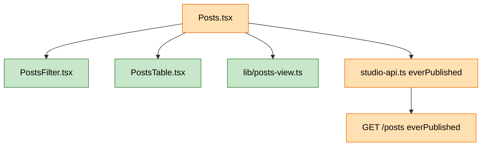

# All posts page Implementation Plan

> **For agentic workers:** steps use checkbox syntax; flip each box when the step is done.

**Status:** planned. Spec: `docs/specs/2026-11-15-studio-design.md`, sections 7.8 (the page), 7.1 (tokens), 7.7 (dialogs and strips), 7.9 (phone) and 7.11 (wording). Ticket: BLOG-41. The code PR starts after the BLOG-61 code PR merges: both edit `frontend/components/Posts.tsx`, and this page loads its list with BLOG-61's `useRequest`. It never touches `PostEditor.tsx` or its tests (BLOG-39, BLOG-40).

## TL;DR

- One code PR replaces the run-on list at `/` (`title /slug · Draft · 2026-11-17T00:56:51Z [Delete]`) with the 7.8 page: heading "Posts", a white "New post" button that adds a title row at the top of the table, a segmented filter ("All n", "Drafts n", "Published n") and "Filter by title", and a table with Title (and `/slug` or "No slug yet"), Status, Last edited and an actions column.
- Owner acceptance (BLOG-41 comment 12150), on top of 7.8:
  - **Status at a glance:** a status column holding the existing `Pill`. The draft pill is a grey ring with "Draft". The published pill is a green dot with "Published", and "version n" sits beside it in `muted`. The word is never inside a run-on line.
  - **Readable dates:** "Today, 14:05", "Yesterday, 09:12", or "17 Nov 2026" for anything older, in the browser's time zone. A `<time dateTime>` holds the ISO value, with the full date and time as its `title`.
  - **Actions with room:** "Unpublish" (published posts only) and "Delete" sit in their own right-hand column with a fixed minimum width and a gap. Both ask first, in a `Dialog` worded as 7.7.
- **Delete asks one question, never two** (BLOG-41 comments 11723 and 11790). `GET /posts` gains `everPublished`, so the client can choose the right dialog before it asks:
  - A post that was ever published gets "Delete this post?" and is deleted with `confirm=published`.
  - Any other post gets "Delete this draft?".
  - The 409 fallback stays for a post published elsewhere after the list loaded. A 404 still counts as done.
- Phone (under 760px): each row stacks to the title, then the status and date, then the actions, with no sideways scroll.
- Empty states: an empty studio shows "Nothing written yet", the 7.8 line and a "New post" button. A filter without a match shows `No post matches "<text>".`.
- Tests come first. Each unit test runs red before its code, and there is one browser test per flow (five, listed under Task 5).
- About 17 files and roughly 900 changed lines. There is no new dependency, no workflow change and no `/v1` contract change (the read API and `openapi/v1.json` are untouched), and no Azure change. Cost: none.

## Cost estimate

None. The list makes one more blob listing per `GET /posts` call, on the same storage account.

## Architecture

Source: `docs/plans/diagrams/2026-11-22-all-posts-page.mmd` (green new, amber changed, grey unchanged). The inline copy shows the core only.

## Global constraints

- Branch from fresh `origin/main` once the BLOG-61 code PR has merged (`frontend/effects/useRequest.ts` exists on main). Commit messages: two lines at most, no trailer.
- No `useEffect` outside `frontend/effects/`. No new comments. Each touched file whose comments restate the code, narrate a change or name a ticket is cleaned in a separate commit. The PR description has a `Comments: <path>: <reason>` line for every file that keeps any.
- Existing accessible names stay: "Title" for the new-post input, links named by the post title, `Delete <title>`. New ones: `Unpublish <title>`, `Open <title>`, "New post", "Filter by title", and the filter buttons "All", "Drafts" and "Published" (with their counts, `aria-pressed`).
- Tokens only (`bg-pane`, `text-muted`, `border-line`, `bg-ok`); the theme has no default colours. Type sizes from 7.1: heading 30, meta 12.5.
- Run `scripts/rules/run.sh` and `scripts/ci-local.sh` before asking for review.

## Review focus

- **One question per delete.** Covered by `a post published once and unpublished asks the post question once and deletes with confirm` (unit) and the browser delete flow.
- **Unpublish asks first.** On the answer, the row becomes a draft that is still marked as ever published, and the green strip uses `unpublishedNotice`. Covered by `Unpublish asks, unpublishes, and the row turns into a draft` (unit and browser).
- **Counts come from the whole list.** The filter only narrows the rows, and the counts follow a delete or an unpublish. Covered by `the counts follow a delete and an unpublish`.
- **`everPublished` costs one blob listing per list call,** not one per post. Covered by `test_the_list_lists_the_published_versions_once`.
- **Phone width.** No sideways scroll at 390px, and the actions stay reachable. Covered by the browser test `on a phone each post stacks and nothing scrolls sideways`.

## Owner gates

- After Task 5: `cd frontend && E2E_SKIP_BUILD=1 npm run e2e` passes, including the five list flows.
- On the PR: screenshots of `/` at 1280px and 390px, with a draft, a published post and one that was published and then unpublished, plus the empty-filter state. The owner gets no local run (owner decision 2026-11-22).

## Tasks

### Task 0: Baseline

- [ ] **Step 1:** `git fetch origin && git checkout -b devin/blog-41-all-posts-page origin/main`. Then `test -f frontend/effects/useRequest.ts`; if it is missing, stop and tell the coordinator.
- [ ] **Step 2:** In `frontend`, run `npm ci && npx vitest run && npm run lint`. In `backend`, run `poetry run pytest -q`. Record the counts.
- [ ] **Step 3:** BLOG-41: `[Devin Coding Agent] Starting code PR`.

### Task 1: `everPublished` in the list (backend, test first)

**Files:** `backend/studio_api/posts.py`, `backend/studio_api/routes.py`, `backend/tests/test_posts.py`, `backend/tests/test_post_routes.py`.

- [ ] **Step 1, red:** in `test_post_routes.py`, add `test_the_list_says_whether_a_post_was_ever_published`. It seeds a draft, a live post, and a post that was published and then unpublished, and expects `everPublished` to be `False`, `True` and `True`.
- [ ] **Step 2, red:** in `test_posts.py`, add `test_the_list_lists_the_published_versions_once`, using a counting wrapper around `InMemoryBlobStore`. With three posts, `list(blog-published, ...)` is called exactly once per `list_drafts()`.
- [ ] **Step 3, green:** `DraftSummary` gains `ever_published: bool`. `list_drafts` lists `layout.PUBLISHED` under `posts/` once and collects the post ids that have a `posts/<id>/v<n>/meta.json`. That is the same rule as `_ever_published`, so a half-finished first publish still does not count. One helper serves both, so the rule lives in one place. The list route returns `"everPublished": d.ever_published`.
- [ ] **Step 4:** `poetry run pytest -q && poetry run ruff check . && poetry run ruff format --check . && poetry run pyright`. Commit: `Report everPublished in the studio post list`.

### Task 2: View helpers (test first)

**Files:** create `frontend/lib/posts-view.ts` and `frontend/lib/posts-view.test.ts`. Modify `frontend/lib/studio-api.ts` (`ListItem.everPublished: boolean`) and `frontend/lib/live-status.ts` with its test.

- [ ] **Step 1, red:** add tests for:
  - `countPosts(items)`, which returns `{ all, drafts, published }`.
  - `visiblePosts(items, filter, text)`, which keeps the server's order and matches the title case-insensitively and trimmed.
  - `editedLabel(iso, now, timeZone)`, which gives "Today, 14:05", "Yesterday, 09:12" and "17 Nov 2026". Test the day boundary in `Europe/London` across the clock change on 2026-10-25.
- [ ] **Step 2, green:** implement them with `Intl.DateTimeFormat("en-GB", { timeZone, ... })`. `timeZone` defaults to the browser's.
- [ ] **Step 3:** `postStatus` is no longer used by the list (the pill says "Draft" or "Published", and the version is separate text). If nothing else uses it, remove it and its test in the same commit. Commit: `Add the All posts view helpers`.

### Task 3: Filter and table components (test first)

**Files:** create `frontend/components/PostsFilter.tsx`, `PostsTable.tsx` and a test file for each.

- [ ] **Step 1, red:** `PostsFilter` tests:
  - Three buttons with counts, and the active one has `aria-pressed="true"`.
  - Typing in "Filter by title" calls `onText` for each change.
- [ ] **Step 2, red:** `PostsTable` tests:
  - Each row shows the title link, `/slug` or "No slug yet", the status pill, "version n" for a published post, and the edited label inside `<time dateTime>`.
  - "Unpublish" appears only on published rows.
  - A click on a row, but not on a button, calls `onOpen`.
  - The actions column cell has the `actions` class with `min-w` and `gap`.
- [ ] **Step 3, green:** build a semantic `<table>` (`caption` is screen-reader only, "Posts").
  - Below 760px the rows use `max-[759px]:grid` and stack: title, then status and date, then actions.
  - Hover uses `bg-raise`, and buttons use `Button`.
- [ ] Commit: `Add the posts filter and table`.

### Task 4: The page (`Posts.tsx`, test first)

**Files:** `frontend/components/Posts.tsx`, `Posts.test.tsx`, `frontend/app/page.tsx`, `app/page.test.tsx`, `app/globals.css` (remove the stale `.posts` rules).

- [ ] **Step 1, red:** rewrite `Posts.test.tsx` around these behaviours (keep the `fakeApi` helper):
  - The heading "Posts" and the "New post" button.
  - "New post" adds a top row with the "Title" input. Enter or "Create post" creates the post and opens it, and Esc or "Cancel" removes the row.
  - The empty studio shows "Nothing written yet", the 7.8 line and a "New post" button.
  - Filtering by status and by title, with `No post matches "<text>".` when nothing matches.
  - The counts follow a delete and an unpublish.
  - A draft asks "Delete this draft?". A post that is live, or that was published once and unpublished, asks "Delete this post?" once and deletes with confirm.
  - A 409 confirmation answer to a draft delete opens the post dialog.
  - A 404 removes the row.
  - Unpublish asks "Unpublish this post?" (7.7 body and buttons), then unpublishes, and the row turns into a draft with the green strip.
  - "Keep it" or "Keep it published", and Esc, send nothing.
  - A failed or unanswered request keeps the row and shows the 7.7 strip.
- [ ] **Step 2, green:**
  - `Posts.tsx` holds the list (loaded with `useRequest`), the filter, the text, the new-row flag, the open dialog (`draft`, `post` or `unpublish`) and the strip. `app/page.tsx` renders `<main>` with the h1 "Posts".
  - The row click uses `router.push`.
  - Delete of an `everPublished` post sends `confirm=published` straight away.
  - Unpublish sets `published: false, version: null` on the row, keeps `everPublished: true`, and shows `unpublishedNotice(slug)` as a success `MessageStrip`.
- [ ] **Step 3:** `npx vitest run && npm run lint && npx tsc --noEmit`. Commit: `Build the All posts page`.

### Task 5: Browser tests, one per flow (written and run red before Task 4's code)

**File:** `frontend/e2e/studio.spec.ts`. Each test seeds its own posts and assumes nothing about the rest of the list.

- [ ] `the list shows each post's status as a badge and a readable edit time, filters by status and title`. This replaces `the list shows draft and published pills and the white primary button`, and keeps its white-button and green-dot colour checks.
- [ ] `Delete asks one question for a draft, a live post and a post published earlier`. This replaces the two-question test: the third post now gets "Delete this post?" first.
- [ ] `Unpublish in the list asks first and turns the row into a draft`.
- [ ] `New post adds a title row that creates the post and opens it`. This adapts `creating a post opens its editor and the API holds the title` to the new button.
- [ ] `on a phone each post stacks and nothing scrolls sideways` (390x844). It checks that `document.documentElement.scrollWidth <= 390` and that the Delete button is visible.
- [ ] Run red after Task 3 and green after Task 4. Commit: `Browser tests for the All posts page`.

### Task 6: Docs and cleanup

- [ ] `AGENTS.md`: replace the "posts list asks before a delete" sentence (Gotchas) with the new rule (one dialog, chosen from `everPublished`) and name `PostsTable`, `PostsFilter` and `lib/posts-view.ts`. Update the studio API list fields where they are listed.
- [ ] Separate commit: remove the comments in `Posts.tsx` and `e2e/studio.spec.ts` that restate the code or narrate history. Keep the e2e header comment about the real API's rules if `comment-count` allows it, with a `Comments:` line.
- [ ] Set this plan's header to `Status: done (PR #n)`.
- [ ] `scripts/rules/run.sh` and `scripts/ci-local.sh`. Then take the screenshots at 1280px and 390px and open the draft PR.
