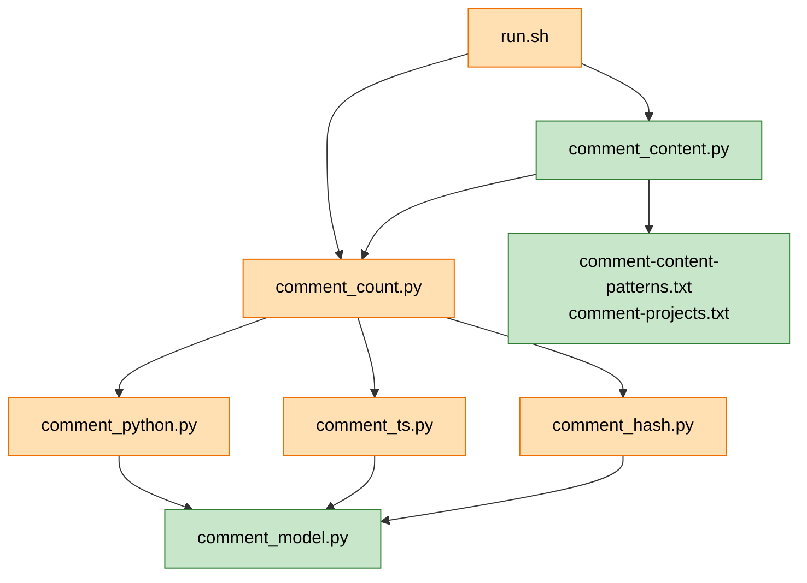

# The `comment-content` rule and the comment lint settings Implementation Plan

> **For agentic workers:** use `superpowers:executing-plans` (inline). Steps use checkbox syntax; flip each box when the step is done.

**Status:** proposed. Spec: `docs/specs/2026-11-22-comment-content-rule.md`. Ticket: BLOG-62. Builds on the tokenizers of `comment-count` (merged, PR #71). The rules run with the repo's Python: use only standard-library features present in Python 3.12 and 3.13.

## TL;DR

- Ships one PR: the lint settings (Ruff and ESLint), the `comment-content` rule with its data files, and the tokenizer change that lets the rule read the comments themselves.
- A touched file fails when a comment names a ticket, a plan or spec path, a project, or history; when its header has more than 3 comment lines; when a docstring only repeats the signature; or when a tool directive switches off every lint rule or a comment lint rule. No escape.
- No new dependency, no workflow change, no new Azure resource. The PR touches no `.github` file and implements the owner's own decisions (606, 605, 607, quoted on the ticket): a coordinator merge (workspace `AGENTS.md`, auto-merge class (c)) once checks are green and the diff matches the ticket.
- Cost: none.
- Every code block below ran green in a prototype before this plan was written: 164 backend rule tests (`comment-content`, `comment-count`, the tokenizers and the rule runner), 7 Ruff-setting tests and 8 ESLint-setting tests; ruff clean. The three added tokenizer tests of Task 1 are the only ones not run in the prototype.

## Cost estimate

None.

## Architecture

Source: `docs/plans/diagrams/2026-11-22-comment-content-rule.mmd` (green new, amber changed, grey unchanged). The inline copy below shows the rule's core only; the `.mmd` file is the full schematic (tests, lint settings, local run, legend).



## Global constraints

- Edit files only with Edit and Write. No comment in any new file.
- Commit messages: two lines at most, no trailer. Branch from `main` after the docs PR merged.
- Run Python from `backend/` as `PYTHONDONTWRITEBYTECODE=1 poetry run pytest ...`; delete `scripts/rules/__pycache__` before a rerun that follows a source change.
- Comment standard for the files this PR edits (`AGENTS.md`, `backend/pyproject.toml`, `frontend/eslint.config.mjs`, `scripts/rules/*.py` and `*.sh`, `backend/tests/test_rules.py`, `backend/tests/test_comment_count.py`): delete every comment that is not a constraint, a security reason or a workaround with its source, in a separate commit; list what stays as `Comments: <path>: <reason>` in the PR description.

## Review focus

- `comment-count` behaves exactly as before after the tokenizer change (its tests stay green, unchanged except one helper in Task 2).
- A ticket key, project name or history phrase inside a string or in code is not a comment and does not fail (Task 2).
- A shebang and tool directives do not count toward the header limit (Task 2).
- A directive that switches off an unrelated lint rule is left alone, and banned text after a directive is still found (Task 2).
- Every Ruff and ESLint suppression form of the comment rules is covered, and no ignore or override turns them off (Tasks 2 and 3).

---

### Task 0: Worktree and baseline

- [x] **Step 1:** from the repo's main checkout, after the docs PR merged and `git pull --ff-only`: `git -C Personal-Blog-Studio worktree add ../.worktrees/Personal-Blog-Studio-commentcontent -b feat/comment-content-rule origin/main`.
- [x] **Step 2:** `cd .worktrees/Personal-Blog-Studio-commentcontent/backend && poetry install && PYTHONDONTWRITEBYTECODE=1 poetry run pytest -q`; `cd ../frontend && npm ci --ignore-scripts`. Expected: all pass.
- [x] **Step 3:** comment BLOG-62 "Starting code PR".

### Task 1: Tokenizers return the comments

**Files:** create `scripts/rules/comment_model.py`; modify `scripts/rules/comment_python.py`, `comment_hash.py`, `comment_ts.py`, `comment_count.py`; modify `backend/tests/test_comment_tokens.py`.

- [x] **Step 1:** append to `backend/tests/test_comment_tokens.py` (add `import comment_model` is not needed; the tests call the modules):

```python
def test_python_comments_carry_the_owner_words_of_a_docstring():
    found = comment_python.comments('def fetch_user(user_id, *rest):\n    """Doc."""\n')
    docstring = found[0]
    assert docstring.owner == {"fetch", "user", "id", "rest"}
    assert (docstring.line, docstring.end) == (2, 2)


def test_owner_words_split_camel_case_and_acronyms():
    found = comment_python.comments('class HTTPError:\n    """HTTP error."""\n')
    assert found[0].owner == {"http", "error"}


def test_typescript_comments_mark_the_shebang_and_directives():
    found = comment_ts.comments(
        "#!/usr/bin/env node\n// eslint-disable-next-line x\n// a\n"
    )
    assert [(c.line, c.directive) for c in found] == [(1, True), (2, True), (3, False)]


def test_hash_comments_mark_directives():
    found = comment_hash.comments("#!/bin/sh\n# note\nx=1\n")
    assert [(c.line, c.directive) for c in found] == [(1, True), (2, False)]
```

- [x] **Step 2:** `cd backend && PYTHONDONTWRITEBYTECODE=1 poetry run pytest tests/test_comment_tokens.py -q`. Expected: 3 failures, `module 'comment_python' has no attribute 'comments'` (red).
- [x] **Step 3:** create `scripts/rules/comment_model.py`:

```python
from typing import NamedTuple


class Comment(NamedTuple):
    line: int
    end: int
    text: str
    directive: bool = False
    owner: frozenset[str] | None = None


def lines(found: list[Comment], directive: bool = False) -> set[int]:
    return {
        number
        for comment in found
        if comment.directive == directive
        for number in range(comment.line, comment.end + 1)
    }
```

- [x] **Step 4:** replace the whole of `scripts/rules/comment_python.py` with:

```python
import ast
import io
import re
import tokenize

import comment_model
import directives
from comment_model import Comment

SCOPES = (ast.Module, ast.ClassDef, ast.FunctionDef, ast.AsyncFunctionDef)


def name_words(name: str) -> set[str]:
    found = re.findall(r"[A-Z]+(?![a-z])|[A-Z]?[a-z]+|\d+", name)
    return {word.lower() for word in found}


def owner_words(node: ast.AST) -> frozenset[str] | None:
    if isinstance(node, ast.Module):
        return None
    words = name_words(getattr(node, "name", ""))
    if isinstance(node, (ast.FunctionDef, ast.AsyncFunctionDef)):
        arguments = node.args
        every = [
            *arguments.posonlyargs,
            *arguments.args,
            *arguments.kwonlyargs,
            *filter(None, [arguments.vararg, arguments.kwarg]),
        ]
        for argument in every:
            words |= name_words(argument.arg)
    return frozenset(words)


def comments(source: str) -> list[Comment]:
    found: list[Comment] = []
    try:
        for token in tokenize.generate_tokens(io.StringIO(source).readline):
            if token.type == tokenize.COMMENT:
                line = token.start[0]
                found.append(
                    Comment(
                        line,
                        line,
                        token.string,
                        directives.is_directive(token.string, "python"),
                    )
                )
        tree = ast.parse(source)
    except (SyntaxError, tokenize.TokenError) as error:
        raise ValueError(f"cannot read comments: {error}") from error
    for node in ast.walk(tree):
        if isinstance(node, SCOPES):
            text = ast.get_docstring(node, clean=False)
            if text:
                first = node.body[0]
                end = first.end_lineno or first.lineno
                found.append(Comment(first.lineno, end, text, False, owner_words(node)))
    return found


def count(source: str) -> int:
    return len(comment_model.lines(comments(source)))
```

- [x] **Step 5:** replace the whole of `scripts/rules/comment_hash.py` with:

```python
import comment_model
import directives
from comment_model import Comment


def comments(source: str) -> list[Comment]:
    return [
        Comment(number, number, line.strip(), directives.is_directive(line, "hash"))
        for number, line in enumerate(source.splitlines(), 1)
        if line.lstrip().startswith("#")
    ]


def count(source: str) -> int:
    return len(comment_model.lines(comments(source)))
```

- [x] **Step 6:** in `scripts/rules/comment_ts.py`: replace the line `import directives` with the three lines `import comment_model`, `import directives`, `from comment_model import Comment`; then replace the block from `def count(source: str) -> int:` through the end of the `record` function with:

```python
def count(source: str) -> int:
    return len(comment_model.lines(comments(source)))


def comments(source: str) -> list[Comment]:
    found: list[Comment] = []
    line = 1
    i = 0
    if source.startswith("#!"):
        i = source.find("\n") if "\n" in source else len(source)
        found.append(Comment(1, 1, source[:i], True))
    depth = 0
    interpolations: list[int] = []
    previous = ""
    previous_word = ""
    in_template = False

    def record(text: str, first_line: int) -> None:
        end = first_line + text.count("\n")
        found.append(
            Comment(first_line, end, text, directives.is_directive(text, "ts"))
        )
```

and replace the final line `    return len(lines)` of that function with `    return found`.

- [x] **Step 7:** in `scripts/rules/comment_count.py`: add `from types import ModuleType` after `from pathlib import PurePosixPath`; replace the `SUFFIX_COUNTERS` dictionary and the `counter_for` function with:

```python
SUFFIX_MODULES: dict[str, ModuleType] = {
    ".py": comment_python,
    ".ts": comment_ts,
    ".tsx": comment_ts,
    ".js": comment_ts,
    ".jsx": comment_ts,
    ".mjs": comment_ts,
    ".cjs": comment_ts,
    ".sh": comment_hash,
    ".yml": comment_hash,
    ".yaml": comment_hash,
    ".toml": comment_hash,
}
```

(placed where `SUFFIX_COUNTERS` was, before `REASON`) and, where `counter_for` was:

```python
def module_for(path: str) -> ModuleType | None:
    pure = PurePosixPath(path)
    if path in GENERATED or "fixtures" in pure.parts[:-1]:
        return None
    if pure.name.startswith("Dockerfile"):
        return comment_hash
    return SUFFIX_MODULES.get(pure.suffix)


def counter_for(path: str) -> Callable[[str], int] | None:
    module = module_for(path)
    return module.count if module else None
```

- [x] **Step 8:** `cd backend && poetry run ruff check --fix . ../scripts/rules && poetry run ruff format . ../scripts/rules && PYTHONDONTWRITEBYTECODE=1 poetry run pytest tests/test_comment_tokens.py tests/test_comment_count.py tests/test_rules.py -q`. Expected: all pass (every `comment-count` test unchanged).
- [x] **Step 9:** `git add scripts/rules backend/tests && git commit -m "Return the comments themselves from the tokenizers"`.

### Task 2: The content rule

**Files:** create `scripts/rules/comment-content-patterns.txt`, `scripts/rules/comment-projects.txt`, `scripts/rules/comment_content.py`, `backend/tests/test_comment_content.py`; modify `scripts/rules/run.sh`, `backend/tests/test_rules.py`, `backend/tests/test_comment_count.py`.

- [x] **Step 1:** create `backend/tests/test_comment_content.py`:

```python
from pathlib import Path

import comment_content
import comment_python
import pytest

from tests.rules_support import commit_all, make_repo, run_rules


def content_output(tmp_path: Path, files: dict[str, str]) -> str:
    repo = make_repo(tmp_path)
    for path, text in files.items():
        target = repo / path
        target.parent.mkdir(parents=True, exist_ok=True)
        target.write_text(text)
    commit_all(repo)
    reasons = "\n".join(f"Comments: {path}: x" for path in files)
    stdout = run_rules(repo, COMMENTS_REASON=reasons).stdout
    return stdout[stdout.index("comment-content:") :]


@pytest.mark.parametrize(
    ("path", "text", "message"),
    [
        ("src.py", "x = 1  # see BLOG-56\n", "names a ticket"),
        ("src.py", "# PAIR-46 decided this\nx = 1\n", "names a ticket"),
        ("src.py", "x = 1  # see docs/plans/a.md\n", "points at a spec or a plan"),
        (
            "src.py",
            f"x = 1  # same as {comment_content.NAMES[0]} does\n",
            "names a project",
        ),
        ("src.py", "x = 1  # this used to be a list\n", "narrates history"),
        ("src.py", "x = 1  # removed in the refactor\n", "narrates history"),
        ("web/a.ts", "export const a = 1; // no longer needed\n", "narrates history"),
        ("web/a.ts", "/* tracked as CKE-7 */\nexport {};\n", "names a ticket"),
        ("run.sh", "# the old script, see git history\nset -e\n", "narrates history"),
        ("src.py", "import os  # noqa: F401 see BLOG-12\n", "names a ticket"),
        (
            "web/a.ts",
            "// eslint-disable-next-line no-console -- see PAIR-3\nexport {};\n",
            "names a ticket",
        ),
        ("src.py", "x = 1  # it used to be a list\n", "narrates history"),
    ],
)
def test_a_comment_with_banned_content_fails_and_the_comments_line_does_not_lift_it(
    tmp_path, path, text, message
):
    output = content_output(tmp_path, {path: text})
    assert output.startswith("comment-content: FAIL 1 problem(s)")
    assert f"  {path}:1: " in output
    assert message in output


def test_an_ordinary_sentence_with_used_to_passes(tmp_path):
    text = "x = 1  # the key used to sign the token\n"
    assert content_output(tmp_path, {"src.py": text}).startswith("comment-content: ok")


def test_the_same_words_in_a_string_or_in_code_pass(tmp_path):
    text = f'LABEL = "BLOG-56 {comment_content.NAMES[0]} used to"\n'
    assert content_output(tmp_path, {"src.py": text}).startswith("comment-content: ok")


def test_the_failure_names_the_line_and_never_echoes_the_comment(tmp_path):
    output = content_output(tmp_path, {"src.py": "x = 1\ny = 2  # see BLOG-56\n"})
    assert "  src.py:2: names a ticket: delete the reference" in output
    assert "BLOG-56" not in output


def test_a_header_of_four_comment_lines_fails_and_three_pass(tmp_path):
    four = "# a\n# b\n# c\n# d\nx = 1\n"
    three = "# a\n# b\n# c\nx = 1\n"
    failing = content_output(tmp_path / "four", {"src.py": four})
    assert "  src.py:1: the file header has 4 comment lines (at most 3)" in failing
    assert content_output(tmp_path / "three", {"src.py": three}).startswith(
        "comment-content: ok"
    )


def test_a_shebang_and_a_directive_do_not_count_toward_the_header(tmp_path):
    text = "#!/usr/bin/env python3\n# ruff: noqa: F401\n# a\n# b\n# c\nx = 1\n"
    assert content_output(tmp_path, {"src.py": text}).startswith("comment-content: ok")


def test_comments_after_the_first_code_line_are_not_header(tmp_path):
    text = "x = 1\n# a\n# b\n# c\n# d\ny = 2\n"
    assert content_output(tmp_path, {"src.py": text}).startswith("comment-content: ok")


def test_a_module_docstring_counts_toward_the_header(tmp_path):
    text = '"""one\ntwo\nthree\nfour"""\nx = 1\n'
    assert "the file header has 4 comment lines" in content_output(
        tmp_path, {"src.py": text}
    )


def test_a_docstring_that_only_repeats_the_name_and_parameters_fails(tmp_path):
    text = 'def get_user(user_id):\n    """Get user by id."""\n    return user_id\n'
    output = content_output(tmp_path, {"src.py": text})
    assert "  src.py:2: the docstring only repeats the name and parameters" in output


def test_a_docstring_that_says_more_passes(tmp_path):
    text = 'def get_user(user_id):\n    """Raises when the id is blocked."""\n    return 1\n'
    assert content_output(tmp_path, {"src.py": text}).startswith("comment-content: ok")


@pytest.mark.parametrize(
    ("path", "text"),
    [
        ("src.py", "import os  # noqa\n"),
        ("src.py", "import os  # noqa: ERA001\n"),
        ("src.py", "import os  # noqa: F401, FIX002\n"),
        ("src.py", "# ruff: noqa\nx = 1\n"),
        ("src.py", "# flake8: noqa\nx = 1\n"),
        ("src.py", "# flake8: noqa: ERA001\nx = 1\n"),
        ("src.py", "# ruff: disable[ERA001]\nx = 1\n"),
        ("src.py", "# ruff: file-ignore[FIX002]\nx = 1\n"),
        ("web/a.ts", '/* eslint no-warning-comments: "off" */\nexport {};\n'),
        ("web/a.ts", "/* eslint no-warning-comments: 0 */\nexport {};\n"),
        ("web/a.ts", '/*eslint no-warning-comments: ["off"] */\nexport {};\n'),
        ("web/a.ts", "// eslint-disable-next-line\nexport {};\n"),
        ("web/a.ts", "/* eslint-disable */\nexport {};\n"),
        ("web/a.ts", "// eslint-disable-next-line no-warning-comments\nexport {};\n"),
        ("web/a.ts", "// eslint-disable-line -- reason\nexport {};\n"),
    ],
)
def test_switching_off_a_comment_lint_rule_or_all_rules_fails(tmp_path, path, text):
    output = content_output(tmp_path, {path: text})
    assert output.startswith("comment-content: FAIL")
    assert "lint rule" in output


@pytest.mark.parametrize(
    ("path", "text"),
    [
        ("src.py", "def f(N803):  # noqa: N803\n    return N803\n"),
        ("src.py", "# ruff: disable[E501]\nx = 1\n# ruff: enable[E501]\n"),
        ("web/a.ts", '/* eslint no-console: "off" */\nexport {};\n'),
        (
            "web/a.ts",
            "// eslint-disable-next-line react-hooks/exhaustive-deps\nexport {};\n",
        ),
    ],
)
def test_switching_off_an_unrelated_rule_is_left_alone(tmp_path, path, text):
    assert content_output(tmp_path, {path: text}).startswith("comment-content: ok")


def test_a_file_that_cannot_be_read_fails(tmp_path):
    output = content_output(tmp_path, {"broken.py": "def (:\n"})
    assert "  broken.py: cannot read comments" in output


def test_header_lines_skip_blank_lines_and_stop_at_code():
    source = "\n# a\n\n# b\nx = 1\n# c\n"
    found = comment_python.comments(source)
    assert comment_content.header_lines(source, found) == 2
```

- [x] **Step 2:** `cd backend && PYTHONDONTWRITEBYTECODE=1 poetry run pytest tests/test_comment_content.py -q`. Expected: collection error `No module named 'comment_content'` (red).
- [x] **Step 3:** create `scripts/rules/comment-projects.txt`: one lowercase name per line, the names of the owner's other public repositories as the coordinator lists them on BLOG-62 (read them there; this plan does not repeat them). Leave out this repo's own name and every private repository: this file is in a public repo.
- [x] **Step 3a:** in `scripts/rules/comment-directives.txt` replace `python	^(pyright|ruff|isort|pylint|mypy):` with `python	^(pyright|ruff|flake8|isort|pylint|mypy):` and add the row `ts	^eslint\s` after the row `ts	^eslint-(disable|enable)` (tab-separated like every row): an inline ESLint configuration comment is a tool directive, and a `flake8:` comment too.
- [x] **Step 4:** create `scripts/rules/comment-content-patterns.txt` (tab-separated `kind`, language, regex, message; no blank lines):

```
content	all	\b(BLOG|PW|CKE|TA|PP|RR|PAIR)-\d+\b	names a ticket: delete the reference
content	all	(?i)\b(docs/(specs|plans)/|superpowers)	points at a spec or a plan: delete the pointer
content	all	(?i)\b(used to be|(it|this|we|which) used to|no longer|git history|removed in|previously|formerly|before this change|after this change|this pr|this ticket)\b	narrates history: delete it
disable	python	(?i)\bnoqa\b(?!\s*:)	switches off every lint rule: delete it
disable	python	(?i)\bnoqa\s*:.*\b(ERA\d*|FIX\d*|ALL)\b	switches off a comment lint rule: delete it
disable	python	\bruff:\s*(disable|enable|file-ignore|ignore)\s*\[[^\]]*\b(ERA\d*|FIX\d*|ALL)\b	switches off a comment lint rule: delete it
disable	ts	eslint-(disable|enable)(-next-line|-line)?\s*(--.*)?(\*/)?\s*$	switches off every lint rule: delete it
disable	ts	eslint-disable.*\bno-warning-comments\b	switches off a comment lint rule: delete it
disable	ts	eslint\s+[^*]*\bno-warning-comments\b	changes a comment lint rule: delete it
```

- [x] **Step 5:** create `scripts/rules/comment_content.py`:

```python
import re
import sys
from pathlib import Path

import comment_count
import comment_model
import common
from comment_model import Comment

DATA = Path(__file__).with_name("comment-content-patterns.txt")
HEADER_LIMIT = 3
STOP_WORDS = {
    "a",
    "an",
    "the",
    "of",
    "to",
    "for",
    "by",
    "in",
    "on",
    "and",
    "or",
    "is",
    "are",
    "this",
    "that",
    "with",
    "from",
    "return",
    "returns",
    "args",
    "arg",
    "param",
    "parameter",
    "parameters",
    "self",
    "cls",
}
LANGUAGES = {"comment_python": "python", "comment_ts": "ts", "comment_hash": "hash"}


def load() -> list[tuple[str, str, re.Pattern[str], str]]:
    rows = []
    for row in DATA.read_text().splitlines():
        if row.strip():
            kind, language, regex, message = row.split("\t", 3)
            rows.append((kind, language, re.compile(regex), message))
    return rows


PATTERNS = load()
NAMES = Path(__file__).with_name("comment-projects.txt").read_text().split()
PROJECT_NAME = re.compile(r"(?i)\b(" + "|".join(map(re.escape, NAMES)) + r")\b")


def header_lines(source: str, found: list[Comment]) -> int:
    covered = comment_model.lines(found)
    skipped = comment_model.lines(found, directive=True)
    total = 0
    for number, text in enumerate(source.splitlines(), 1):
        if not text.strip() or number in skipped:
            continue
        if number not in covered:
            break
        total += 1
    return total


def repeats_owner(comment: Comment) -> bool:
    if comment.owner is None:
        return False
    words = set(re.findall(r"[a-z]+", comment.text.lower())) - STOP_WORDS
    return bool(words) and words <= comment.owner


def problems(path: str, source: str, language: str, found: list[Comment]) -> list[str]:
    out: list[str] = []
    for comment in found:
        for kind, scope, pattern, message in PATTERNS:
            applies = kind == "content" or comment.directive
            if not applies or scope not in ("all", language):
                continue
            if pattern.search(comment.text):
                out.append(f"{path}:{comment.line}: {message}")
        if PROJECT_NAME.search(comment.text):
            out.append(
                f"{path}:{comment.line}: names a project: "
                "state the constraint on its own"
            )
        if repeats_owner(comment):
            out.append(
                f"{path}:{comment.line}: the docstring only repeats the name "
                "and parameters: delete it"
            )
    header = header_lines(source, found)
    if header > HEADER_LIMIT:
        out.append(
            f"{path}:1: the file header has {header} comment lines "
            f"(at most {HEADER_LIMIT}): delete the narration"
        )
    return out


def main() -> int:
    rows = comment_count.changed(common.diff("--name-status", "-M"))
    found_problems: list[str] = []
    unreadable: list[str] = []
    read = 0
    for path, _ in rows:
        module = comment_count.module_for(path)
        if module is None:
            continue
        source = common.git("show", f"HEAD:{path}")
        try:
            found = module.comments(source)
        except ValueError:
            unreadable.append(path)
            continue
        read += 1
        language = LANGUAGES[module.__name__]
        found_problems += problems(path, source, language, found)
    if found_problems or unreadable:
        total = len(found_problems) + len(unreadable)
        print(f"comment-content: FAIL {total} problem(s)")
        for line in found_problems:
            print(f"  {line}")
        for path in unreadable:
            print(f"  {path}: cannot read comments")
        return 1
    print(f"comment-content: ok ({read} file(s) read)")
    return 0


if __name__ == "__main__":
    sys.exit(main())
```

- [x] **Step 6:** in `scripts/rules/run.sh` replace `shared_block comment_count; do` with `shared_block comment_count comment_content; do`.
- [x] **Step 7:** in `backend/tests/test_rules.py`, in `test_a_clean_change_passes_every_rule`, add the line `"comment-content: ok (1 file(s) read)",` after `"  src.py: 0 -> 0",` in the expected list.
- [x] **Step 8:** in `backend/tests/test_comment_count.py` replace the body of `code_with_comments` with:

```python
    lines = [f"x{i} = {i}" for i in range(code)]
    notes = [f"# c{i}" for i in range(comments)]
    return "\n".join(lines[:1] + notes + lines[1:]) + "\n"
```

(the comments must follow the first code line, or `comment-content` reads them as an over-long header).
- [x] **Step 9:** `cd backend && poetry run ruff check --fix . ../scripts/rules && poetry run ruff format . ../scripts/rules && rm -rf ../scripts/rules/__pycache__ && PYTHONDONTWRITEBYTECODE=1 poetry run pytest tests/test_comment_content.py tests/test_comment_count.py tests/test_comment_tokens.py tests/test_rules.py -q`. Expected: all pass.
- [x] **Step 10:** mutation checks, each must turn at least one test red, then restore: (a) in `repeats_owner` change `<=` to `==`; (b) in `header_lines` remove `or number in skipped`; (c) change `HEADER_LIMIT = 3` to `4`; (d) in `problems` change `wanted = "disable" if comment.directive else "content"` to always `"content"`; (e) in `comment-content-patterns.txt` delete the `(?!\s*:)` from the first `disable python` row; (f) remove the `PROJECT_NAME` branch in `problems`.
- [x] **Step 11:** `git add scripts/rules backend/tests && git commit -m "Add the comment-content rule"`.

### Task 3: Lint settings

**Files:** modify `backend/pyproject.toml`, `frontend/eslint.config.mjs`; create `backend/tests/test_lint_settings.py`, `frontend/tests/lint-settings.test.ts`.

- [x] **Step 1:** create `backend/tests/test_lint_settings.py`:

```python
import json
import subprocess
import sys
import tomllib
from pathlib import Path

import pytest

PYPROJECT = Path(__file__).resolve().parents[1] / "pyproject.toml"
CODES = ["ERA001", "FIX001", "FIX002", "FIX003", "FIX004"]


def rule_codes(tmp_path: Path, source: str) -> set[str]:
    target = tmp_path / "sample.py"
    target.write_text(source)
    result = subprocess.run(
        [
            sys.executable,
            "-m",
            "ruff",
            "check",
            "--no-cache",
            "--config",
            str(PYPROJECT),
            "--output-format",
            "json",
            str(target),
        ],
        capture_output=True,
        text=True,
    )
    return {found["code"] for found in json.loads(result.stdout)}


@pytest.mark.parametrize(
    ("source", "code"),
    [
        ("# x = compute(1)\n", "ERA001"),
        ("# FIXME later\n", "FIX001"),
        ("# TODO later\n", "FIX002"),
        ("# HACK around it\n", "FIX004"),
        ("# XXX\n", "FIX003"),
    ],
)
def test_commented_out_code_and_marker_comments_are_reported(tmp_path, source, code):
    assert code in rule_codes(tmp_path, source)


def test_an_ordinary_comment_is_left_to_the_rules_job(tmp_path):
    assert rule_codes(tmp_path, "# a constraint\nx = 1\n") == set()


def test_no_ignore_turns_a_comment_rule_off():
    lint = tomllib.loads(PYPROJECT.read_text())["tool"]["ruff"]["lint"]
    ignored = [*lint.get("ignore", []), *lint.get("extend-ignore", [])]
    for codes in [
        *lint.get("per-file-ignores", {}).values(),
        *lint.get("extend-per-file-ignores", {}).values(),
    ]:
        ignored += codes
    assert [c for c in CODES for i in ignored if c.startswith(i) or i == "ALL"] == []
```

- [x] **Step 2:** create `frontend/tests/lint-settings.test.ts`:

```ts
// @vitest-environment node
import { ESLint } from "eslint";
import { describe, expect, it } from "vitest";

async function ruleIds(source: string): Promise<string[]> {
  const eslint = new ESLint({ cwd: process.cwd() });
  const [result] = await eslint.lintText(source, { filePath: "lib/sample.ts" });
  return result.messages.map((message) => message.ruleId ?? "");
}

describe("comment lint settings", () => {
  it.each(["// TODO later", "// fixme", "/* XXX */", "// HACK around it"])(
    "reports %s",
    async (comment) => {
      expect(await ruleIds(`${comment}\nexport const a = 1;\n`)).toContain(
        "no-warning-comments",
      );
    },
  );

  it("leaves an ordinary comment to the rules job", async () => {
    expect(await ruleIds("// a constraint\nexport const a = 1;\n")).not.toContain(
      "no-warning-comments",
    );
  });

  it.each(["components/PostEditor.tsx", "lib/proxy.ts", "tests/hardening.test.ts"])(
    "keeps no-warning-comments an error for %s",
    async (path) => {
      const config = await new ESLint({ cwd: process.cwd() }).calculateConfigForFile(path);
      expect(config.rules?.["no-warning-comments"]?.[0]).toBe(2);
    },
  );
});
```

(the first line of this file is a Vitest environment directive, not a comment of ours.)
- [x] **Step 3:** red runs: `cd backend && PYTHONDONTWRITEBYTECODE=1 poetry run pytest tests/test_lint_settings.py -q` (expected: 5 failed, 2 passed: the ignore assertion passes already) and `cd frontend && npx vitest run tests/lint-settings.test.ts` (expected: 7 failed, 1 passed).
- [x] **Step 4:** in `backend/pyproject.toml` replace `select = ["E4", "E7", "E9", "F", "I"]` with `select = ["E4", "E7", "E9", "F", "I", "ERA001", "FIX001", "FIX002", "FIX003", "FIX004"]`. In `frontend/eslint.config.mjs` insert before `globalIgnores(`:

```js
  {
    rules: {
      "no-warning-comments": [
        "error",
        { terms: ["todo", "fixme", "xxx", "hack"], location: "anywhere" },
      ],
    },
  },
```

- [x] **Step 5:** green runs: both commands of Step 3 (expected: `7 passed`; `8 passed`), then `cd backend && poetry run ruff check . ../scripts/rules` and `cd frontend && npm run lint`. Expected: no findings in either (measured on `main`).
- [x] **Step 6:** `git add backend frontend && git commit -m "Turn on the comment lint rules"`.

### Task 4: Docs and wiring

- [x] **Step 1:** in `AGENTS.md`, in the CI sentence, replace `` `pr-size`, `spec-location`, `shared-block`, `comment-count`; violating inputs in `backend/tests/test_rules.py` and `test_comment_count.py`; what `comment-count` counts and how a file is excused: `docs/specs/2026-11-22-comment-count-rule.md` `` with `` `pr-size`, `spec-location`, `shared-block`, `comment-count`, `comment-content`; violating inputs in `backend/tests/test_rules.py`, `test_comment_count.py` and `test_comment_content.py`; what they check: `docs/specs/2026-11-22-comment-count-rule.md` and `docs/specs/2026-11-22-comment-content-rule.md`; lint settings for comments: Ruff `ERA001` and `FIX`, ESLint `no-warning-comments` ``.
- [x] **Step 2:** `bash scripts/rules/run.sh`. Expected: five ok lines (`comment-content` reads the files this PR touches and finds nothing).
- [x] **Step 3:** `git add AGENTS.md && git commit -m "Document the comment-content rule"`.

### Task 5: Verify, clean up, hand over

- [x] **Step 1:** `cd backend && poetry run ruff check . ../scripts/rules && poetry run ruff format --check . ../scripts/rules && poetry run pyright && PYTHONDONTWRITEBYTECODE=1 poetry run pytest -q`; `cd frontend && npm test && npm run lint && npx tsc --noEmit`. Expected: no errors; all tests pass.
- [x] **Step 2:** cleanup commit under the comment standard in "Global constraints" (separate commit, "Delete comments that restate the code in the touched files"); record before and after comment lines per file on the ticket.
- [x] **Step 3:** run `auditing-branch-changes` (subagent) before `gh pr create`; fix findings.
- [x] **Step 4:** `git fetch && git merge origin/main`, push, `gh pr create --draft` (body: what changed, local checks, one `Comments: <path>: <reason>` line per file that keeps comments), set `Status: done (PR #n)` in the spec and this plan, push.
- [x] **Step 5:** wait with the bare `gh pr checks <n> -R Fredheda/Personal-Blog-Studio --watch --interval 60 --fail-fast` (or `gh run watch <id> ... --interval 60`) as a background task; when the draft's CI finished, `gh pr ready`, wait again, confirm every job ran, read the review `Verdict:` once, hand the URL to the coordinator.
- [x] **Step 6:** after merge: remove the worktree (no `--force`), delete the branch, check the remote branch is gone, `git pull --ff-only` in the main checkout, BLOG-62 to Done with what shipped.
