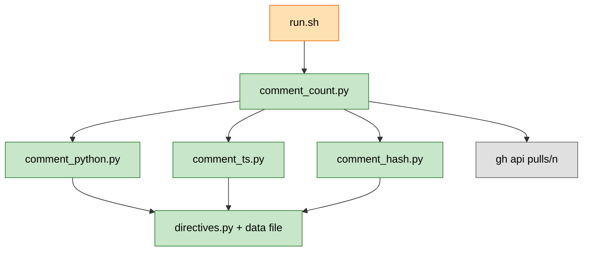

# The `comment-count` rule Implementation Plan

> **For agentic workers:** use `superpowers:executing-plans` (inline). Steps use checkbox syntax; flip each box when the step is done.

**Status:** done (PR #n); the floor of owner decision 605 A joined the rule during execution (see the spec). Spec: `docs/specs/2026-11-22-comment-count-rule.md`. Ticket: BLOG-60. Extends `scripts/rules/` and the `rules` job from BLOG-59 (merged, PR #69). The rules run with the repo's Python (`backend/.python-version`, set in the job): use only standard-library features present in Python 3.12 and 3.13.

## TL;DR

- Ships one PR: rule `comment-count` (three counters, a directives data file, the rule, wiring, tests).
- A PR may not raise any changed file's comment lines; a line `Comments: <path>: <reason>` in the PR description lifts the failure for that one file. The job summary shows before, after and the change in percent per file and in total.
- The floor (density cap, one-time drop or none) is an open owner question and is not built; the growth check is one small function where a floor would go.
- No new dependency and no new Azure resource. Owner action: merge (the PR touches `.github/workflows/ci.yml`).
- Cost: none.
- Every code block below ran green in a prototype before this plan was written: 50 tokenizer tests, 30 rule tests, ruff clean. The TypeScript counter also matched the TypeScript compiler's own scanner on all 75 TS and JS files of this repo (165 comment lines, no difference); Task 6 repeats that check on the final code.

## Cost estimate

None. Python standard library, `git` and the `gh` CLI already present on the runner.

## Architecture

Source: `docs/plans/diagrams/2026-11-22-comment-count-rule.mmd` (green new, amber changed, grey unchanged). The inline copy below is the rule's core only; the `.mmd` file is the full schematic (job, tests, git history, summary, legend).



## Global constraints

- Edit files only with Edit and Write. Comments: none in any new file (the rule applies to its own PR).
- Commit messages: two lines at most, no trailer. Branch from `main` after the docs PR merged.
- Run Python from `backend/` as `PYTHONDONTWRITEBYTECODE=1 poetry run pytest ...`; delete `scripts/rules/__pycache__` before a rerun that follows a source change.
- Comment standard for the files this PR edits (`backend/tests/test_rules.py`, `.github/workflows/ci.yml`, `AGENTS.md`, `scripts/rules/pr_size.py`, `common.py`, `shared_block.py`, `spec_location.py`): delete every comment that is not a constraint, a security reason or a workaround with its source, aiming at least 70 percent fewer comment lines per file, in a separate commit; list what stays as `Comments: <path>: <reason>` in the PR description.

## Review focus

- A comment marker inside a string, template literal or regular expression is not a comment (Tasks 2 and 3).
- An unterminated quote in JSX text ends at the line end; a JSX closing tag is not a regular expression (Task 3).
- A prose comment that merely mentions a tool name is counted; only a comment that starts with the directive is not (Tasks 2 and 3).
- A renamed file is compared with its old path, so a pure rename never fails (Task 4).
- A `Comments:` line lifts only the file it names, and only with a non-blank reason (Task 4).

---

### Task 0: Worktree and baseline

- [ ] **Step 1:** from the repo's main checkout, after the docs PR merged and `git pull --ff-only`: `git -C Personal-Blog-Studio worktree add ../.worktrees/Personal-Blog-Studio-commentcount -b feat/comment-count-rule origin/main`.
- [ ] **Step 2:** `cd .worktrees/Personal-Blog-Studio-commentcount/backend && poetry install && PYTHONDONTWRITEBYTECODE=1 poetry run pytest -q`. Expected: all pass.
- [ ] **Step 3:** comment BLOG-60 "Starting code PR" and keep the ticket `In Progress`.

### Task 1: Share the test helpers

**Files:** create `backend/tests/rules_support.py`; modify `backend/tests/test_rules.py`.

- [ ] **Step 1:** create `backend/tests/rules_support.py`:

```python
import os
import shutil
import subprocess
from pathlib import Path

import shared_block

RULES = Path(__file__).resolve().parents[2] / "scripts" / "rules"
FIXTURES = Path(__file__).parent / "fixtures" / "rules"
GOOD = (FIXTURES / "agents-block-good.md").read_text()
GIT = [
    "git",
    "-c",
    "user.name=t",
    "-c",
    "user.email=t@t",
    "-c",
    "commit.gpgsign=false",
]
FOREIGN_ENV = (
    "PR_NUMBER",
    "GITHUB_REPOSITORY",
    "COMMENTS_REASON",
    "GITHUB_STEP_SUMMARY",
)


def present(value: str | None) -> str:
    assert value is not None
    return value


RECORDED = shared_block.digest(present(shared_block.extract(GOOD)))


def make_repo(tmp_path: Path, agents: str = GOOD) -> Path:
    shutil.copytree(
        RULES,
        tmp_path / "scripts" / "rules",
        ignore=shutil.ignore_patterns("__pycache__"),
    )
    (tmp_path / "scripts" / "rules" / "shared-block.sha256").write_text(RECORDED + "\n")
    (tmp_path / "AGENTS.md").write_text(agents)
    subprocess.run(["git", "init", "-q", "-b", "main"], cwd=tmp_path, check=True)
    commit_all(tmp_path)
    return tmp_path


def commit_all(repo: Path) -> None:
    subprocess.run(["git", "add", "-A"], cwd=repo, check=True)
    subprocess.run([*GIT, "commit", "-q", "-m", "change"], cwd=repo, check=True)


def run_rules(repo: Path, **extra_env: str) -> subprocess.CompletedProcess:
    base = subprocess.run(
        ["git", "rev-parse", "HEAD~1"],
        cwd=repo,
        check=True,
        capture_output=True,
        text=True,
    ).stdout.strip()
    env = {k: v for k, v in os.environ.items() if k not in FOREIGN_ENV}
    return subprocess.run(
        ["bash", "scripts/rules/run.sh"],
        cwd=repo,
        env={**env, "BASE_SHA": base, **extra_env},
        capture_output=True,
        text=True,
    )
```

- [ ] **Step 2:** in `backend/tests/test_rules.py` replace everything from the first line through the line `RECORDED = shared_block.digest(present(shared_block.extract(GOOD)))` (imports, `RULES`, `FIXTURES`, `GOOD`, `present`, `RECORDED`) with:

```python
import pr_size
import shared_block
import spec_location
from tests.rules_support import (
    FIXTURES,
    GOOD,
    RECORDED,
    commit_all,
    make_repo,
    present,
    run_rules,
)
```

- [ ] **Step 3:** in the same file delete the three functions `make_repo`, `commit_all`, `run_rules` (from `def make_repo` through the end of `run_rules`). Keep every `test_*` function.
- [ ] **Step 4:** `cd backend && poetry run ruff check --fix . ../scripts/rules && poetry run ruff format . ../scripts/rules && PYTHONDONTWRITEBYTECODE=1 poetry run pytest tests/test_rules.py -q`. Expected: `28 passed` (the same tests as before the move).
- [ ] **Step 5:** `git add backend/tests && git commit -m "Share the rule test helpers"`.

### Task 2: Directives, the Python counter and the hash counter

**Files:** create `scripts/rules/comment-directives.txt`, `scripts/rules/directives.py`, `scripts/rules/comment_python.py`, `scripts/rules/comment_hash.py`, `backend/tests/test_comment_tokens.py`.

- [ ] **Step 1:** create `backend/tests/test_comment_tokens.py` (Python and hash cases first):

```python
import comment_hash
import comment_python
import pytest


@pytest.mark.parametrize(
    ("source", "expected"),
    [
        ("x = 1  # note\n", 1),
        ("# a\n# b\n", 2),
        ('x = "# not"\n', 0),
        ('def f():\n    """one\n    two"""\n    return 1\n', 2),
        ('"""doc"""\nx = 1\n', 1),
        ('x = 1\n"""not a docstring"""\n', 0),
        ("import os  # noqa: F401\n", 0),
        ("#!/usr/bin/env python3\nx = 1\n", 0),
        ("x = f()  # type: ignore\n", 0),
        ("# -*- coding: utf-8 -*-\nx = 1\n", 0),
        ("# fmt: off\nx = 1\n# fmt: on\n", 0),
        ("# plain\nimport os  # noqa\n", 1),
        ("# ruff is strict here\n", 1),
        ("# ruff: noqa\n", 0),
        ("# we use noqa here\n", 1),
        ("# pragma: no cover\n", 0),
    ],
)
def test_python_counts(source, expected):
    assert comment_python.count(source) == expected


def test_python_unreadable_source_raises():
    with pytest.raises(ValueError, match="cannot read comments"):
        comment_python.count("def (:\n")


@pytest.mark.parametrize(
    ("source", "expected"),
    [
        ("# a\n# b\n", 2),
        ("  # indented\nkey: value\n", 1),
        ("key: value  # trailing\n", 0),
        ("#!/usr/bin/env bash\nset -e\n", 0),
        ("# shellcheck disable=SC2086\n", 0),
        ("# syntax=docker/dockerfile:1\nFROM x\n", 0),
        ("# yaml-language-server: $schema=x\n", 0),
        ("# shellcheck is strict here\n", 1),
        ("[tool]\n# note\nname = 1\n", 1),
    ],
)
def test_hash_counts(source, expected):
    assert comment_hash.count(source) == expected
```

- [ ] **Step 2:** `cd backend && PYTHONDONTWRITEBYTECODE=1 poetry run pytest tests/test_comment_tokens.py -q`. Expected: collection error `No module named 'comment_hash'` (red).
- [ ] **Step 3:** create `scripts/rules/comment-directives.txt` (tab between the language and the regex; no blank or comment lines). Every pattern is anchored to the start of the comment text, after the comment marker and spaces:

```
python	^!
python	^(-\*-\s*)?coding[:=]
python	^noqa\b
python	^type:\s*ignore
python	^(pyright|ruff|isort|pylint|mypy):
python	^pragma:
python	^nosec\b
python	^fmt:\s*(off|on|skip)
ts	^!
ts	^eslint-(disable|enable)
ts	^@ts-(expect-error|ignore|nocheck|check)
ts	^prettier-ignore
ts	^(istanbul|v8|c8) ignore\b
ts	^<reference
ts	^@(vitest|jest)-environment
ts	^[#@]\s*sourceMappingURL
hash	^!
hash	^shellcheck\s+(disable|enable|source|shell)=
hash	^(syntax|escape|check)=
hash	^yaml-language-server\b
```

- [ ] **Step 4:** create `scripts/rules/directives.py`:

```python
import re
from pathlib import Path

DATA = Path(__file__).with_name("comment-directives.txt")
MARKER = re.compile(r"^(#+|/{2,}|/\*+)\s*")


def load(path: Path = DATA) -> dict[str, list[re.Pattern[str]]]:
    patterns: dict[str, list[re.Pattern[str]]] = {"python": [], "ts": [], "hash": []}
    for row in path.read_text().splitlines():
        if row.strip():
            language, regex = row.split("\t", 1)
            patterns[language].append(re.compile(regex))
    return patterns


PATTERNS = load()


def is_directive(text: str, language: str) -> bool:
    body = MARKER.sub("", text.strip(), count=1)
    return any(pattern.search(body) for pattern in PATTERNS[language])
```

- [ ] **Step 5:** create `scripts/rules/comment_python.py`:

```python
import ast
import io
import tokenize

import directives


def count(source: str) -> int:
    lines: set[int] = set()
    try:
        for token in tokenize.generate_tokens(io.StringIO(source).readline):
            if token.type == tokenize.COMMENT and not directives.is_directive(
                token.string, "python"
            ):
                lines.add(token.start[0])
        tree = ast.parse(source)
    except (SyntaxError, tokenize.TokenError) as error:
        raise ValueError(f"cannot read comments: {error}") from error
    for node in ast.walk(tree):
        if isinstance(
            node, (ast.Module, ast.ClassDef, ast.FunctionDef, ast.AsyncFunctionDef)
        ) and ast.get_docstring(node, clean=False):
            first = node.body[0]
            lines.update(range(first.lineno, (first.end_lineno or first.lineno) + 1))
    return len(lines)
```

- [ ] **Step 6:** create `scripts/rules/comment_hash.py`:

```python
import directives


def count(source: str) -> int:
    return sum(
        1
        for line in source.splitlines()
        if line.lstrip().startswith("#") and not directives.is_directive(line, "hash")
    )
```

- [ ] **Step 7:** run the Step 2 command. Expected: `26 passed`.
- [ ] **Step 8:** mutation checks, each must turn tests red, then restore: (a) in `comment_python.py` delete the `not` before `directives.is_directive`; (b) in `directives.py` change `MARKER.sub(...)` to leave the text unchanged (the anchored cases fail); (c) in `comment_hash.py` replace `line.lstrip().startswith("#")` by `"#" in line` (the trailing-comment case fails).
- [ ] **Step 9:** `git add scripts/rules backend/tests && git commit -m "Count Python and hash-comment lines"`.

### Task 3: The TypeScript and JavaScript counter

**Files:** create `scripts/rules/comment_ts.py`; modify `backend/tests/test_comment_tokens.py`.

- [ ] **Step 1:** in `backend/tests/test_comment_tokens.py` change the import block to `import comment_hash\nimport comment_python\nimport comment_ts\nimport pytest` and append:

```python
@pytest.mark.parametrize(
    ("source", "expected"),
    [
        ("const a = 1; // note\n", 1),
        ("// a\n// b\n", 2),
        ("/* one\n two */\nconst a = 1;\n", 2),
        ("const x = <div>{/* jsx */}</div>;\n", 1),
        ("const u = \"https://x.y\"; const v = 'a // b';\n", 0),
        ("const t = `a // b ${x /* c */} d`;\n", 1),
        ("const t = `a ${`b // c`} d`;\n", 0),
        ("const r = /\\/\\/ x/;\n", 0),
        ("const q = b / 2 / 3; // c\n", 1),
        ("function f(s) { return /x/.test(s); } // c\n", 1),
        ("const q = (a) / 2; // c\n", 1),
        ("const p = <p>Don't // no</p>;\n// real\n", 1),
        ("const a = <a>x</a>; // c\n", 1),
        ("const a = <a>x</a>{/* c */};\n", 1),
        ("const a = <b>{/* c */}</b>;\nconst d = <i/>; // d\n", 2),
        ("// eslint-disable-next-line no-console\n", 0),
        ("// we use eslint-disable here\n", 1),
        ("/* istanbul ignore next */\n", 0),
        ("// @ts-expect-error reason\n", 0),
        ('/// <reference types="x" />\n', 0),
        ("#!/usr/bin/env node\n// a\n", 1),
        ("/* // */\n", 1),
        ("// plain\n// eslint-disable-line\n", 1),
        ("/**\n * Header narrative.\n * More.\n */\nexport {};\n", 4),
    ],
)
def test_ts_counts(source, expected):
    assert comment_ts.count(source) == expected
```

- [ ] **Step 2:** `cd backend && PYTHONDONTWRITEBYTECODE=1 poetry run pytest tests/test_comment_tokens.py -q`. Expected: collection error `No module named 'comment_ts'` (red).
- [ ] **Step 3:** create `scripts/rules/comment_ts.py`:

```python
import directives

REGEX_KEYWORDS = {
    "return",
    "typeof",
    "case",
    "of",
    "in",
    "delete",
    "void",
    "throw",
    "yield",
    "await",
    "else",
    "do",
    "new",
}
DIVISION_BEFORE = set(")]}\"'`<")


def is_word_char(char: str) -> bool:
    return char.isalnum() or char in "_$"


def skip_quoted(source: str, start: int) -> int:
    quote = source[start]
    i = start + 1
    while i < len(source) and source[i] != "\n":
        if source[i] == "\\":
            i += 2
            continue
        if source[i] == quote:
            return i + 1
        i += 1
    return i


def skip_regex(source: str, start: int) -> int | None:
    i = start + 1
    in_class = False
    while i < len(source) and source[i] != "\n":
        char = source[i]
        if char == "\\":
            i += 2
            continue
        if char == "[":
            in_class = True
        elif char == "]":
            in_class = False
        elif char == "/" and not in_class:
            return i + 1
        i += 1
    return None


def count(source: str) -> int:
    lines: set[int] = set()
    line = 1
    i = 0
    if source.startswith("#!"):
        i = source.find("\n") if "\n" in source else len(source)
    depth = 0
    interpolations: list[int] = []
    previous = ""
    previous_word = ""
    in_template = False

    def record(text: str, first_line: int) -> None:
        if directives.is_directive(text, "ts"):
            return
        lines.update(range(first_line, first_line + text.count("\n") + 1))

    while i < len(source):
        char = source[i]
        if in_template:
            if char == "\\":
                line += source[i : i + 2].count("\n")
                i += 2
            elif char == "`":
                in_template = False
                previous = "`"
                i += 1
            elif source.startswith("${", i):
                interpolations.append(depth)
                depth += 1
                in_template = False
                previous = "{"
                i += 2
            else:
                line += char == "\n"
                i += 1
            continue
        if char == "\n":
            line += 1
            i += 1
        elif char.isspace():
            i += 1
        elif source.startswith("//", i):
            end = source.find("\n", i)
            end = len(source) if end == -1 else end
            record(source[i:end], line)
            i = end
        elif source.startswith("/*", i):
            end = source.find("*/", i + 2)
            end = len(source) if end == -1 else end + 2
            record(source[i:end], line)
            line += source.count("\n", i, end)
            i = end
        elif char in "'\"":
            i = skip_quoted(source, i)
            previous = char
        elif char == "`":
            in_template = True
            i += 1
        elif char == "/":
            if previous == "w":
                regex_allowed = previous_word in REGEX_KEYWORDS
            else:
                regex_allowed = previous not in DIVISION_BEFORE
            end = skip_regex(source, i) if regex_allowed else None
            if end is None:
                previous = "/"
                i += 1
            else:
                previous = "w"
                previous_word = ""
                i = end
        elif is_word_char(char):
            start = i
            while i < len(source) and is_word_char(source[i]):
                i += 1
            previous = "w"
            previous_word = source[start:i]
        else:
            if char == "{":
                depth += 1
            elif char == "}":
                depth -= 1
                if interpolations and depth == interpolations[-1]:
                    interpolations.pop()
                    in_template = True
            previous = char
            i += 1
    return len(lines)
```

- [ ] **Step 4:** run the Step 2 command. Expected: `50 passed`.
- [ ] **Step 5:** mutation checks, each must turn at least one test red, then restore: (a) in `skip_quoted` replace `source[i] != "\n"` by `True` (the JSX apostrophe case hangs or fails); (b) in the `//` branch remove the `record` call (every line-comment case fails); (c) remove `"return"` from `REGEX_KEYWORDS` (the `return /x/` case fails); (d) remove `<` from `DIVISION_BEFORE` (the JSX closing-tag cases fail).
- [ ] **Step 6:** `git add scripts/rules backend/tests && git commit -m "Count TypeScript and JavaScript comment lines"`.

### Task 4: The rule

**Files:** create `scripts/rules/comment_count.py`, `backend/tests/test_comment_count.py`; modify `scripts/rules/run.sh`, `backend/tests/test_rules.py`.

- [ ] **Step 1:** create `backend/tests/test_comment_count.py`:

```python
from pathlib import Path

import comment_count
import pytest
from tests.rules_support import commit_all, make_repo, run_rules


def write(repo: Path, path: str, text: str) -> None:
    target = repo / path
    target.parent.mkdir(parents=True, exist_ok=True)
    target.write_text(text)


def repo_with(tmp_path: Path, path: str, before: str, after: str) -> Path:
    repo = make_repo(tmp_path)
    write(repo, path, before)
    commit_all(repo)
    write(repo, path, after)
    commit_all(repo)
    return repo


def test_a_new_comment_in_an_existing_file_fails(tmp_path):
    repo = repo_with(tmp_path, "src.py", "x = 1\n", "x = 1  # why\n")
    result = run_rules(repo)
    assert result.returncode == 1
    assert "comment-count: FAIL 1 file(s) have more comments" in result.stdout
    assert "  src.py: 0 -> 1" in result.stdout


def test_a_new_file_starts_at_zero(tmp_path):
    repo = make_repo(tmp_path)
    write(repo, "web/a.ts", "// note\nexport const a = 1;\n")
    commit_all(repo)
    result = run_rules(repo)
    assert result.returncode == 1
    assert "  web/a.ts: 0 -> 1" in result.stdout


def test_fewer_comments_pass(tmp_path):
    repo = repo_with(tmp_path, "src.py", "# a\n# b\nx = 1\n", "# a\nx = 1\n")
    result = run_rules(repo)
    assert result.returncode == 0
    assert "comment-count: ok (2 -> 1)" in result.stdout


def test_a_line_naming_the_file_lifts_its_failure(tmp_path):
    repo = repo_with(tmp_path, "src.py", "x = 1\n", "x = 1  # why\n")
    result = run_rules(repo, COMMENTS_REASON="Comments: src.py: a secret reason")
    assert result.returncode == 0
    assert "comment-count: ok (1 file(s) with a reason)" in result.stdout
    assert "  src.py: 0 -> 1 (reason given)" in result.stdout
    assert "a secret reason" not in result.stdout


def test_a_line_for_one_file_does_not_lift_another(tmp_path):
    repo = make_repo(tmp_path)
    write(repo, "a.py", "# one\n")
    write(repo, "b.py", "# two\n")
    commit_all(repo)
    result = run_rules(repo, COMMENTS_REASON="Comments: a.py: needed")
    assert result.returncode == 1
    assert "comment-count: FAIL 1 file(s) have more comments" in result.stdout
    assert "  a.py: 0 -> 1 (reason given)" in result.stdout
    assert "  b.py: 0 -> 1\n" in result.stdout


def test_a_line_without_a_reason_or_a_path_does_not_count(tmp_path):
    repo = repo_with(tmp_path, "src.py", "x = 1\n", "x = 1  # why\n")
    assert run_rules(repo, COMMENTS_REASON="Comments: src.py:   ").returncode == 1
    assert run_rules(repo, COMMENTS_REASON="Comments: needed").returncode == 1


def test_a_rename_keeps_its_old_count(tmp_path):
    repo = make_repo(tmp_path)
    write(repo, "old.py", "# keep\nx = 1\n")
    commit_all(repo)
    (repo / "old.py").rename(repo / "new.py")
    commit_all(repo)
    result = run_rules(repo)
    assert result.returncode == 0
    assert "  new.py: 1 -> 1" in result.stdout


def test_fixtures_generated_files_and_other_languages_are_not_counted(tmp_path):
    repo = make_repo(tmp_path)
    write(repo, "tests/fixtures/sample.py", "# note\n")
    write(repo, "frontend/next-env.d.ts", "// note\n")
    write(repo, "notes.md", "# heading\n")
    commit_all(repo)
    result = run_rules(repo)
    assert result.returncode == 0
    assert "comment-count: ok (0 -> 0)" in result.stdout


@pytest.mark.parametrize(
    "path", ["run.sh", "ci.yml", "deploy.yaml", "pyproject.toml", "Dockerfile.api"]
)
def test_full_line_hash_comments_count_in_scripts_and_config(tmp_path, path):
    repo = make_repo(tmp_path)
    write(repo, path, "# header narrative\nkey = 1\n")
    commit_all(repo)
    result = run_rules(repo)
    assert result.returncode == 1
    assert f"  {path}: 0 -> 1" in result.stdout


def test_a_file_that_cannot_be_read_fails_even_with_a_reason(tmp_path):
    repo = make_repo(tmp_path)
    write(repo, "broken.py", "def (:\n")
    commit_all(repo)
    result = run_rules(repo, COMMENTS_REASON="Comments: broken.py: anything")
    assert result.returncode == 1
    assert "  broken.py: cannot read comments" in result.stdout


def test_the_job_summary_shows_the_change_per_file_and_in_total(tmp_path):
    repo = make_repo(tmp_path)
    write(repo, "a.py", "# a\n# b\nx = 1\n")
    write(repo, "b.py", "x = 1\n")
    commit_all(repo)
    write(repo, "a.py", "# a\nx = 1\n")
    write(repo, "b.py", "# new\nx = 1\n")
    write(repo, "c.py", "x = 1\n")
    commit_all(repo)
    summary = tmp_path / "summary.md"
    run_rules(
        repo, GITHUB_STEP_SUMMARY=str(summary), COMMENTS_REASON="Comments: b.py: x"
    )
    assert summary.read_text().splitlines() == [
        "| file | before | after | change |",
        "|---|---:|---:|---:|",
        "| a.py | 2 | 1 | -50% |",
        "| b.py | 0 | 1 | new |",
        "| c.py | 0 | 0 | 0% |",
        "| **total** | 2 | 2 | 0% |",
    ]


@pytest.mark.parametrize(
    ("body", "expected"),
    [
        ("Comments: src/a.py: needed for X\n", {"src/a.py"}),
        ("text\n\nComments: a.py: why\nComments: b.ts: also: this\n", {"a.py", "b.ts"}),
        ("Comments: a.py: why\r\n", {"a.py"}),
        ("Comments: a.py:\n", set()),
        ("Comments: a.py:   \n", set()),
        ("Comments: just a reason\n", set()),
        ("see Comments: a.py: why\n", set()),
        ("", set()),
        (None, set()),
    ],
)
def test_paths_with_a_reason_come_from_lines_of_the_description(body, expected):
    assert comment_count.paths_with_reason(body) == expected


@pytest.mark.parametrize(
    ("before", "after", "expected"),
    [(4, 1, "-75%"), (2, 3, "+50%"), (3, 3, "0%"), (0, 0, "0%"), (0, 2, "new")],
)
def test_change_is_a_signed_percent(before, after, expected):
    assert comment_count.change(before, after) == expected


def test_only_added_modified_and_renamed_countable_files_are_read():
    name_status = (
        "A\tnew.py\nM\tweb/a.tsx\nD\tgone.py\nR100\told.py\tmoved.py\n"
        "A\tREADME.md\nA\tx/fixtures/f.py\nM\tci.yml\nA\tDockerfile.api\n"
        "A\tfrontend/next-env.d.ts\n"
    )
    assert comment_count.changed(name_status) == [
        ("new.py", None),
        ("web/a.tsx", "web/a.tsx"),
        ("moved.py", "old.py"),
        ("ci.yml", "ci.yml"),
        ("Dockerfile.api", None),
    ]
```

- [ ] **Step 2:** `cd backend && PYTHONDONTWRITEBYTECODE=1 poetry run pytest tests/test_comment_count.py -q`. Expected: collection error `No module named 'comment_count'` (red).
- [ ] **Step 3:** create `scripts/rules/comment_count.py`:

```python
import os
import re
import subprocess
import sys
from collections.abc import Callable
from pathlib import PurePosixPath

import comment_hash
import comment_python
import comment_ts
import common
from pr_size import GENERATED

SUFFIX_COUNTERS: dict[str, Callable[[str], int]] = {
    ".py": comment_python.count,
    ".ts": comment_ts.count,
    ".tsx": comment_ts.count,
    ".js": comment_ts.count,
    ".jsx": comment_ts.count,
    ".mjs": comment_ts.count,
    ".cjs": comment_ts.count,
    ".sh": comment_hash.count,
    ".yml": comment_hash.count,
    ".yaml": comment_hash.count,
    ".toml": comment_hash.count,
}
REASON = re.compile(r"^Comments:[ \t]+(\S+):[ \t]+\S.*$", re.MULTILINE)


def counter_for(path: str) -> Callable[[str], int] | None:
    pure = PurePosixPath(path)
    if path in GENERATED or "fixtures" in pure.parts[:-1]:
        return None
    if pure.name.startswith("Dockerfile"):
        return comment_hash.count
    return SUFFIX_COUNTERS.get(pure.suffix)


def paths_with_reason(text: str | None) -> set[str]:
    return {found.group(1) for found in REASON.finditer(text or "")}


def changed(name_status: str) -> list[tuple[str, str | None]]:
    rows: list[tuple[str, str | None]] = []
    for row in name_status.splitlines():
        status, *names = row.split("\t")
        if status == "A" and counter_for(names[0]):
            rows.append((names[0], None))
        elif status == "M" and counter_for(names[0]):
            rows.append((names[0], names[0]))
        elif status.startswith("R") and counter_for(names[1]):
            rows.append((names[1], names[0]))
    return rows


def tally(
    rows: list[tuple[str, str | None]], base: str
) -> tuple[list[tuple[str, int, int]], list[str]]:
    counts: list[tuple[str, int, int]] = []
    unreadable: list[str] = []
    for path, old_path in rows:
        counter = counter_for(path)
        assert counter is not None
        try:
            before = (
                counter(common.git("show", f"{base}:{old_path}")) if old_path else 0
            )
            after = counter(common.git("show", f"HEAD:{path}"))
        except ValueError:
            unreadable.append(path)
            continue
        counts.append((path, before, after))
    return counts, unreadable


def growth(counts: list[tuple[str, int, int]]) -> list[str]:
    return [path for path, before, after in counts if after > before]


def change(before: int, after: int) -> str:
    if before == 0:
        return "0%" if after == 0 else "new"
    value = round((after - before) * 100 / before)
    return f"{value:+d}%" if value else "0%"


def summary(counts: list[tuple[str, int, int]]) -> str:
    lines = ["| file | before | after | change |", "|---|---:|---:|---:|"]
    lines += [
        f"| {path} | {before} | {after} | {change(before, after)} |"
        for path, before, after in counts
    ]
    total_before = sum(c[1] for c in counts)
    total_after = sum(c[2] for c in counts)
    lines.append(
        f"| **total** | {total_before} | {total_after} | "
        f"{change(total_before, total_after)} |"
    )
    return "\n".join(lines) + "\n"


def description() -> str | None:
    local = os.environ.get("COMMENTS_REASON")
    if local is not None:
        return local
    number = os.environ.get("PR_NUMBER")
    repo = os.environ.get("GITHUB_REPOSITORY")
    if not (number and repo):
        return None
    result = subprocess.run(
        ["gh", "api", f"repos/{repo}/pulls/{number}", "--jq", ".body"],
        capture_output=True,
        text=True,
    )
    return result.stdout if result.returncode == 0 else None


def main() -> int:
    base = common.merge_base()
    rows = changed(common.git("diff", "--name-status", "-M", base, "HEAD"))
    counts, unreadable = tally(rows, base)
    grown = growth(counts)
    given = paths_with_reason(description()) if grown else set()
    missing = [path for path in grown if path not in given]
    if unreadable:
        print(f"comment-count: FAIL {len(unreadable)} file(s) cannot be read")
        status = 1
    elif missing:
        print(
            f"comment-count: FAIL {len(missing)} file(s) have more comments than "
            "before and no `Comments: <path>: <reason>` line in the PR description; "
            "cut comments, or add the line and re-run this job"
        )
        status = 1
    elif grown:
        print(f"comment-count: ok ({len(grown)} file(s) with a reason)")
        status = 0
    else:
        before = sum(c[1] for c in counts)
        after = sum(c[2] for c in counts)
        print(f"comment-count: ok ({before} -> {after})")
        status = 0
    for path, old, new in counts:
        note = " (reason given)" if path in given and path in grown else ""
        print(f"  {path}: {old} -> {new}{note}")
    for path in unreadable:
        print(f"  {path}: cannot read comments")
    target = os.environ.get("GITHUB_STEP_SUMMARY")
    if target:
        with open(target, "a") as handle:
            handle.write(summary(counts))
    return status


if __name__ == "__main__":
    sys.exit(main())
```

- [ ] **Step 4:** in `scripts/rules/run.sh` replace `for rule in pr_size spec_location shared_block; do` with `for rule in pr_size spec_location shared_block comment_count; do`.
- [ ] **Step 5:** in `backend/tests/test_rules.py`, in `test_a_clean_change_passes_every_rule` replace the expected list with:

```python
    assert result.stdout.splitlines() == [
        "pr-size: ok (1 files, 1 lines)",
        "spec-location: ok",
        "shared-block: ok",
        "comment-count: ok (0 -> 0)",
        "  src.py: 0 -> 0",
    ]
```

- [ ] **Step 6:** `cd backend && poetry run ruff format . ../scripts/rules && PYTHONDONTWRITEBYTECODE=1 poetry run pytest tests/test_comment_count.py tests/test_rules.py tests/test_comment_tokens.py -q`. Expected: all pass (`30 + 28 + 50`).
- [ ] **Step 7:** mutation checks, each must turn a test red, then restore: (a) in `growth` change `after > before` to `after >= before` (the rename and fewer-comments tests); (b) replace `if old_path else 0` by `if old_path else 5` (new-file test); (c) in `main` change `path not in given` to `not given` (the one-file-does-not-lift-another test); (d) in `REASON` change `\S.*` to `.*` (blank-reason test); (e) remove `or "fixtures" in pure.parts[:-1]` (fixtures test); (f) remove `path in GENERATED` (generated-file test).
- [ ] **Step 8:** `git add scripts/rules backend/tests && git commit -m "Add the comment-count rule"`.

### Task 5: Wiring and docs

**Files:** modify `.github/workflows/ci.yml`, `AGENTS.md`.

- [ ] **Step 1:** in `.github/workflows/ci.yml`, in job `rules`, add after the checkout step (before `- run: scripts/rules/run.sh`), with the `actions/setup-python` SHA the other jobs use:

```yaml
      - uses: actions/setup-python@6d4fd22b20465ccc0f7354476588e8df7c9ca0e0 # v7.1.0
        with:
          python-version-file: backend/.python-version
```

Confirm the job already has `permissions: pull-requests: read`, `GH_TOKEN` and `PR_NUMBER` (BLOG-59); `GITHUB_REPOSITORY` and `GITHUB_STEP_SUMMARY` come from the runner.
- [ ] **Step 2:** `actionlint` (or `docker run` as in `scripts/ci-local.sh`, `workflow-lint` step). Expected: no output.
- [ ] **Step 3:** in `AGENTS.md`, in the CI sentence, replace `` `rules` (`scripts/rules/run.sh`: `pr-size`, `spec-location`, `shared-block`; each has violating inputs in `backend/tests/test_rules.py`; `comment-count` follows in BLOG-60) `` with `` `rules` (`scripts/rules/run.sh`: `pr-size`, `spec-location`, `shared-block`, `comment-count`; violating inputs in `backend/tests/test_rules.py` and `test_comment_count.py`; `comment-count` counts comment lines in Python, TypeScript, JavaScript, shell, YAML, TOML and Dockerfiles, lets a file grow only with a PR description line `Comments: <path>: <reason>` (locally the same lines in the variable `COMMENTS_REASON`), and prints before, after and the change in percent per file in the job summary; its directive exceptions are `scripts/rules/comment-directives.txt`) ``.
- [ ] **Step 4:** `git add .github AGENTS.md && git commit -m "Run the rules with the repo's Python and document comment-count"`.

### Task 6: Cross-check, verify, clean up, hand over

- [ ] **Step 1: cross-check against the TypeScript scanner (one-off, not in CI).** Install the locked frontend dependencies (`cd frontend && npm ci --ignore-scripts`). In the scratchpad directory write `tsscan.cjs` and `crosscheck.py`:

`tsscan.cjs`:

```js
const fs = require("fs");
const ts = require(process.env.TS_MODULE);

const kinds = {
  ".tsx": ts.ScriptKind.TSX,
  ".ts": ts.ScriptKind.TS,
  ".jsx": ts.ScriptKind.JSX,
  ".js": ts.ScriptKind.JS,
  ".mjs": ts.ScriptKind.JS,
  ".cjs": ts.ScriptKind.JS,
};

const result = {};
for (const file of process.argv.slice(2)) {
  const text = fs.readFileSync(file, "utf8");
  const ext = file.slice(file.lastIndexOf("."));
  const source = ts.createSourceFile(file, text, ts.ScriptTarget.Latest, true, kinds[ext]);
  const lineOf = (pos) => source.getLineAndCharacterOfPosition(pos).line + 1;
  const seen = new Set();
  const lines = new Set();
  const take = (ranges) => {
    for (const range of ranges ?? []) {
      if (seen.has(range.pos)) continue;
      seen.add(range.pos);
      for (let line = lineOf(range.pos); line <= lineOf(Math.max(range.pos, range.end - 1)); line++) {
        lines.add(line);
      }
    }
  };
  const visit = (node) => {
    take(ts.getLeadingCommentRanges(text, node.pos));
    take(ts.getTrailingCommentRanges(text, node.end));
    for (const child of node.getChildren(source)) visit(child);
  };
  visit(source);
  result[file] = [...lines].sort((a, b) => a - b);
}
process.stdout.write(JSON.stringify(result));
```

`crosscheck.py` (run as `python3 -I crosscheck.py <repo-root>/scripts/.. <repo-root>/frontend`; the first argument is a directory that has `scripts/rules`):

```python
import json
import subprocess
import sys
from pathlib import Path

L = Path(sys.argv[1])
FRONT = Path(sys.argv[2])
sys.path.insert(0, str(L / "scripts" / "rules"))

import comment_ts  # noqa: E402
import directives  # noqa: E402

directives.is_directive = lambda text, language: False

files = [
    f
    for f in subprocess.run(
        ["git", "ls-files", "*.ts", "*.tsx", "*.js", "*.jsx", "*.mjs", "*.cjs"],
        cwd=FRONT.parent,
        capture_output=True,
        text=True,
        check=True,
    ).stdout.split()
    if "fixtures" not in f.split("/")[:-1]
]
scan = subprocess.run(
    ["node", str(Path(__file__).with_name("tsscan.cjs")), *files],
    cwd=FRONT.parent,
    capture_output=True,
    text=True,
    check=True,
    env={
        "PATH": "/usr/bin:/bin:/usr/local/bin:/opt/homebrew/bin",
        "TS_MODULE": str(FRONT / "node_modules" / "typescript"),
    },
)
reference = json.loads(scan.stdout)
differences = 0
total_ref = total_ours = 0
for name in files:
    ours = comment_ts.count((FRONT.parent / name).read_text())
    expected = len(reference[name])
    total_ref += expected
    total_ours += ours
    if ours != expected:
        differences += 1
        print(f"{name}: scanner {expected} ours {ours}")
print(f"{len(files)} files, scanner {total_ref}, ours {total_ours}, {differences} differ")
```

Expected on this repo's `main` before the PR: `0 differ`. For each file that differs, read both line sets, fix `comment_ts.py` with a test first, or explain the difference. Record the final output and each resolution on BLOG-60. The scripts stay in the scratchpad: they are not committed.
- [ ] **Step 2:** `cd backend && poetry run ruff check . ../scripts/rules && poetry run ruff format --check . ../scripts/rules && poetry run pyright && PYTHONDONTWRITEBYTECODE=1 poetry run pytest -q`. Expected: no errors; all tests pass. If pyright flags a test module, type it with the smallest change and rerun.
- [ ] **Step 3:** `bash scripts/rules/run.sh`. Expected: four ok lines; `comment-count` lists the changed countable files with before and after.
- [ ] **Step 4:** cleanup commit under the comment standard in "Global constraints": in each edited file delete the comments that fail it (and any redundant test, saying what it duplicated); separate commit "Delete comments that restate the code in the touched files". Also in this commit: `pr_size.main` measures the diff once and `common` gets the one `diff` helper the three rules share (BLOG-59 audit leftovers), tests unchanged and green. Record the before and after comment lines per file on the ticket.
- [ ] **Step 5:** run `auditing-branch-changes` (subagent) before `gh pr create`; fix findings.
- [ ] **Step 6:** `git fetch && git merge origin/main`, push, `gh pr create --draft` (title without any tool name; body: what changed, local checks, one `Comments: <path>: <reason>` line per file that keeps comments), set `Status: done (PR #n)` in the spec and this plan, push.
- [ ] **Step 7:** wait with the bare `gh pr checks <n> -R Fredheda/Personal-Blog-Studio --watch --interval 60 --fail-fast` as a background task; when the draft's CI finished, `gh pr ready`, wait again, confirm every job ran (including `rules`, and its summary shows the table), read the review `Verdict:` once, hand the URL to the coordinator. Owner merges.
- [ ] **Step 8:** after merge: remove the worktree (no `--force`), delete the branch, check the remote branch is gone, `git pull --ff-only` in the main checkout, BLOG-60 to Done with what shipped.
