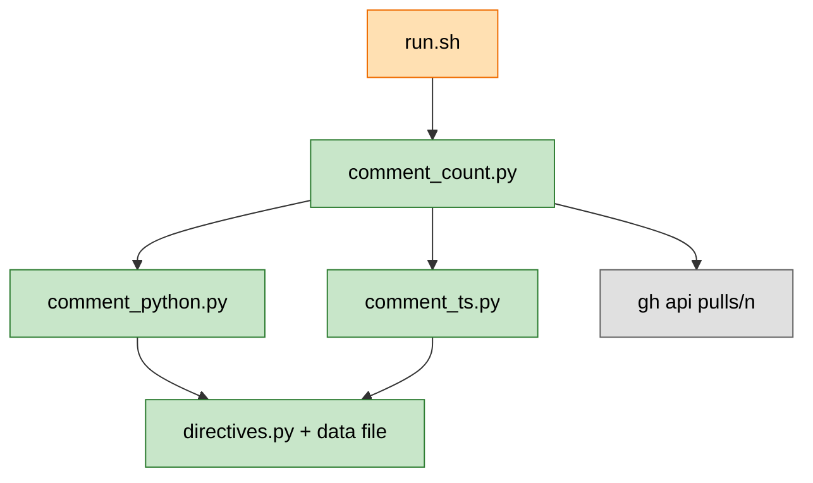

# The `comment-count` rule Implementation Plan

> **For agentic workers:** use `superpowers:executing-plans` (inline). Steps use checkbox syntax; flip each box when the step is done.

**Status:** proposed. Spec: `docs/specs/2026-11-22-comment-count-rule.md`. Ticket: BLOG-60. Extends `scripts/rules/` and the `rules` job from BLOG-59 (merged, PR #69). The rules run with the runner's `python3`: use only standard-library features present in Python 3.12 and 3.13.

## TL;DR

- Ships one PR: rule `comment-count` (two tokenizers, a directives data file, the rule, wiring, tests).
- A PR may not raise any changed code file's comment lines; a `Comments: <reason>` line in the PR description lifts it. The job summary shows before and after per file and in total.
- No new dependency and no new Azure resource. Owner action: merge (the PR touches `.github/workflows/ci.yml`).
- Cost: none (no paid API, no new resource; the job adds seconds to the existing `rules` job).
- Prototype of every code block below ran green before this plan was written: 35 tokenizer tests, 18 rule tests, ruff clean, and the tokenizers read all 153 code files of this repo without error.

## Cost estimate

None. Python standard library, `git` and the `gh` CLI already present on the runner.

## Architecture

Source: `docs/plans/diagrams/2026-11-22-comment-count-rule.mmd` (green new, amber changed, grey unchanged). The inline copy below is the rule's core only; the `.mmd` file is the full schematic (job, tests, git history, summary, legend).



## Global constraints

- Edit files only with Edit and Write. Comments: none in any new file (the rule applies to its own PR).
- Commit messages: two lines at most, no trailer. Branch from `main` after #69 merged.
- Run Python from `backend/` as `PYTHONDONTWRITEBYTECODE=1 poetry run pytest ...`; delete `scripts/rules/__pycache__` before a rerun that follows a source change.

## Review focus

- A comment marker inside a string, template literal or regular expression is not a comment (tests in Task 2 and 3).
- An unterminated quote in JSX text ends at the line end and cannot swallow later comments (Task 3).
- A renamed file is compared with its old path, so a pure rename never fails (Task 4).
- A description line without a reason does not lift the failure (Task 4).

---

### Task 0: Worktree and baseline

- [ ] **Step 1:** from the repo's main checkout, after the docs PR merged and `git pull --ff-only`: `git -C Personal-Blog-Studio fetch origin && git -C Personal-Blog-Studio worktree add ../.worktrees/Personal-Blog-Studio-commentcount -b feat/comment-count-rule origin/main`.
- [ ] **Step 2:** `cd .worktrees/Personal-Blog-Studio-commentcount/backend && poetry install && PYTHONDONTWRITEBYTECODE=1 poetry run pytest -q`. Expected: all pass (about 624 passed, 14 skipped).
- [ ] **Step 3:** comment BLOG-60 "Starting code PR" and keep the ticket `In Progress`.

### Task 1: Share the test helpers

**Files:** create `backend/tests/rules_support.py`; modify `backend/tests/test_rules.py`.

- [ ] **Step 1:** create `backend/tests/rules_support.py`:

```python
import os
import shutil
import subprocess
from pathlib import Path

import shared_block

RULES = Path(__file__).resolve().parents[2] / "scripts" / "rules"
FIXTURES = Path(__file__).parent / "fixtures" / "rules"
GOOD = (FIXTURES / "agents-block-good.md").read_text()
GIT = [
    "git",
    "-c",
    "user.name=t",
    "-c",
    "user.email=t@t",
    "-c",
    "commit.gpgsign=false",
]
FOREIGN_ENV = (
    "PR_NUMBER",
    "GITHUB_REPOSITORY",
    "COMMENTS_REASON",
    "GITHUB_STEP_SUMMARY",
)


def present(value: str | None) -> str:
    assert value is not None
    return value


RECORDED = shared_block.digest(present(shared_block.extract(GOOD)))


def make_repo(tmp_path: Path, agents: str = GOOD) -> Path:
    shutil.copytree(
        RULES,
        tmp_path / "scripts" / "rules",
        ignore=shutil.ignore_patterns("__pycache__"),
    )
    (tmp_path / "scripts" / "rules" / "shared-block.sha256").write_text(RECORDED + "\n")
    (tmp_path / "AGENTS.md").write_text(agents)
    subprocess.run(["git", "init", "-q", "-b", "main"], cwd=tmp_path, check=True)
    commit_all(tmp_path)
    return tmp_path


def commit_all(repo: Path) -> None:
    subprocess.run(["git", "add", "-A"], cwd=repo, check=True)
    subprocess.run([*GIT, "commit", "-q", "-m", "change"], cwd=repo, check=True)


def run_rules(repo: Path, **extra_env: str) -> subprocess.CompletedProcess:
    base = subprocess.run(
        ["git", "rev-parse", "HEAD~1"],
        cwd=repo,
        check=True,
        capture_output=True,
        text=True,
    ).stdout.strip()
    env = {k: v for k, v in os.environ.items() if k not in FOREIGN_ENV}
    return subprocess.run(
        ["bash", "scripts/rules/run.sh"],
        cwd=repo,
        env={**env, "BASE_SHA": base, **extra_env},
        capture_output=True,
        text=True,
    )
```

- [ ] **Step 2:** in `backend/tests/test_rules.py` replace everything from the first line through the line `RECORDED = shared_block.digest(present(shared_block.extract(GOOD)))` (imports, `RULES`, `FIXTURES`, `GOOD`, `present`, `RECORDED`) with:

```python
import pr_size
import shared_block
import spec_location
from tests.rules_support import (
    FIXTURES,
    GOOD,
    RECORDED,
    commit_all,
    make_repo,
    present,
    run_rules,
)
```

- [ ] **Step 3:** in the same file delete the three functions `make_repo`, `commit_all`, `run_rules` (from `def make_repo` through the end of `run_rules`). Keep every `test_*` function.
- [ ] **Step 4:** `cd backend && poetry run ruff check --fix . ../scripts/rules && poetry run ruff format . ../scripts/rules && PYTHONDONTWRITEBYTECODE=1 poetry run pytest tests/test_rules.py -q`. Expected: `28 passed` (the same tests as before the move).
- [ ] **Step 5:** `git add backend/tests && git commit -m "Share the rule test helpers"`.

### Task 2: Directives and the Python tokenizer

**Files:** create `scripts/rules/comment-directives.txt`, `scripts/rules/directives.py`, `scripts/rules/comment_python.py`, `backend/tests/test_comment_tokens.py`.

- [ ] **Step 1:** create `backend/tests/test_comment_tokens.py` (Python cases first):

```python
import comment_python
import pytest


@pytest.mark.parametrize(
    ("source", "expected"),
    [
        ("x = 1  # note\n", 1),
        ("# a\n# b\n", 2),
        ('x = "# not"\n', 0),
        ('def f():\n    """one\n    two"""\n    return 1\n', 2),
        ('"""doc"""\nx = 1\n', 1),
        ('x = 1\n"""not a docstring"""\n', 0),
        ("import os  # noqa: F401\n", 0),
        ("#!/usr/bin/env python3\nx = 1\n", 0),
        ("x = f()  # type: ignore\n", 0),
        ("# -*- coding: utf-8 -*-\nx = 1\n", 0),
        ("# fmt: off\nx = 1\n# fmt: on\n", 0),
        ("# plain\nimport os  # noqa\n", 1),
    ],
)
def test_python_counts(source, expected):
    assert comment_python.count(source) == expected


def test_python_unreadable_source_raises():
    with pytest.raises(ValueError, match="cannot read comments"):
        comment_python.count("def (:\n")
```

- [ ] **Step 2:** `cd backend && PYTHONDONTWRITEBYTECODE=1 poetry run pytest tests/test_comment_tokens.py -q`. Expected: collection error `No module named 'comment_python'` (red).
- [ ] **Step 3:** create `scripts/rules/comment-directives.txt` (tab between the language and the regex; no blank or comment lines):

```
python	^#!
python	coding[:=]
python	\bnoqa\b
python	type:\s*ignore
python	\b(pyright|ruff|isort|pylint|pragma|nosec)\b
python	fmt:\s*(off|on|skip)
ts	^#!
ts	eslint-(disable|enable)
ts	@ts-(expect-error|ignore|nocheck|check)
ts	prettier-ignore
ts	\b(istanbul|v8|c8) ignore\b
ts	^///\s*<reference
ts	@(vitest|jest)-environment
ts	sourceMappingURL
```

- [ ] **Step 4:** create `scripts/rules/directives.py`:

```python
import re
from pathlib import Path

DATA = Path(__file__).with_name("comment-directives.txt")


def load(path: Path = DATA) -> dict[str, list[re.Pattern[str]]]:
    patterns: dict[str, list[re.Pattern[str]]] = {"python": [], "ts": []}
    for row in path.read_text().splitlines():
        if row.strip():
            language, regex = row.split("\t", 1)
            patterns[language].append(re.compile(regex))
    return patterns


PATTERNS = load()


def is_directive(text: str, language: str) -> bool:
    return any(pattern.search(text) for pattern in PATTERNS[language])
```

- [ ] **Step 5:** create `scripts/rules/comment_python.py`:

```python
import ast
import io
import tokenize

import directives


def count(source: str) -> int:
    lines: set[int] = set()
    try:
        for token in tokenize.generate_tokens(io.StringIO(source).readline):
            if token.type == tokenize.COMMENT and not directives.is_directive(
                token.string, "python"
            ):
                lines.add(token.start[0])
        tree = ast.parse(source)
    except (SyntaxError, tokenize.TokenError) as error:
        raise ValueError(f"cannot read comments: {error}") from error
    for node in ast.walk(tree):
        if isinstance(
            node, (ast.Module, ast.ClassDef, ast.FunctionDef, ast.AsyncFunctionDef)
        ) and ast.get_docstring(node, clean=False):
            first = node.body[0]
            lines.update(range(first.lineno, (first.end_lineno or first.lineno) + 1))
    return len(lines)
```

- [ ] **Step 6:** run the Step 2 command. Expected: `13 passed`.
- [ ] **Step 7:** mutation check: in `comment_python.py` delete the `not` in front of `directives.is_directive`; the run must fail (directive cases); restore.
- [ ] **Step 8:** `git add scripts/rules backend/tests && git commit -m "Count Python comments and docstrings"`.

### Task 3: The TypeScript and JavaScript tokenizer

**Files:** create `scripts/rules/comment_ts.py`; modify `backend/tests/test_comment_tokens.py`.

- [ ] **Step 1:** in `backend/tests/test_comment_tokens.py` change the import line to `import comment_python\nimport comment_ts\nimport pytest` and append:

```python
@pytest.mark.parametrize(
    ("source", "expected"),
    [
        ("const a = 1; // note\n", 1),
        ("// a\n// b\n", 2),
        ("/* one\n two */\nconst a = 1;\n", 2),
        ("const x = <div>{/* jsx */}</div>;\n", 1),
        ("const u = \"https://x.y\"; const v = 'a // b';\n", 0),
        ("const t = `a // b ${x /* c */} d`;\n", 1),
        ("const t = `a ${`b // c`} d`;\n", 0),
        ("const r = /\\/\\/ x/;\n", 0),
        ("const q = b / 2 / 3; // c\n", 1),
        ("function f(s) { return /x/.test(s); } // c\n", 1),
        ("const q = (a) / 2; // c\n", 1),
        ("const p = <p>Don't // no</p>;\n// real\n", 1),
        ("const a = <a>x</a>; // c\n", 1),
        ("const a = <a>x</a>{/* c */};\n", 1),
        ("const a = <b>{/* c */}</b>;\nconst d = <i/>; // d\n", 2),
        ("// eslint-disable-next-line no-console\n", 0),
        ("/* istanbul ignore next */\n", 0),
        ("// @ts-expect-error reason\n", 0),
        ('/// <reference types="x" />\n', 0),
        ("#!/usr/bin/env node\n// a\n", 1),
        ("/* // */\n", 1),
        ("// plain\n// eslint-disable-line\n", 1),
    ],
)
def test_ts_counts(source, expected):
    assert comment_ts.count(source) == expected
```

- [ ] **Step 2:** `cd backend && PYTHONDONTWRITEBYTECODE=1 poetry run pytest tests/test_comment_tokens.py -q`. Expected: collection error `No module named 'comment_ts'` (red).
- [ ] **Step 3:** create `scripts/rules/comment_ts.py`:

```python
import directives

REGEX_KEYWORDS = {
    "return",
    "typeof",
    "case",
    "of",
    "in",
    "delete",
    "void",
    "throw",
    "yield",
    "await",
    "else",
    "do",
    "new",
}
DIVISION_BEFORE = set(")]}\"'`<")


def is_word_char(char: str) -> bool:
    return char.isalnum() or char in "_$"


def skip_quoted(source: str, start: int) -> int:
    quote = source[start]
    i = start + 1
    while i < len(source) and source[i] != "\n":
        if source[i] == "\\":
            i += 2
            continue
        if source[i] == quote:
            return i + 1
        i += 1
    return i


def skip_regex(source: str, start: int) -> int | None:
    i = start + 1
    in_class = False
    while i < len(source) and source[i] != "\n":
        char = source[i]
        if char == "\\":
            i += 2
            continue
        if char == "[":
            in_class = True
        elif char == "]":
            in_class = False
        elif char == "/" and not in_class:
            return i + 1
        i += 1
    return None


def count(source: str) -> int:
    lines: set[int] = set()
    line = 1
    i = 0
    if source.startswith("#!"):
        i = source.find("\n") if "\n" in source else len(source)
    depth = 0
    interpolations: list[int] = []
    previous = ""
    previous_word = ""
    in_template = False

    def record(text: str, first_line: int) -> None:
        if directives.is_directive(text, "ts"):
            return
        lines.update(range(first_line, first_line + text.count("\n") + 1))

    while i < len(source):
        char = source[i]
        if in_template:
            if char == "\\":
                line += source[i : i + 2].count("\n")
                i += 2
            elif char == "`":
                in_template = False
                previous = "`"
                i += 1
            elif source.startswith("${", i):
                interpolations.append(depth)
                depth += 1
                in_template = False
                previous = "{"
                i += 2
            else:
                line += char == "\n"
                i += 1
            continue
        if char == "\n":
            line += 1
            i += 1
        elif char.isspace():
            i += 1
        elif source.startswith("//", i):
            end = source.find("\n", i)
            end = len(source) if end == -1 else end
            record(source[i:end], line)
            i = end
        elif source.startswith("/*", i):
            end = source.find("*/", i + 2)
            end = len(source) if end == -1 else end + 2
            record(source[i:end], line)
            line += source.count("\n", i, end)
            i = end
        elif char in "'\"":
            i = skip_quoted(source, i)
            previous = char
        elif char == "`":
            in_template = True
            i += 1
        elif char == "/":
            if previous == "w":
                regex_allowed = previous_word in REGEX_KEYWORDS
            else:
                regex_allowed = previous not in DIVISION_BEFORE
            end = skip_regex(source, i) if regex_allowed else None
            if end is None:
                previous = "/"
                i += 1
            else:
                previous = "w"
                previous_word = ""
                i = end
        elif is_word_char(char):
            start = i
            while i < len(source) and is_word_char(source[i]):
                i += 1
            previous = "w"
            previous_word = source[start:i]
        else:
            if char == "{":
                depth += 1
            elif char == "}":
                depth -= 1
                if interpolations and depth == interpolations[-1]:
                    interpolations.pop()
                    in_template = True
            previous = char
            i += 1
    return len(lines)
```

- [ ] **Step 4:** run the Step 2 command. Expected: `35 passed`.
- [ ] **Step 5:** mutation checks, each must turn at least one test red, then restore: (a) in `skip_quoted` replace `source[i] != "\n"` by `True` (the JSX apostrophe case hangs or fails); (b) in the `//` branch remove the `record` call (every line-comment case fails); (c) remove `"return"` from `REGEX_KEYWORDS` (the `return /x/` case fails); (d) remove `<` from `DIVISION_BEFORE` (the JSX closing-tag cases fail).
- [ ] **Step 6:** `git add scripts/rules backend/tests && git commit -m "Count TypeScript and JavaScript comments"`.

### Task 4: The rule

**Files:** create `scripts/rules/comment_count.py`, `backend/tests/test_comment_count.py`; modify `scripts/rules/run.sh`, `backend/tests/test_rules.py`.

- [ ] **Step 1:** create `backend/tests/test_comment_count.py`:

```python
from pathlib import Path

import comment_count
import pytest
from tests.rules_support import commit_all, make_repo, run_rules


def write(repo: Path, path: str, text: str) -> None:
    target = repo / path
    target.parent.mkdir(parents=True, exist_ok=True)
    target.write_text(text)


def repo_with(tmp_path: Path, path: str, before: str, after: str) -> Path:
    repo = make_repo(tmp_path)
    write(repo, path, before)
    commit_all(repo)
    write(repo, path, after)
    commit_all(repo)
    return repo


def test_a_new_comment_in_an_existing_file_fails(tmp_path):
    repo = repo_with(tmp_path, "src.py", "x = 1\n", "x = 1  # why\n")
    result = run_rules(repo)
    assert result.returncode == 1
    assert "comment-count: FAIL 1 file(s) have more comments" in result.stdout
    assert "  src.py: 0 -> 1" in result.stdout


def test_a_new_file_starts_at_zero(tmp_path):
    repo = make_repo(tmp_path)
    write(repo, "web/a.ts", "// note\nexport const a = 1;\n")
    commit_all(repo)
    result = run_rules(repo)
    assert result.returncode == 1
    assert "  web/a.ts: 0 -> 1" in result.stdout


def test_fewer_comments_pass(tmp_path):
    repo = repo_with(tmp_path, "src.py", "# a\n# b\nx = 1\n", "# a\nx = 1\n")
    result = run_rules(repo)
    assert result.returncode == 0
    assert "comment-count: ok (2 -> 1)" in result.stdout


def test_the_comments_line_lifts_the_failure(tmp_path):
    repo = repo_with(tmp_path, "src.py", "x = 1\n", "x = 1  # why\n")
    result = run_rules(repo, COMMENTS_REASON="a constraint the code cannot show")
    assert result.returncode == 0
    assert (
        "comment-count: ok (Comments: a constraint the code cannot show)"
        in result.stdout
    )


def test_a_blank_reason_does_not_count(tmp_path):
    repo = repo_with(tmp_path, "src.py", "x = 1\n", "x = 1  # why\n")
    assert run_rules(repo, COMMENTS_REASON="   ").returncode == 1


def test_a_rename_keeps_its_old_count(tmp_path):
    repo = make_repo(tmp_path)
    write(repo, "old.py", "# keep\nx = 1\n")
    commit_all(repo)
    (repo / "old.py").rename(repo / "new.py")
    commit_all(repo)
    result = run_rules(repo)
    assert result.returncode == 0
    assert "  new.py: 1 -> 1" in result.stdout


def test_fixtures_and_other_languages_are_not_counted(tmp_path):
    repo = make_repo(tmp_path)
    write(repo, "tests/fixtures/sample.py", "# note\n")
    write(repo, "ci.yml", "# note\n")
    commit_all(repo)
    result = run_rules(repo)
    assert result.returncode == 0
    assert "comment-count: ok (0 -> 0)" in result.stdout


def test_a_file_that_cannot_be_read_fails_even_with_a_reason(tmp_path):
    repo = make_repo(tmp_path)
    write(repo, "broken.py", "def (:\n")
    commit_all(repo)
    result = run_rules(repo, COMMENTS_REASON="anything")
    assert result.returncode == 1
    assert "  broken.py: cannot read comments" in result.stdout


def test_the_job_summary_lists_every_file_and_the_total(tmp_path):
    repo = repo_with(tmp_path, "src.py", "# a\n# b\nx = 1\n", "# a\nx = 1\n")
    summary = tmp_path / "summary.md"
    run_rules(repo, GITHUB_STEP_SUMMARY=str(summary))
    assert summary.read_text().splitlines() == [
        "| file | before | after |",
        "|---|---:|---:|",
        "| src.py | 2 | 1 |",
        "| **total** | 2 | 1 |",
    ]


@pytest.mark.parametrize(
    ("body", "expected"),
    [
        ("Comments: needed for X\n", "needed for X"),
        ("text\n\nComments: why\nmore\n", "why"),
        ("Comments: why\r\n", "why"),
        ("Comments:\n", None),
        ("Comments:   \n", None),
        ("see Comments: why\n", None),
        ("", None),
        (None, None),
    ],
)
def test_the_reason_is_read_from_a_line_of_the_description(body, expected):
    assert comment_count.reason_from(body) == expected


def test_only_added_modified_and_renamed_code_files_are_read():
    name_status = (
        "A\tnew.py\nM\tweb/a.tsx\nD\tgone.py\nR100\told.py\tmoved.py\n"
        "A\tREADME.md\nA\tx/fixtures/f.py\nM\tci.yml\n"
    )
    assert comment_count.changed(name_status) == [
        ("new.py", None),
        ("web/a.tsx", "web/a.tsx"),
        ("moved.py", "old.py"),
    ]
```

- [ ] **Step 2:** `cd backend && PYTHONDONTWRITEBYTECODE=1 poetry run pytest tests/test_comment_count.py -q`. Expected: collection error `No module named 'comment_count'` (red).
- [ ] **Step 3:** create `scripts/rules/comment_count.py`:

```python
import os
import re
import subprocess
import sys
from pathlib import PurePosixPath

import comment_python
import comment_ts
import common

COUNTERS = {
    ".py": comment_python.count,
    ".ts": comment_ts.count,
    ".tsx": comment_ts.count,
    ".js": comment_ts.count,
    ".jsx": comment_ts.count,
    ".mjs": comment_ts.count,
    ".cjs": comment_ts.count,
}
REASON = re.compile(r"^Comments:[ \t]+(\S.*)$", re.MULTILINE)


def counted(path: str) -> bool:
    pure = PurePosixPath(path)
    return pure.suffix in COUNTERS and "fixtures" not in pure.parts[:-1]


def reason_from(body: str | None) -> str | None:
    found = REASON.search(body or "")
    return found.group(1).strip() if found else None


def changed(name_status: str) -> list[tuple[str, str | None]]:
    rows: list[tuple[str, str | None]] = []
    for row in name_status.splitlines():
        status, *names = row.split("\t")
        if status == "A" and counted(names[0]):
            rows.append((names[0], None))
        elif status == "M" and counted(names[0]):
            rows.append((names[0], names[0]))
        elif status.startswith("R") and counted(names[1]):
            rows.append((names[1], names[0]))
    return rows


def tally(
    rows: list[tuple[str, str | None]], base: str
) -> tuple[list[tuple[str, int, int]], list[str]]:
    counts: list[tuple[str, int, int]] = []
    unreadable: list[str] = []
    for path, old_path in rows:
        counter = COUNTERS[PurePosixPath(path).suffix]
        try:
            before = (
                counter(common.git("show", f"{base}:{old_path}")) if old_path else 0
            )
            after = counter(common.git("show", f"HEAD:{path}"))
        except ValueError:
            unreadable.append(path)
            continue
        counts.append((path, before, after))
    return counts, unreadable


def summary(counts: list[tuple[str, int, int]]) -> str:
    lines = ["| file | before | after |", "|---|---:|---:|"]
    lines += [f"| {path} | {before} | {after} |" for path, before, after in counts]
    lines.append(
        f"| **total** | {sum(c[1] for c in counts)} | {sum(c[2] for c in counts)} |"
    )
    return "\n".join(lines) + "\n"


def escape_reason() -> str | None:
    local = os.environ.get("COMMENTS_REASON", "").strip()
    if local:
        return local
    number = os.environ.get("PR_NUMBER")
    repo = os.environ.get("GITHUB_REPOSITORY")
    if not (number and repo):
        return None
    result = subprocess.run(
        ["gh", "api", f"repos/{repo}/pulls/{number}", "--jq", ".body"],
        capture_output=True,
        text=True,
    )
    return reason_from(result.stdout) if result.returncode == 0 else None


def main() -> int:
    base = common.merge_base()
    rows = changed(common.git("diff", "--name-status", "-M", base, "HEAD"))
    counts, unreadable = tally(rows, base)
    before = sum(c[1] for c in counts)
    after = sum(c[2] for c in counts)
    grown = [c for c in counts if c[2] > c[1]]
    escape = escape_reason() if grown or unreadable else None
    if unreadable:
        print(f"comment-count: FAIL {len(unreadable)} file(s) cannot be read")
        status = 1
    elif grown and escape:
        print(f"comment-count: ok (Comments: {escape})")
        status = 0
    elif grown:
        print(
            f"comment-count: FAIL {len(grown)} file(s) have more comments than before; "
            "cut comments, or add a line `Comments: <reason>` to the PR description "
            "and re-run this job"
        )
        status = 1
    else:
        print(f"comment-count: ok ({before} -> {after})")
        status = 0
    for path, old, new in counts:
        print(f"  {path}: {old} -> {new}")
    for path in unreadable:
        print(f"  {path}: cannot read comments")
    target = os.environ.get("GITHUB_STEP_SUMMARY")
    if target:
        with open(target, "a") as handle:
            handle.write(summary(counts))
    return status


if __name__ == "__main__":
    sys.exit(main())
```

- [ ] **Step 4:** in `scripts/rules/run.sh` replace `for rule in pr_size spec_location shared_block; do` with `for rule in pr_size spec_location shared_block comment_count; do`.
- [ ] **Step 5:** in `backend/tests/test_rules.py`, in `test_a_clean_change_passes_every_rule` replace the expected list with:

```python
    assert result.stdout.splitlines() == [
        "pr-size: ok (1 files, 1 lines)",
        "spec-location: ok",
        "shared-block: ok",
        "comment-count: ok (0 -> 0)",
        "  src.py: 0 -> 0",
    ]
```

- [ ] **Step 6:** `cd backend && poetry run ruff format . ../scripts/rules && PYTHONDONTWRITEBYTECODE=1 poetry run pytest tests/test_comment_count.py tests/test_rules.py tests/test_comment_tokens.py -q`. Expected: all pass (`18 + 28 + 35`).
- [ ] **Step 7:** mutation checks, each must turn a test red, then restore: (a) `c[2] > c[1]` to `c[2] >= c[1]` (the rename and fewer-comments tests); (b) `else 0` path: replace `if old_path else 0` by `if old_path else 5` (new-file test); (c) remove `and not unreadable`-equivalent by making the `elif grown and escape` branch come before `if unreadable` (unreadable test); (d) change `\S.*` in `REASON` to `.*` (blank-reason test).
- [ ] **Step 8:** `git add scripts/rules backend/tests && git commit -m "Add the comment-count rule"`.

### Task 5: Wiring and docs

**Files:** modify `.github/workflows/ci.yml` (only if the `rules` job lacks the `gh` environment, see Step 1), `AGENTS.md`.

- [ ] **Step 1:** confirm the `rules` job in `.github/workflows/ci.yml` already has `permissions: pull-requests: read`, `GH_TOKEN` and `PR_NUMBER` (BLOG-59 added them). `GITHUB_REPOSITORY` and `GITHUB_STEP_SUMMARY` are set by the runner. No edit when all are present.
- [ ] **Step 2:** in `AGENTS.md`, in the CI sentence, replace `` `rules` (`scripts/rules/run.sh`: `pr-size`, `spec-location`, `shared-block`; each has violating inputs in `backend/tests/test_rules.py`; `comment-count` follows in BLOG-60) `` with `` `rules` (`scripts/rules/run.sh`: `pr-size`, `spec-location`, `shared-block`, `comment-count`; violating inputs in `backend/tests/test_rules.py` and `test_comment_count.py`; `comment-count` reads the PR description line `Comments: <reason>`, locally the variable `COMMENTS_REASON`, and prints before and after per file in the job summary; its directive exceptions are `scripts/rules/comment-directives.txt`) ``.
- [ ] **Step 3:** `git add AGENTS.md && git commit -m "Document the comment-count rule"`.

### Task 6: Verify, clean up, hand over

- [ ] **Step 1:** `cd backend && poetry run ruff check . ../scripts/rules && poetry run ruff format --check . ../scripts/rules && poetry run pyright && PYTHONDONTWRITEBYTECODE=1 poetry run pytest -q`. Expected: no errors; all tests pass. If pyright flags a test module, type it with the smallest change and rerun.
- [ ] **Step 2:** `bash scripts/rules/run.sh`. Expected: four ok lines; `comment-count` reports `0 -> 0` for the new files and test files without comments.
- [ ] **Step 3:** cleanup commit: for every edited file (`backend/tests/test_rules.py`, `AGENTS.md`, `scripts/rules/run.sh`), delete comments that restate the code, narrate a change or point at a ticket, and redundant tests; separate commit "Delete comments that restate the code in the touched files". With no such comments, record "none found" on the ticket.
- [ ] **Step 4:** run `auditing-branch-changes` (subagent) before `gh pr create`; fix findings.
- [ ] **Step 5:** `git fetch && git merge origin/main`, push, `gh pr create --draft` (title without any tool name; body: what changed, local checks, `Comments:` line only if needed), set `Status: done (PR #n)` in the spec and this plan, push.
- [ ] **Step 6:** wait with the bare `gh pr checks <n> -R Fredheda/Personal-Blog-Studio --watch --interval 60 --fail-fast` as a background task; when the draft's CI finished, `gh pr ready`, wait again, confirm every job ran (including `rules`), read the review `Verdict:` once, hand the URL to the coordinator. Owner merges.
- [ ] **Step 7:** after merge: remove the worktree (no `--force`), delete the branch, check the remote branch is gone, `git pull --ff-only` in the main checkout, BLOG-60 to Done with what shipped.
