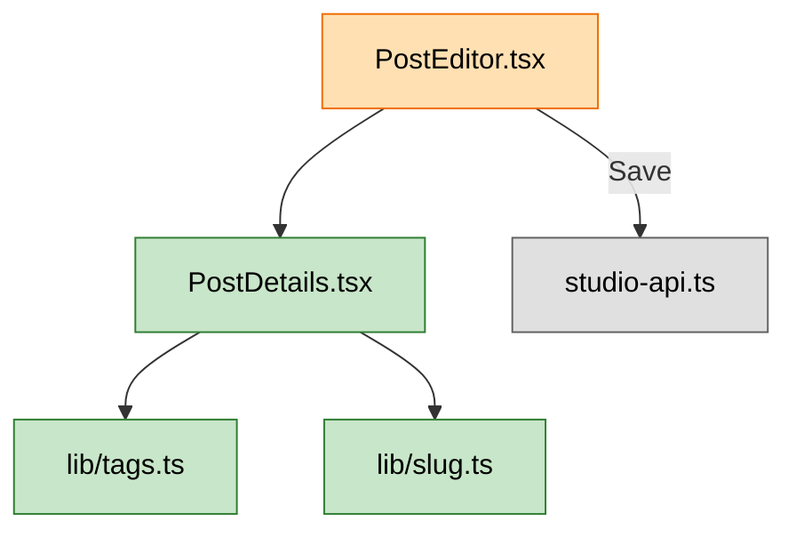

# Details typed in place Implementation Plan

> **For agentic workers:** use `superpowers:executing-plans` (inline). Steps use checkbox syntax; flip each box when the step is done.

**Status:** proposed. Spec: `docs/specs/2026-11-22-details-in-place.md`. Ticket: BLOG-39. Runs before the BLOG-61 code PR and BLOG-40 (all three edit `PostEditor.tsx`, never in parallel). The edits below name each piece by what it does; if the surrounding code moved, re-read the file and apply the same replacement.

## TL;DR

- Ships one PR: the title as the page `h1`, the summary under it, the slug pill and the tag pills typed in the page (`PostDetails`), replacing the labelled form and the repeated saved-title heading. Saving is unchanged: details still save only through Save.
- New files: `lib/tags.ts`, `lib/slug.ts`, `components/PostDetails.tsx` and a test file each; changed files: `PostEditor.tsx`, `PostEditor.test.tsx`, `e2e/studio.spec.ts` and `AGENTS.md` (ten files, about 550 changed lines).
- Tests first: four browser tests are written and run red before any code; each unit gets its test red before its code. The prototype of this plan passed 331 frontend tests (314 existing plus 17 new), 23 browser tests (19 existing plus 4 new), lint and types.
- Behaviour change worth a look: tags typed in the pill input are added to the list (the old field replaced the whole text); duplicates are dropped ignoring case; the slug input filters what is typed.
- No new dependency, no workflow change, no API change, no new Azure resource. Cost: none. Feature-class PR: the owner gets the local-run-or-merge choice.
- A separate cleanup commit cuts the comments in `PostEditor.tsx` that restate the code (24 to 9).

## Cost estimate

None.

## Architecture

Source: `docs/plans/diagrams/2026-11-22-details-in-place.mmd` (green new, amber changed, grey unchanged). The inline copy shows the core only.



## Global constraints

- Edit files only with Edit and Write. No comment in any new file.
- Commit messages: two lines at most, no trailer. Branch from `main`.
- Run frontend commands from `frontend/` (`npx vitest run ...`, `npm run lint`, `npx tsc --noEmit`), backend commands from `backend/`.
- Existing accessible names stay: "Title", "Slug", "Summary", "Tags", "Save", "Publish", "Preview".
- Comment standard for the touched files: separate cleanup commit; `PostEditor.tsx` is the only touched file above the floor (24 comment lines, allowance 10).

## Review focus

- A tag typed and not confirmed is not lost when the input loses focus (`keeps what was typed when the input loses focus`).
- A published post's slug cannot be edited: no input appears on a click (`the slug of a post that has been published is read only with a lock`, browser).
- A phone width never scrolls sideways because of the pills (`on a phone the details and their pills fit the width and wrap`, browser).
- Unsaved details keep Publish off and a failed Save keeps the typed text, now with tags as a list (existing `PostEditor` tests, adapted).
- Preview shows no control that could change the details (`the Preview shows the details as plain text`).

## Owner gates

- After Task 6: `cd frontend && E2E_SKIP_BUILD=1 npm run e2e` prints `23 passed`.
- After Task 8: the owner may run the PR branch locally (coordinator offers it); what to check: open a post, click the title and type, click `/slug`, add and remove tags with Enter, comma and Backspace, press Save, reload, press Preview, shrink the window to a phone width.

## Tasks

### Task 1: Browser tests, red

**Files:** modify `frontend/e2e/studio.spec.ts`.

- [ ] **Step 1:** replace the `Seed` type line and the `createPost` patch condition and data, and the `stored` helper:

```ts
type Seed = { title: string; slug?: string; summary?: string; tags?: string[]; body?: string; publish?: boolean };
```

In `createPost`, replace

```ts
  if (seed.slug || seed.summary) {
    await must(
      await request.patch(`${API_ORIGIN}/posts/${id}/meta`, {
        headers: { ...HEADERS, "if-match": created.metaEtag },
        data: { slug: seed.slug, summary: seed.summary },
```

with

```ts
  if (seed.slug || seed.summary || seed.tags) {
    await must(
      await request.patch(`${API_ORIGIN}/posts/${id}/meta`, {
        headers: { ...HEADERS, "if-match": created.metaEtag },
        data: { slug: seed.slug, summary: seed.summary, tags: seed.tags },
```

and replace the line `async function stored(request: APIRequestContext, id: string): Promise<{ title: string; body: string }> {` with

```ts
async function stored(
  request: APIRequestContext,
  id: string,
): Promise<{ title: string; summary: string; slug: string; tags: string[]; body: string }> {
```

- [ ] **Step 2:** insert these four tests before the line `test("typing in the editor autosaves the text through the real ETag flow", ...`:

```ts
test("the title, summary, slug and tags are typed in the page and saved with Save", async ({ page, request }) => {
  const { postId } = await createPost(request, { title: unique("Details") });
  await page.goto(`/posts/${postId}`);
  const title = unique("Typed heading");
  await page.getByLabel("Title").fill(title);
  await page.getByRole("textbox", { name: "Summary" }).fill("A short summary.");
  await page.getByRole("button", { name: "Add a slug" }).click();
  const slugText = `typed-${Math.random().toString(36).slice(2, 8)}`;
  await page.getByLabel("Slug").fill(slugText.toUpperCase());
  await page.getByLabel("Slug").press("Enter");
  await expect(page.getByRole("button", { name: `/${slugText}` })).toBeVisible();
  await page.getByRole("button", { name: "Add a tag" }).click();
  await page.getByLabel("Tags").fill("maths, physics, extra,");
  await page.getByLabel("Tags").press("Backspace");
  await expect(page.getByRole("button", { name: "Remove tag extra" })).toHaveCount(0);
  await page.getByLabel("Tags").fill("chemistry");
  await page.getByLabel("Tags").press("Enter");
  await expect(page.getByRole("button", { name: "Remove tag maths" })).toBeVisible();
  await expect(page.getByRole("button", { name: "Remove tag chemistry" })).toBeVisible();
  await page.getByRole("button", { name: "Remove tag maths" }).click();
  await page.getByRole("button", { name: "Save", exact: true }).click();
  await expect(page.getByRole("banner").getByText(/^Saved/)).toBeVisible();
  await expect
    .poll(async () => {
      const post = await stored(request, postId);
      return [post.title, post.summary, post.slug, post.tags];
    })
    .toEqual([title, "A short summary.", slugText, ["physics", "chemistry"]]);
  await page.reload();
  await expect(page.getByLabel("Title")).toHaveValue(title);
  await expect(page.getByRole("textbox", { name: "Summary" })).toHaveValue("A short summary.");
  await expect(page.getByRole("button", { name: `/${slugText}` })).toBeVisible();
  await expect(page.getByRole("button", { name: "Remove tag physics" })).toBeVisible();
});

test("the slug of a post that has been published is read only with a lock", async ({ page, request }) => {
  const slugText = `live-${Math.random().toString(36).slice(2, 8)}`;
  const { postId } = await createPost(request, {
    title: unique("Locked"),
    slug: slugText,
    summary: "Sum",
    body: "Hello.",
    publish: true,
  });
  await page.goto(`/posts/${postId}`);
  const pill = page.getByTitle("The slug is fixed once the post has been published");
  await expect(pill).toContainText(`/${slugText}`);
  await pill.click();
  await expect(page.getByLabel("Slug")).toHaveCount(0);
});

test("the Preview shows the details as plain text with no controls", async ({ page, request }) => {
  const title = unique("Plain");
  const { postId } = await createPost(request, { title, slug: `plain-${Math.random().toString(36).slice(2, 8)}`, summary: "Only text.", tags: ["maths"], body: "Text." });
  await page.goto(`/posts/${postId}`);
  await page.getByRole("banner").getByRole("button", { name: "Preview" }).click();
  await expect(page.getByRole("heading", { level: 1, name: title })).toBeVisible();
  await expect(page.getByText("Only text.")).toBeVisible();
  await expect(page.getByLabel("Title")).toHaveCount(0);
  await expect(page.getByRole("button", { name: "Add a tag" })).toHaveCount(0);
  await expect(page.getByRole("button", { name: "Remove tag maths" })).toHaveCount(0);
});

test("on a phone the details and their pills fit the width and wrap", async ({ page, request }) => {
  const { postId } = await createPost(request, {
    title: unique("Phone details"),
    slug: "a-fairly-long-slug-for-a-phone-screen",
    tags: ["first-tag", "second-tag", "third-tag", "fourth-tag"],
    body: "Text.",
  });
  await page.setViewportSize({ width: 390, height: 800 });
  await page.goto(`/posts/${postId}`);
  await expect(page.getByRole("button", { name: "Add a tag" })).toBeVisible();
  const overflow = await page.evaluate(() => document.documentElement.scrollWidth - window.innerWidth);
  expect(overflow).toBeLessThanOrEqual(0);
  const tag = await page.getByRole("button", { name: "Add a tag" }).boundingBox();
  expect(tag !== null && tag.x + tag.width <= 390).toBeTruthy();
});
```

The title text avoids the word "title": the list page's "Title" label also matches a delete button named after a post with that word.

- [ ] **Step 3:** `cd frontend && env -u AI_AGENT -u CLAUDECODE npm run e2e` (builds first; ports 3200, 8200, 8201 and 10000 to 10002 free). Expected: `4 failed`, `19 passed`; the four failures are the new tests (no "Add a slug" button, no lock title, the form still shows in Preview, no "Add a tag" button).
- [ ] **Step 4:** `git add frontend && git commit -m "Browser tests for details typed in place"`.

### Task 2: Tag helpers

**Files:** create `frontend/lib/tags.test.ts`, `frontend/lib/tags.ts`.

- [ ] **Step 1:** create `frontend/lib/tags.test.ts`:

```ts
import { describe, expect, it } from "vitest";

import { addTags, removeLast, removeTag } from "./tags";

describe("addTags", () => {
  it("adds the trimmed, non-empty parts of a comma separated text", () => {
    expect(addTags(["a"], " b , ,c ")).toEqual(["a", "b", "c"]);
  });

  it("skips a tag that is already there, ignoring case", () => {
    expect(addTags(["Maths"], "maths, Physics")).toEqual(["Maths", "Physics"]);
  });

  it("leaves the list alone for an empty text", () => {
    expect(addTags(["a"], "  ")).toEqual(["a"]);
  });
});

describe("removing tags", () => {
  it("removes the last tag, or none from an empty list", () => {
    expect(removeLast(["a", "b"])).toEqual(["a"]);
    expect(removeLast([])).toEqual([]);
  });

  it("removes one named tag", () => {
    expect(removeTag(["a", "b", "c"], "b")).toEqual(["a", "c"]);
  });
});
```

- [ ] **Step 2:** `cd frontend && npx vitest run lib/tags.test.ts`. Expected: the file fails to load (`Failed to resolve import "./tags"`), red.
- [ ] **Step 3:** create `frontend/lib/tags.ts`:

```ts
export function addTags(list: string[], text: string): string[] {
  const next = [...list];
  for (const part of text.split(",")) {
    const tag = part.trim();
    if (tag !== "" && !next.some((t) => t.toLowerCase() === tag.toLowerCase())) next.push(tag);
  }
  return next;
}

export function removeLast(list: string[]): string[] {
  return list.slice(0, -1);
}

export function removeTag(list: string[], tag: string): string[] {
  return list.filter((t) => t !== tag);
}
```

- [ ] **Step 4:** rerun Step 2's command. Expected: `5 passed`. Mutation (must turn red, then restore): delete the `!next.some(...)` part of the condition (`skips a tag that is already there` fails).
- [ ] **Step 5:** `git add frontend/lib && git commit -m "Add the tag list helpers"`.

### Task 3: Slug input filter

**Files:** create `frontend/lib/slug.test.ts`, `frontend/lib/slug.ts`.

- [ ] **Step 1:** create `frontend/lib/slug.test.ts`:

```ts
import { describe, expect, it } from "vitest";

import { slugInput } from "./slug";

describe("slugInput", () => {
  it("lower-cases, turns spaces into hyphens and drops other characters", () => {
    expect(slugInput("Hello World_2!")).toBe("hello-world2");
  });

  it("keeps hyphens so a slug can be typed one character at a time", () => {
    expect(slugInput("a-")).toBe("a-");
  });
});
```

- [ ] **Step 2:** `cd frontend && npx vitest run lib/slug.test.ts`. Expected: fails to load (`Failed to resolve import "./slug"`), red.
- [ ] **Step 3:** create `frontend/lib/slug.ts`:

```ts
export function slugInput(value: string): string {
  return value.toLowerCase().replace(/\s+/g, "-").replace(/[^a-z0-9-]/g, "");
}
```

- [ ] **Step 4:** rerun Step 2's command. Expected: `2 passed`. The server's rule (`blog_core/ids.py`: lower-case letters and digits, single hyphens, at most 100) still decides at Save.
- [ ] **Step 5:** `git add frontend/lib && git commit -m "Add the slug input filter"`.

### Task 4: The PostDetails component

**Files:** create `frontend/components/PostDetails.test.tsx`, `frontend/components/PostDetails.tsx`.

- [ ] **Step 1:** create `frontend/components/PostDetails.test.tsx`:

```tsx
import { cleanup, fireEvent, render, screen } from "@testing-library/react";
import { useState } from "react";
import { afterEach, describe, expect, it } from "vitest";

import { PostDetails } from "./PostDetails";

afterEach(cleanup);

function Harness({
  slugLocked = false,
  preview = false,
  initial = { title: "Hello", summary: "Sum", slug: "hello", tags: ["maths"] },
}: {
  slugLocked?: boolean;
  preview?: boolean;
  initial?: { title: string; summary: string; slug: string; tags: string[] };
}) {
  const [title, setTitle] = useState(initial.title);
  const [summary, setSummary] = useState(initial.summary);
  const [slug, setSlug] = useState(initial.slug);
  const [tags, setTags] = useState(initial.tags);
  return (
    <PostDetails
      title={title}
      summary={summary}
      slug={slug}
      tags={tags}
      slugLocked={slugLocked}
      preview={preview}
      onTitle={setTitle}
      onSummary={setSummary}
      onSlug={setSlug}
      onTags={setTags}
    />
  );
}

const names = () => screen.getAllByRole("button").map((b) => b.textContent ?? "");

describe("title and summary", () => {
  it("are typed in place with their names, limits and placeholders", () => {
    render(<Harness initial={{ title: "", summary: "", slug: "", tags: [] }} />);
    const title = screen.getByLabelText("Title") as HTMLInputElement;
    expect(title.placeholder).toBe("Title");
    expect(title.maxLength).toBe(200);
    expect(title.closest("h1")).not.toBeNull();
    const summary = screen.getByLabelText("Summary") as HTMLTextAreaElement;
    expect(summary.placeholder).toBe("Add a summary: one or two sentences for lists and previews");
    expect(summary.maxLength).toBe(500);
    fireEvent.change(title, { target: { value: "New" } });
    fireEvent.change(summary, { target: { value: "Words" } });
    expect(title.value).toBe("New");
    expect(summary.value).toBe("Words");
  });
});

describe("the slug pill", () => {
  it("shows the slug, turns into an input on a click and closes on Enter", () => {
    render(<Harness />);
    fireEvent.click(screen.getByRole("button", { name: "/hello" }));
    const input = screen.getByLabelText("Slug") as HTMLInputElement;
    expect(document.activeElement).toBe(input);
    fireEvent.change(input, { target: { value: "hello-2" } });
    fireEvent.keyDown(input, { key: "Enter" });
    expect(screen.queryByLabelText("Slug")).toBeNull();
    expect(screen.getByRole("button", { name: "/hello-2" })).toBeTruthy();
  });

  it("accepts only lower-case letters, digits and hyphens, up to 100", () => {
    render(<Harness />);
    fireEvent.click(screen.getByRole("button", { name: "/hello" }));
    const input = screen.getByLabelText("Slug") as HTMLInputElement;
    expect(input.maxLength).toBe(100);
    fireEvent.change(input, { target: { value: "Hello World!" } });
    expect(input.value).toBe("hello-world");
  });

  it("shows a dashed add button when empty", () => {
    render(<Harness initial={{ title: "T", summary: "", slug: "", tags: [] }} />);
    expect(screen.getByRole("button", { name: "Add a slug" })).toBeTruthy();
  });

  it("is read only with a lock once the post has been published", () => {
    render(<Harness slugLocked />);
    expect(screen.queryByRole("button", { name: "/hello" })).toBeNull();
    const pill = screen.getByTitle("The slug is fixed once the post has been published");
    expect(pill.textContent).toContain("/hello");
  });
});

describe("the tag pills", () => {
  it("lists the tags with a remove button each", () => {
    render(<Harness initial={{ title: "T", summary: "", slug: "s", tags: ["a", "b"] }} />);
    fireEvent.click(screen.getByRole("button", { name: "Remove tag a" }));
    expect(names()).not.toContain("Remove tag a");
    expect(screen.getByRole("button", { name: "Remove tag b" })).toBeTruthy();
  });

  it("adds on Enter and on a comma, and ignores a duplicate", () => {
    render(<Harness initial={{ title: "T", summary: "", slug: "s", tags: [] }} />);
    fireEvent.click(screen.getByRole("button", { name: "Add a tag" }));
    const input = screen.getByLabelText("Tags") as HTMLInputElement;
    fireEvent.change(input, { target: { value: "maths" } });
    fireEvent.keyDown(input, { key: "Enter" });
    fireEvent.change(input, { target: { value: "physics," } });
    fireEvent.change(input, { target: { value: "MATHS" } });
    fireEvent.keyDown(input, { key: "Enter" });
    expect(screen.getByRole("button", { name: "Remove tag maths" })).toBeTruthy();
    expect(screen.getByRole("button", { name: "Remove tag physics" })).toBeTruthy();
    expect(screen.queryByRole("button", { name: "Remove tag MATHS" })).toBeNull();
  });

  it("removes the last tag on Backspace in the empty input", () => {
    render(<Harness initial={{ title: "T", summary: "", slug: "s", tags: ["a", "b"] }} />);
    fireEvent.click(screen.getByRole("button", { name: "Add a tag" }));
    const input = screen.getByLabelText("Tags");
    fireEvent.keyDown(input, { key: "Backspace" });
    expect(screen.queryByRole("button", { name: "Remove tag b" })).toBeNull();
    expect(screen.getByRole("button", { name: "Remove tag a" })).toBeTruthy();
  });

  it("keeps what was typed when the input loses focus", () => {
    render(<Harness initial={{ title: "T", summary: "", slug: "s", tags: [] }} />);
    fireEvent.click(screen.getByRole("button", { name: "Add a tag" }));
    const input = screen.getByLabelText("Tags");
    fireEvent.change(input, { target: { value: "late" } });
    fireEvent.blur(input);
    expect(screen.getByRole("button", { name: "Remove tag late" })).toBeTruthy();
    expect(screen.queryByLabelText("Tags")).toBeNull();
  });
});

describe("preview", () => {
  it("shows the details as plain text without any control", () => {
    render(<Harness preview />);
    expect(screen.queryByLabelText("Title")).toBeNull();
    expect(screen.queryByRole("button")).toBeNull();
    expect(screen.getByRole("heading", { level: 1 }).textContent).toBe("Hello");
    expect(screen.getByText("Sum")).toBeTruthy();
    expect(screen.getByText("/hello")).toBeTruthy();
    expect(screen.getByText("maths")).toBeTruthy();
  });
});
```

- [ ] **Step 2:** `cd frontend && npx vitest run components/PostDetails.test.tsx`. Expected: fails to load (`Failed to resolve import "./PostDetails"`), red.
- [ ] **Step 3:** create `frontend/components/PostDetails.tsx`:

```tsx
"use client";

import { useState } from "react";

import { slugInput } from "../lib/slug";
import { addTags, removeLast, removeTag } from "../lib/tags";

type Props = {
  title: string;
  summary: string;
  slug: string;
  tags: string[];
  slugLocked: boolean;
  preview: boolean;
  onTitle: (value: string) => void;
  onSummary: (value: string) => void;
  onSlug: (value: string) => void;
  onTags: (value: string[]) => void;
};

const PILL =
  "inline-flex items-center gap-1.5 rounded-full border border-line bg-pane px-2.5 py-0.5 text-[12.5px] text-muted";
const DASHED =
  "inline-flex items-center rounded-full border border-dashed border-line bg-transparent px-2.5 py-0.5 text-[12.5px] text-muted";

function Lock() {
  return (
    <svg aria-hidden viewBox="0 0 16 16" className="size-3" fill="none" stroke="currentColor" strokeWidth="1.5">
      <rect x="3" y="7" width="10" height="7" rx="1.5" />
      <path d="M5.5 7V5a2.5 2.5 0 0 1 5 0v2" />
    </svg>
  );
}

export function PostDetails({
  title,
  summary,
  slug,
  tags,
  slugLocked,
  preview,
  onTitle,
  onSummary,
  onSlug,
  onTags,
}: Props) {
  const [editingSlug, setEditingSlug] = useState(false);
  const [adding, setAdding] = useState(false);
  const [text, setText] = useState("");

  if (preview) {
    return (
      <div>
        <h1>{title || "(untitled)"}</h1>
        {summary && <p className="text-[18.5px] text-muted">{summary}</p>}
        <div className="mt-3 flex flex-wrap items-center gap-2 border-b border-line pb-4">
          {slug && <span className={PILL}>/{slug}</span>}
          {tags.map((tag) => (
            <span key={tag} className={PILL}>
              {tag}
            </span>
          ))}
        </div>
      </div>
    );
  }

  function commit() {
    onTags(addTags(tags, text));
    setText("");
  }

  return (
    <div>
      <h1>
        <input
          aria-label="Title"
          placeholder="Title"
          maxLength={200}
          value={title}
          onChange={(e) => onTitle(e.target.value)}
          className="w-full border-0 bg-transparent p-0 text-[inherit] font-[inherit] text-text outline-none placeholder:text-muted"
        />
      </h1>
      <textarea
        aria-label="Summary"
        placeholder="Add a summary: one or two sentences for lists and previews"
        maxLength={500}
        rows={2}
        value={summary}
        onChange={(e) => onSummary(e.target.value)}
        className="mt-1 w-full resize-none border-0 bg-transparent p-0 text-[18.5px] text-muted outline-none placeholder:text-muted"
      />
      <div className="mt-3 flex flex-wrap items-center gap-2 border-b border-line pb-4">
        {slugLocked ? (
          <span className={PILL} title="The slug is fixed once the post has been published">
            <Lock />
            {slug ? `/${slug}` : "No slug"}
          </span>
        ) : editingSlug ? (
          <input
            aria-label="Slug"
            autoFocus
            maxLength={100}
            value={slug}
            onChange={(e) => onSlug(slugInput(e.target.value))}
            onBlur={() => setEditingSlug(false)}
            onKeyDown={(e) => {
              if (e.key === "Enter" || e.key === "Escape") setEditingSlug(false);
            }}
            className={`${PILL} w-48 outline-none`}
          />
        ) : (
          <button type="button" className={slug ? PILL : DASHED} onClick={() => setEditingSlug(true)}>
            {slug ? `/${slug}` : "Add a slug"}
          </button>
        )}
        {tags.map((tag) => (
          <span key={tag} className={PILL}>
            {tag}
            <button type="button" aria-label={`Remove tag ${tag}`} onClick={() => onTags(removeTag(tags, tag))}>
              ×
            </button>
          </span>
        ))}
        {adding ? (
          <input
            aria-label="Tags"
            autoFocus
            value={text}
            onChange={(e) => {
              const value = e.target.value;
              if (value.includes(",")) {
                onTags(addTags(tags, value));
                setText("");
              } else {
                setText(value);
              }
            }}
            onKeyDown={(e) => {
              if (e.key === "Enter") {
                e.preventDefault();
                commit();
              } else if (e.key === "Backspace" && text === "") {
                onTags(removeLast(tags));
              }
            }}
            onBlur={() => {
              commit();
              setAdding(false);
            }}
            className={`${PILL} w-32 outline-none`}
          />
        ) : (
          <button type="button" className={DASHED} onClick={() => setAdding(true)}>
            Add a tag
          </button>
        )}
      </div>
    </div>
  );
}
```

- [ ] **Step 4:** rerun Step 2's command. Expected: `10 passed`. Mutations (each must turn a test red, then restore): (a) remove `commit();` from the tag input's `onBlur` (`keeps what was typed when the input loses focus` fails); (b) change `if (preview) {` to `if (false as boolean) {` (`shows the details as plain text` fails); (c) remove `maxLength={100}` (`accepts only lower-case letters...` fails).
- [ ] **Step 5:** `git add frontend/components && git commit -m "Add PostDetails: title, summary, slug and tag pills"`.

### Task 5: Use it in PostEditor

**Files:** modify `frontend/components/PostEditor.test.tsx`, `frontend/components/PostEditor.tsx`.

- [ ] **Step 1:** in `PostEditor.test.tsx` insert these two helpers before the first `afterEach(() => {`:

```tsx
async function typeSlug(value: string) {
  fireEvent.click(await screen.findByRole("button", { name: /^(\/.+|Add a slug)$/ }));
  fireEvent.change(screen.getByLabelText("Slug"), { target: { value } });
}

async function typeTags(text: string) {
  fireEvent.click(await screen.findByRole("button", { name: "Add a tag" }));
  const input = screen.getByLabelText("Tags");
  fireEvent.change(input, { target: { value: text } });
  fireEvent.keyDown(input, { key: "Enter" });
}
```

Then make these replacements (use `replace_all` for the first):

- every `fireEvent.change(await screen.findByLabelText("Slug"), { target: { value: "hello-2" } });` (five) becomes `await typeSlug("hello-2");`
- in the test `loads the post into the form and the editor` replace
  `expect((screen.getByLabelText("Slug") as HTMLInputElement).value).toBe("hello");` and
  `expect((screen.getByLabelText("Tags (comma separated, optional)") as HTMLInputElement).value).toBe("maths");` with
  `expect(screen.getByRole("button", { name: "/hello" })).toBeTruthy();` and
  `expect(screen.getByRole("button", { name: "Remove tag maths" })).toBeTruthy();`
- replace the test `tags typed as 'a, b' are sent as two tags` with:

```tsx
test("tags typed as 'a, b' are added to the existing tag and sent", async () => {
  const patchMeta = vi.fn(async () => ({ ...draft, tags: ["maths", "a", "b"], metaEtag: '"m2"' }));
  render(<PostEditor id={draft.postId} api={fakeApi({ patchMeta })} />);
  await typeTags("a, b");
  fireEvent.click(saveButton());
  await waitFor(() =>
    expect(patchMeta).toHaveBeenCalledWith(draft.postId, { title: "Hello", slug: "hello", summary: "Sum", tags: ["maths", "a", "b"] }, '"m1"'),
  );
});
```

- in the test `tags are optional: clearing the box saves an empty list, ...` replace `fireEvent.change(await screen.findByLabelText("Tags (comma separated, optional)"), { target: { value: "" } });` with `fireEvent.click(await screen.findByRole("button", { name: "Remove tag maths" }));`
- in the test `Publish stays disabled with unsaved details, ...` replace `fireEvent.change(await screen.findByLabelText("Slug"), { target: { value: "Bad Slug" } });` with `await typeSlug("Bad Slug");`

- [ ] **Step 2:** `cd frontend && npx vitest run components/PostEditor.test.tsx`. Expected: `9 failed` (the nine adapted tests: no "Add a slug" or "/hello" button, no "Remove tag maths" button, no "Add a tag" button), the rest pass: red.
- [ ] **Step 3:** edit `frontend/components/PostEditor.tsx` (each old text occurs once unless noted):

1. After `import type { EditorHandle } from "./CrepeEditor";` add the line `import { PostDetails } from "./PostDetails";` (so it sits before `import { Preview } from "./Preview";`).
2. Delete the function

```tsx
function splitTags(text: string): string[] {
  return text.split(",").map((t) => t.trim()).filter((t) => t !== "");
}

```

3. Replace `const [tags, setTags] = useState("");` with `const [tags, setTags] = useState<string[]>([]);`.
4. Replace every `setTags(draft.tags.join(", "));` (two places) with `setTags(draft.tags);`.
5. Replace `splitTags(tags).join(",") !== saved.tags.join(","));` with `tags.join(",") !== saved.tags.join(","));`.
6. Replace `client.patchMeta(id, { title, slug, summary, tags: splitTags(tags) }, saved!.metaEtag)` with `client.patchMeta(id, { title, slug, summary, tags }, saved!.metaEtag)`.
7. Replace this block

```tsx
        <h1>{saved.title || "(untitled)"}</h1>

        <label htmlFor="title">Title</label>
        <input id="title" value={title} maxLength={200} onChange={(e) => { setTitle(e.target.value); edited(); }} />
        <label htmlFor="slug">Slug</label>
        <input id="slug" value={slug} onChange={(e) => { setSlug(e.target.value); edited(); }} />
        <label htmlFor="summary">Summary</label>
        <textarea id="summary" style={{ minHeight: "4rem" }} value={summary} maxLength={500} onChange={(e) => { setSummary(e.target.value); edited(); }} />
        <label htmlFor="tags">Tags (comma separated, optional)</label>
        <input id="tags" value={tags} onChange={(e) => { setTags(e.target.value); edited(); }} />
```

with

```tsx
        <PostDetails
          title={title}
          summary={summary}
          slug={slug}
          tags={tags}
          slugLocked={saved.slugLocked}
          preview={view === "preview"}
          onTitle={(value) => { setTitle(value); edited(); }}
          onSummary={(value) => { setSummary(value); edited(); }}
          onSlug={(value) => { setSlug(value); edited(); }}
          onTags={(value) => { setTags(value); edited(); }}
        />
```

- [ ] **Step 4:** `cd frontend && npx vitest run && npm run lint && npx tsc --noEmit`. Expected: `Tests  331 passed (331)`, lint and tsc print no error.
- [ ] **Step 5:** `git add frontend && git commit -m "Type the post details in place"`.

### Task 6: Browser tests, green

- [ ] **Step 1:** `cd frontend && env -u AI_AGENT -u CLAUDECODE npm run e2e`. Expected: `23 passed`.
- [ ] **Step 2:** if a test fails, read its `error-context.md` under `frontend/test-results`, fix the cause in the component (never weaken the test), rebuild and rerun Step 1.

### Task 7: Docs and the comment cleanup

**Files:** modify `AGENTS.md`, `frontend/components/PostEditor.tsx`.

- [ ] **Step 1:** in `AGENTS.md`, add this sentence at the end of the bullet that starts ``- The post page is a lane and a column (`PostEditor`).``: ``The details are typed in the page (`PostDetails`: the title is the page `h1`, the summary sits under it, the slug and the tags are pills; `slugLocked` makes the slug pill read only; Preview shows them as plain text); they save only through Save.``
- [ ] **Step 2:** `bash scripts/rules/run.sh`. Expected: `comment-count: FAIL` for `frontend/components/PostEditor.tsx` (24 comment lines, allowance 10), the other five lines ok.
- [ ] **Step 3:** the cleanup commit: in `PostEditor.tsx` make these replacements (each old text occurs once):

- `useState(0); // every successful save and every reload: the check asks again` becomes `useState(0);`
- `useRef(false); // saveAll() in progress: a second click sends nothing` becomes `useRef(false);`
- delete the line `  // Display only: keeps "Saved 2 min ago" current. Saving never runs on a timer.`
- delete the two lines starting `  // One body autosave per loaded post. Leaving flushes first and stops only`
- `bodyEtag.current = next.bodyEtag; // before this resolves` becomes `bodyEtag.current = next.bodyEtag;`
- `setBodyError(toApiError(e)); // the reason must reach the screen` becomes `setBodyError(toApiError(e));`
- `setSaved(null); // the editor remounts with the reloaded text` becomes `setSaved(null);`
- delete the four-line doc comment that starts `  /** Saves everything that is unsaved:` (above `async function saveAll`)
- delete the line `  /** The status fields (published, version, dates) of the post as the API has them now; never the text. */`
- replace the three-line comment starting `  // The ETags live in refs: the save callback updates the body's before it` with the single line `  // The ETags live in refs so two saves in a row never send a stale one.`

- [ ] **Step 4:** `bash scripts/rules/run.sh`. Expected: six ok lines (`comment-count: ok (34 -> 19)`). Then `cd frontend && npx vitest run && npm run lint && npx tsc --noEmit` green.
- [ ] **Step 5:** `git add AGENTS.md && git commit -m "Document the details in the page"`, then `git add frontend && git commit -m "Cut comments that restate the code in PostEditor"`.

### Task 8: Verify, hand over

- [ ] **Step 1:** `./scripts/ci-local.sh`. Expected: every check green (it runs the frontend build and the browser tests; ports free).
- [ ] **Step 2:** run `auditing-branch-changes` (subagent) before `gh pr create`; fix findings.
- [ ] **Step 3:** `git fetch && git merge origin/main`, push, `gh pr create --draft` (body: what ships, the behaviour calls from the spec, what was run, the `Comments: frontend/components/PostEditor.tsx: kept nine lines that state a constraint (ETag refs, details adoption, autosave cleanup)` line, evidence that nothing was removed that needs a test: none), set `Status: done (PR #n)` in the spec and this plan, push.
- [ ] **Step 4:** wait with the bare `gh pr checks <n> -R Fredheda/Personal-Blog-Studio --watch --interval 60 --fail-fast` (or `gh run watch <id> ... --interval 60 --exit-status`) as a background task; when the draft's CI finished, `gh pr ready`, wait again, confirm every job ran (none cancelled or skipped), read the review `Verdict:` once, fix or answer every comment in one batched push.
- [ ] **Step 5:** send the PR URL to the coordinator; after the merge: remove the worktree (no `--force`), delete the branch, check the remote branch is gone, `git pull --ff-only` in the main checkout, BLOG-39 to Done with what shipped.
