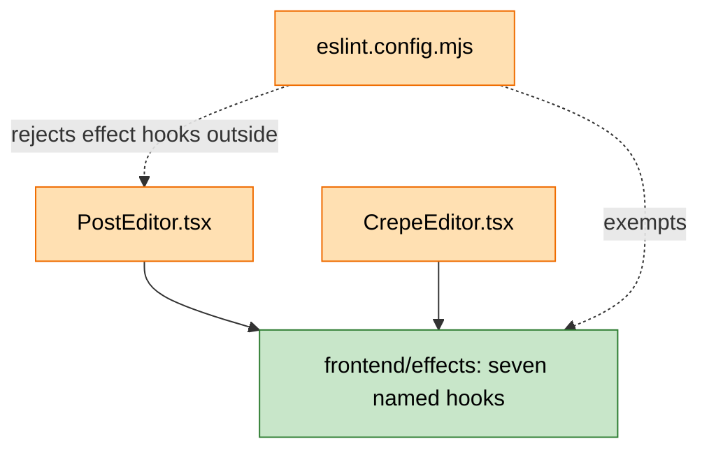

# No `useEffect` Implementation Plan

> **For agentic workers:** use `superpowers:executing-plans` (inline). Steps use checkbox syntax; flip each box when the step is done.

**Status:** proposed. Spec: `docs/specs/2026-11-22-no-use-effect.md`. Ticket: BLOG-61. Run it after BLOG-39 merged and before BLOG-40 (all three edit `PostEditor.tsx`, never in parallel). The edits below name each effect by what it does; if BLOG-39 moved the surrounding code, apply the same replacement to the same effect and re-run the tests.

## TL;DR

- Ships one PR: seven small hooks in `frontend/effects/` with tests, the eleven uses in six files moved onto them, an ESLint rule that rejects every effect hook outside that folder, a guard against switching the rule off, and the cheat sheet in `docs/development.md`.
- Behaviour is unchanged, the editor autosave life cycle included. Proof: the 314 existing frontend tests and the 19 browser tests stay green on the migrated code; the prototype of this plan passed both (346 frontend tests with the new ones, 19 browser tests, lint, types, build).
- No new dependency, no workflow change, no new Azure resource. The PR touches no `.github` file and changes behaviour-free code, but it is a feature-class PR: the owner gets the local-run-or-merge choice.
- Cost: none.
- The long effect comments in `PostEditor.tsx`, `CrepeEditor.tsx` and `use-check.ts` go in a separate cleanup commit (the floor and the content rule apply to touched files).

## Cost estimate

None.

## Architecture

Source: `docs/plans/diagrams/2026-11-22-no-use-effect.mmd` (green new, amber changed, grey unchanged). The inline copy below shows the core only.



## Global constraints

- Edit files only with Edit and Write. No comment in any new file (the `// @vitest-environment node` directive line of a test file is not a comment).
- Commit messages: two lines at most, no trailer. Branch from `main`.
- Run frontend commands from `frontend/` (`npx vitest run ...`, `npm run lint`, `npx tsc --noEmit`), backend commands from `backend/`.
- Comment standard for the touched files: separate cleanup commit; the floor allows one comment line per 40 code lines (at least 2) and `PostEditor.tsx`, `CrepeEditor.tsx` and `use-check.ts` are above it today; what stays is listed as `Comments: <path>: <reason>` in the PR description.

## Review focus

- A stale answer is dropped when the key changes or the owner unmounts (`useRequest`), and the autosave controller is closed before a new one starts with `alive()` false from the cleanup on (`useController`).
- The editor is created once per mount and `initial` is read once (`useWidget`); the latest `onChange` and `onReady` are used (`useLatest`).
- No effect hook is imported anywhere outside `frontend/effects/`, tests included, and a directive cannot switch the rule off.

---

### Task 0: Worktree and baseline

- [ ] **Step 1:** `git -C Personal-Blog-Studio worktree add ../.worktrees/Personal-Blog-Studio-noeffects -b feat/no-use-effect origin/main`.
- [ ] **Step 2:** `cd .worktrees/Personal-Blog-Studio-noeffects/frontend && npm ci --ignore-scripts && npx vitest run && npm run lint`. Expected: all pass. Record the test count.
- [ ] **Step 3:** comment BLOG-61 "Starting code PR".

### Task 1: The hooks

**Files:** create `frontend/effects/effects.test.tsx` and the seven hooks; modify `frontend/vitest.config.ts`.

- [ ] **Step 1:** create `frontend/effects/effects.test.tsx`:

```tsx
import { act, cleanup, render, renderHook } from "@testing-library/react";
import { afterEach, describe, expect, it, vi } from "vitest";

import { useController } from "./useController";
import { useFocusReturn } from "./useFocusReturn";
import { useInterval } from "./useInterval";
import { useLatest } from "./useLatest";
import { useRequest } from "./useRequest";
import { useWidget } from "./useWidget";
import { useWindowListener } from "./useWindowListener";

afterEach(() => {
  cleanup();
  vi.useRealTimers();
});

describe("useLatest", () => {
  it("holds the value of the latest render", () => {
    const { result, rerender } = renderHook(({ value }) => useLatest(value), {
      initialProps: { value: 1 },
    });
    expect(result.current.current).toBe(1);
    rerender({ value: 2 });
    expect(result.current.current).toBe(2);
  });
});

describe("useWindowListener", () => {
  it("calls the latest handler while enabled and stops when disabled", () => {
    const first = vi.fn();
    const second = vi.fn();
    const { rerender } = renderHook(
      ({ handler, enabled }) => useWindowListener("beforeunload", handler, enabled),
      { initialProps: { handler: first, enabled: true } },
    );
    rerender({ handler: second, enabled: true });
    window.dispatchEvent(new Event("beforeunload"));
    expect(first).not.toHaveBeenCalled();
    expect(second).toHaveBeenCalledTimes(1);
    rerender({ handler: second, enabled: false });
    window.dispatchEvent(new Event("beforeunload"));
    expect(second).toHaveBeenCalledTimes(1);
  });

  it("removes the listener on unmount", () => {
    const handler = vi.fn();
    const { unmount } = renderHook(() => useWindowListener("beforeunload", handler));
    unmount();
    window.dispatchEvent(new Event("beforeunload"));
    expect(handler).not.toHaveBeenCalled();
  });
});

describe("useInterval", () => {
  it("runs the latest function on every tick, pauses on null and stops on unmount", () => {
    vi.useFakeTimers();
    const first = vi.fn();
    const second = vi.fn();
    const { rerender, unmount } = renderHook(({ fn, ms }) => useInterval(fn, ms), {
      initialProps: { fn: first, ms: 1000 as number | null },
    });
    rerender({ fn: second, ms: 1000 });
    vi.advanceTimersByTime(2000);
    expect(first).not.toHaveBeenCalled();
    expect(second).toHaveBeenCalledTimes(2);
    rerender({ fn: second, ms: null });
    vi.advanceTimersByTime(5000);
    expect(second).toHaveBeenCalledTimes(2);
    rerender({ fn: second, ms: 1000 });
    unmount();
    vi.advanceTimersByTime(5000);
    expect(second).toHaveBeenCalledTimes(2);
  });
});

describe("useRequest", () => {
  function deferred<T>() {
    let resolve!: (value: T) => void;
    let reject!: (error: unknown) => void;
    const promise = new Promise<T>((res, rej) => {
      resolve = res;
      reject = rej;
    });
    return { promise, resolve, reject };
  }

  it("hands the result to the latest callback", async () => {
    const onResult = vi.fn();
    const { rerender } = renderHook(
      ({ cb }) => useRequest(() => Promise.resolve("a"), "k", { onResult: cb }),
      { initialProps: { cb: vi.fn() } },
    );
    rerender({ cb: onResult });
    await act(async () => {});
    expect(onResult).toHaveBeenCalledWith("a");
  });

  it("drops the answer of a request whose key has changed", async () => {
    const slow = deferred<string>();
    const onResult = vi.fn();
    const { rerender } = renderHook(
      ({ key }) =>
        useRequest(() => (key === "old" ? slow.promise : Promise.resolve("new")), key, {
          onResult,
        }),
      { initialProps: { key: "old" } },
    );
    rerender({ key: "new" });
    await act(async () => {});
    slow.resolve("stale");
    await act(async () => {});
    expect(onResult.mock.calls).toEqual([["new"]]);
  });

  it("drops the answer of a request whose owner unmounted", async () => {
    const slow = deferred<string>();
    const onResult = vi.fn();
    const { unmount } = renderHook(() => useRequest(() => slow.promise, "k", { onResult }));
    unmount();
    slow.resolve("late");
    await act(async () => {});
    expect(onResult).not.toHaveBeenCalled();
  });

  it("does not report a late failure of a request whose key has changed", async () => {
    const slow = deferred<string>();
    const onError = vi.fn();
    const { rerender } = renderHook(
      ({ key }) =>
        useRequest(() => (key === "old" ? slow.promise : Promise.resolve("new")), key, {
          onResult: vi.fn(),
          onError,
        }),
      { initialProps: { key: "old" } },
    );
    rerender({ key: "new" });
    await act(async () => {});
    slow.reject(new Error("late"));
    await act(async () => {});
    expect(onError).not.toHaveBeenCalled();
  });

  it("reports an error only while the request is current and skips a disabled one", async () => {
    const onError = vi.fn();
    const request = vi.fn(() => Promise.reject(new Error("no")));
    const { rerender } = renderHook(
      ({ enabled }) => useRequest(request, "k", { onResult: vi.fn(), onError, enabled }),
      { initialProps: { enabled: false } },
    );
    await act(async () => {});
    expect(request).not.toHaveBeenCalled();
    rerender({ enabled: true });
    await act(async () => {});
    expect(onError).toHaveBeenCalledTimes(1);
  });
});

describe("useController", () => {
  it("creates one controller per key, closes it on a new key and on unmount", () => {
    const closes: string[] = [];
    const seen: Array<() => boolean> = [];
    const create = (name: string) => (alive: () => boolean) => {
      seen.push(alive);
      return { name, close: () => closes.push(name) };
    };
    const { result, rerender, unmount } = renderHook(
      ({ key }) => useController(create(key), key),
      { initialProps: { key: "a" } },
    );
    expect(result.current.current?.name).toBe("a");
    rerender({ key: "a" });
    expect(closes).toEqual([]);
    rerender({ key: "b" });
    expect(closes).toEqual(["a"]);
    expect(seen[0]()).toBe(false);
    expect(seen[1]()).toBe(true);
    expect(result.current.current?.name).toBe("b");
    unmount();
    expect(closes).toEqual(["a", "b"]);
    expect(seen[1]()).toBe(false);
  });
});

describe("useWidget", () => {
  it("mounts once when the node attaches and cleans up when it detaches", () => {
    const cleanups = vi.fn();
    const mount = vi.fn<(root: HTMLDivElement) => () => void>(() => cleanups);
    function Host() {
      const ref = useWidget<HTMLDivElement>(mount);
      return <div ref={ref} />;
    }
    const { rerender, unmount } = render(<Host />);
    rerender(<Host />);
    expect(mount).toHaveBeenCalledTimes(1);
    expect(mount.mock.calls[0][0]).toBeInstanceOf(HTMLDivElement);
    expect(cleanups).not.toHaveBeenCalled();
    unmount();
    expect(cleanups).toHaveBeenCalledTimes(1);
  });
});

describe("useFocusReturn", () => {
  it("focuses the target and gives the focus back on unmount", () => {
    const opener = document.createElement("button");
    document.body.append(opener);
    opener.focus();
    function Panel() {
      const target = { current: null as HTMLButtonElement | null };
      const ref = (node: HTMLButtonElement | null) => {
        target.current = node;
      };
      useFocusReturn(target);
      return <button ref={ref}>ok</button>;
    }
    const { unmount, getByText } = render(<Panel />);
    expect(document.activeElement).toBe(getByText("ok"));
    unmount();
    expect(document.activeElement).toBe(opener);
    opener.remove();
  });
});
```

- [ ] **Step 2:** in `frontend/vitest.config.ts` add `"effects/**/*.test.{ts,tsx}",` after the `"components/**/*.test.{ts,tsx}",` line of `include`. Run `cd frontend && npx vitest run effects`. Expected: the test file fails to import `./useController` (red).
- [ ] **Step 3:** create the seven hooks:

`frontend/effects/useLatest.ts`:

```ts
import { useEffect, useRef, type RefObject } from "react";

export function useLatest<T>(value: T): RefObject<T> {
  const ref = useRef(value);
  useEffect(() => {
    ref.current = value;
  });
  return ref;
}
```

`frontend/effects/useWindowListener.ts`:

```ts
import { useEffect } from "react";

import { useLatest } from "./useLatest";

export function useWindowListener<K extends keyof WindowEventMap>(
  type: K,
  handler: (event: WindowEventMap[K]) => void,
  enabled = true,
) {
  const latest = useLatest(handler);
  useEffect(() => {
    if (!enabled) return;
    const listener = (event: WindowEventMap[K]) => latest.current(event);
    window.addEventListener(type, listener);
    return () => window.removeEventListener(type, listener);
  }, [type, enabled, latest]);
}
```

`frontend/effects/useInterval.ts`:

```ts
import { useEffect } from "react";

import { useLatest } from "./useLatest";

export function useInterval(fn: () => void, ms: number | null) {
  const latest = useLatest(fn);
  useEffect(() => {
    if (ms === null) return;
    const timer = setInterval(() => latest.current(), ms);
    return () => clearInterval(timer);
  }, [ms, latest]);
}
```

`frontend/effects/useRequest.ts`:

```ts
import { useEffect } from "react";

import { useLatest } from "./useLatest";

type Callbacks<T> = {
  onResult: (value: T) => void;
  onError?: (error: unknown) => void;
  enabled?: boolean;
};

export function useRequest<T>(
  request: () => Promise<T>,
  key: unknown,
  { onResult, onError, enabled = true }: Callbacks<T>,
) {
  const latest = useLatest({ request, onResult, onError });
  useEffect(() => {
    if (!enabled) return;
    let alive = true;
    latest.current
      .request()
      .then((value) => {
        if (alive) latest.current.onResult(value);
      })
      .catch((error: unknown) => {
        if (alive) latest.current.onError?.(error);
      });
    return () => {
      alive = false;
    };
  }, [enabled, key, latest]);
}
```

`frontend/effects/useController.ts`:

```ts
import { useEffect, useRef, type RefObject } from "react";

import { useLatest } from "./useLatest";

export function useController<T extends { close: () => unknown }>(
  create: (alive: () => boolean) => T,
  key: unknown,
): RefObject<T | null> {
  const controller = useRef<T | null>(null);
  const latest = useLatest(create);
  useEffect(() => {
    let alive = true;
    const created = latest.current(() => alive);
    controller.current = created;
    return () => {
      alive = false;
      void created.close();
    };
  }, [key, latest]);
  return controller;
}
```

`frontend/effects/useWidget.ts`:

```ts
import { useCallback, type RefCallback } from "react";

import { useLatest } from "./useLatest";

export function useWidget<E extends HTMLElement>(
  mount: (root: E) => () => void,
): RefCallback<E> {
  const latest = useLatest(mount);
  return useCallback((node: E | null) => (node ? latest.current(node) : undefined), [latest]);
}
```

`frontend/effects/useFocusReturn.ts`:

```ts
import { useEffect, type RefObject } from "react";

export function useFocusReturn(target: RefObject<HTMLElement | null>) {
  useEffect(() => {
    const before = document.activeElement as HTMLElement | null;
    target.current?.focus();
    return () => before?.focus();
  }, [target]);
}
```

- [ ] **Step 4:** `cd frontend && npx vitest run effects`. Expected: `12 passed`.
- [ ] **Step 5:** mutation checks, each must turn at least one test red, then restore: (a) in `useRequest` delete `if (alive)` before `onResult`; (b) in `useController` delete `alive = false;`; (c) in `useInterval` replace `ms === null` by `false`; (d) in `useWidget` return `undefined` instead of the mount result; (e) in `useWindowListener` delete the `removeEventListener`; (f) in `useRequest` delete `if (alive)` before `onError`.
- [ ] **Step 6:** `git add frontend/effects frontend/vitest.config.ts && git commit -m "Add the named effect hooks"`.

### Task 2: Move the use sites

**Files:** modify `frontend/components/useModal.ts`, `frontend/lib/use-check.ts`, `frontend/components/Posts.tsx`, `frontend/components/PostEditor.tsx`, `frontend/components/CrepeEditor.tsx`, `frontend/components/PostEditor.test.tsx`. The existing tests of these files are the safety net: run `npx vitest run` after each file; it must stay green.

- [ ] **Step 1:** `useModal.ts`: replace the first import line and the focus effect:

```ts
import { useRef, type KeyboardEvent, type RefObject } from "react";

import { useFocusReturn } from "../effects/useFocusReturn";

export function useModal(onCancel: () => void, first: RefObject<HTMLElement | null>) {
  const panel = useRef<HTMLDivElement>(null);
  useFocusReturn(first);
```

(the old `useEffect` block with `before` and `first.current?.focus()` is deleted).
- [ ] **Step 2:** `lib/use-check.ts`: replace `import { useEffect, useRef, useState } from "react";` with `import { useMemo, useState } from "react";` followed by the two lines `import { useLatest } from "../effects/useLatest";` and `import { useRequest } from "../effects/useRequest";` (before the `./steps` import); replace the `latest` ref, its effect and the request effect with:

```ts
  const latest = useLatest(current);
  const key = useMemo(() => ({ api, id, saves }), [api, id, saves]);
  useRequest(() => api.checkPost(id), key, {
    enabled: ready,
    onResult: (result) => {
      const now = latest.current();
      if (result.bodyEtag !== now.bodyEtag || result.metaEtag !== now.metaEtag) return;
      setAnswer({ at: saves, state: { phase: "done", problems: result.problems } });
    },
    onError: () => setAnswer({ at: saves, state: { phase: "failed" } }),
  });
```

- [ ] **Step 3:** `components/Posts.tsx`: replace `import { useEffect, useMemo, useState } from "react";` with `import { useMemo, useState } from "react";`, add `import { useRequest } from "../effects/useRequest";` before the `live-status` import, and replace the list-loading effect with:

```tsx
  useRequest(() => client.listPosts(), client, {
    onResult: setItems,
    onError: (e) => setLoadError(e instanceof ApiError ? e : new ApiError(0, null)),
  });
```

- [ ] **Step 4:** `components/PostEditor.tsx`: in the react import drop `useEffect`; add the four imports `useController` (`../effects/useController`), `useInterval`, `useRequest`, `useWindowListener` (same folder) before `../lib/autosave`; delete the line `const autosave = useRef<ReturnType<typeof createAutosave> | null>(null);`; replace the load effect, the clock effect and the autosave effect (three consecutive `useEffect` blocks) with:

```tsx
  const loadKey = useMemo(() => ({ client, id, reloadKey }), [client, id, reloadKey]);

  useRequest(() => client.getPost(id), loadKey, {
    onResult: adoptLoaded,
    onError: (e) => setLoadError(toApiError(e)),
  });

  useInterval(() => setNow(Date.now()), 30_000);

  const autosave = useController(
    (alive) =>
      createAutosave({
        delayMs: 1500,
        onStatus: (s) => {
          if (alive()) setStatus(s);
        },
        save: async (text) => {
          try {
            const next = await client.saveBody(id, text, bodyEtag.current);
            if (alive()) {
              bodyEtag.current = next.bodyEtag;
              setSaved((previous) =>
                previous === null ? previous : { ...previous, body: text, bodyEtag: next.bodyEtag, updatedAt: next.updatedAt },
              );
              setBodyError(null);
              setSaves((n) => n + 1);
            }
          } catch (e) {
            if (alive()) setBodyError(toApiError(e));
            throw e;
          }
        },
      }),
    loadKey,
  );
```

and replace the `beforeunload` effect with:

```tsx
  const unsaved =
    detailsUnsaved || status === "pending" || status === "saving" || status === "error" || status === "conflict";
  useWindowListener("beforeunload", (event) => event.preventDefault(), unsaved);
```

(`autosave.current?.flush()` and `autosave.current?.push(text)` stay as they are.)
- [ ] **Step 5:** `components/CrepeEditor.tsx`: replace `import { useEffect, useRef } from "react";` with `import { useLatest } from "../effects/useLatest";` and `import { useWidget } from "../effects/useWidget";`; replace the head of the component through the line `const crepe = new Crepe({` with:

```tsx
export function CrepeEditor({ initial, onChange, onReady }: Props) {
  const latestOnChange = useLatest(onChange);
  const latestOnReady = useLatest(onReady);

  const host = useWidget<HTMLDivElement>((root) => {
    const crepe = new Crepe({
```

and replace the tail (`return () => { ... };` of the old effect, the two comment lines, the `eslint-disable-next-line` line and `}, []);`) with:

```tsx
    return () => {
      alive = false;
      latestOnReady.current?.(null);
      void crepe.destroy();
    };
  });
```

(`return <div ref={host} className="crepe-host" />;` stays.)
- [ ] **Step 6:** `components/PostEditor.test.tsx`: replace `import { useEffect, type ReactElement } from "react";` with `import { type ReactElement } from "react";` and a blank line and `import { useWidget } from "../effects/useWidget";`; replace the stand-in's effect and return with:

```tsx
    const ref = useWidget<HTMLTextAreaElement>(() => {
      const timer = setTimeout(() => onReady?.({ jumpToLine }), editorDelay.ms);
      return () => {
        clearTimeout(timer);
        onReady?.(null);
      };
    });
    return (
      <textarea
        ref={ref}
        aria-label="Body (Markdown)"
        defaultValue={initial}
        onChange={(e) => onChange(e.target.value)}
      />
    );
```

(The stand-in now mounts once, like the real editor; it no longer re-runs when `onReady` changes.)
- [ ] **Step 7:** `cd frontend && npx tsc --noEmit && npx vitest run`. Expected: no type errors; every test passes (the 314 old ones and the 10 new ones).
- [ ] **Step 8:** `grep -rnE "useEffect|useLayoutEffect|useInsertionEffect" frontend --include='*.ts' --include='*.tsx' --exclude-dir=node_modules --exclude-dir=.next -l`. Expected: only files under `frontend/effects/` (and `effects.test.tsx` names them in no import).
- [ ] **Step 9:** `git add frontend && git commit -m "Move the effect uses into the named hooks"`.

### Task 3: The rule

**Files:** create `frontend/tests/no-effects.test.ts`; modify `frontend/eslint.config.mjs`.

- [ ] **Step 1:** create `frontend/tests/no-effects.test.ts`:

```ts
// @vitest-environment node
import { readdirSync } from "node:fs";
import { join, relative } from "node:path";

import { ESLint } from "eslint";
import { describe, expect, it } from "vitest";

const SNIPPETS = {
  "a named import": 'import { useEffect } from "react";\nuseEffect(() => {}, []);\n',
  "a renamed import": 'import { useEffect as run } from "react";\nrun(() => {}, []);\n',
  "a member call": 'import React from "react";\nReact.useEffect(() => {}, []);\n',
  "a computed member call": 'import React from "react";\nReact["useLayoutEffect"](() => {}, []);\n',
  "a destructured binding": 'import React from "react";\nconst { useEffect } = React;\nuseEffect(() => {}, []);\n',
  "a renamed destructured binding": 'import React from "react";\nconst { useEffect: run } = React;\nrun(() => {}, []);\n',
  "useLayoutEffect": 'import { useLayoutEffect } from "react";\nuseLayoutEffect(() => {}, []);\n',
  "useInsertionEffect": 'import { useInsertionEffect } from "react";\nuseInsertionEffect(() => {}, []);\n',
};

const RE_EXPORTS = {
  "a named re-export": 'export { useEffect } from "react";\n',
  "a star re-export": 'export * from "react";\n',
};

const eslint = new ESLint({ cwd: process.cwd() });

async function ruleIds(source: string, filePath: string): Promise<string[]> {
  const [result] = await eslint.lintText(source, { filePath });
  return result.messages.map((message) => message.ruleId ?? "");
}

function restricted(ids: string[]): boolean {
  return ids.includes("no-restricted-imports") || ids.includes("no-restricted-syntax");
}

function sources(directory: string): string[] {
  return readdirSync(directory, { withFileTypes: true }).flatMap((entry) => {
    if (["node_modules", ".next", "effects"].includes(entry.name)) return [];
    const path = join(directory, entry.name);
    if (entry.isDirectory()) return sources(path);
    return /\.(ts|tsx)$/.test(entry.name) ? [path] : [];
  });
}

describe("the no-effects rule", () => {
  it.each(Object.entries(SNIPPETS))("rejects %s outside the effects folder", async (_name, source) => {
    expect(restricted(await ruleIds(source, "components/Sample.tsx"))).toBe(true);
  });

  it.each(Object.entries(SNIPPETS))("allows %s inside the effects folder", async (_name, source) => {
    expect(restricted(await ruleIds(source, "effects/useSample.ts"))).toBe(false);
  });

  it.each(Object.entries(RE_EXPORTS))("rejects %s inside the effects folder", async (_name, source) => {
    expect(restricted(await ruleIds(source, "effects/useSample.ts"))).toBe(true);
  });

  it("does not exempt tests or a nested folder of the same name", async () => {
    const source = SNIPPETS["a named import"];
    expect(restricted(await ruleIds(source, "components/Sample.test.tsx"))).toBe(true);
    expect(restricted(await ruleIds(source, "components/effects/useSample.ts"))).toBe(true);
  });

  it("applies both rules at error level to every source file outside the effects folder", async () => {
    const files = sources(process.cwd()).map((path) => relative(process.cwd(), path));
    expect(files.length).toBeGreaterThan(20);
    const ignored: string[] = [];
    for (const file of files) {
      const config = await eslint.calculateConfigForFile(file);
      if (config === undefined) {
        ignored.push(file);
        continue;
      }
      expect(config.rules?.["no-restricted-imports"]?.[0], file).toBe(2);
      expect(config.rules?.["no-restricted-syntax"]?.[0], file).toBe(2);
    }
    expect(ignored).toEqual(["next-env.d.ts"]);
  });
});
```

- [ ] **Step 2:** `cd frontend && npx vitest run tests/no-effects.test.ts`. Expected: the rejects tests, the re-export tests, the nested-folder test and the walk test fail (red); the allows tests pass.
- [ ] **Step 3:** replace the whole of `frontend/eslint.config.mjs` with:

```js
import { defineConfig, globalIgnores } from "eslint/config";
import nextVitals from "eslint-config-next/core-web-vitals";
import nextTs from "eslint-config-next/typescript";

const EFFECTS = ["useEffect", "useLayoutEffect", "useInsertionEffect"];
const NO_EFFECTS =
  "No effects in components: use a hook from frontend/effects, or derive the value, use an event handler or a key.";
const NO_REEXPORT = "The effects folder must not re-export from react: export a named hook instead.";

const eslintConfig = defineConfig([
  ...nextVitals,
  ...nextTs,
  {
    rules: {
      "no-warning-comments": [
        "error",
        { terms: ["todo", "fixme", "xxx", "hack"], location: "anywhere" },
      ],
      "no-restricted-imports": [
        "error",
        { paths: [{ name: "react", importNames: EFFECTS, message: NO_EFFECTS }] },
      ],
      "no-restricted-syntax": [
        "error",
        {
          selector: "MemberExpression[property.name=/^use(Layout|Insertion)?Effect$/]",
          message: NO_EFFECTS,
        },
        {
          selector: "MemberExpression[property.value=/^use(Layout|Insertion)?Effect$/]",
          message: NO_EFFECTS,
        },
        {
          selector: "ObjectPattern > Property[key.name=/^use(Layout|Insertion)?Effect$/]",
          message: NO_EFFECTS,
        },
        {
          selector: "ObjectPattern > Property[key.value=/^use(Layout|Insertion)?Effect$/]",
          message: NO_EFFECTS,
        },
      ],
    },
  },
  {
    files: ["effects/**"],
    rules: {
      "no-restricted-imports": "off",
      "no-restricted-syntax": [
        "error",
        { selector: 'ExportNamedDeclaration[source.value="react"]', message: NO_REEXPORT },
        { selector: 'ExportAllDeclaration[source.value="react"]', message: NO_REEXPORT },
        {
          selector: "ExportSpecifier[local.name=/^use(Layout|Insertion)?Effect$/]",
          message: NO_REEXPORT,
        },
      ],
    },
  },
  globalIgnores([".next/**", "out/**", "build/**", "next-env.d.ts"]),
]);

export default eslintConfig;
```

- [ ] **Step 4:** `cd frontend && npx vitest run tests/no-effects.test.ts tests/lint-settings.test.ts && npm run lint`. Expected: `28 passed` (20 here, 8 in `lint-settings.test.ts`); lint prints no error or warning.
- [ ] **Step 5:** mutation checks, each must turn a test red, then restore: (a) remove `"useInsertionEffect"` from `EFFECTS`; (b) change `files: ["effects/**"]` to `files: ["effects2/**"]`; (c) delete the second `no-restricted-syntax` selector; (d) delete the two `ObjectPattern` selectors; (e) delete the three `export` selectors of the folder block.
- [ ] **Step 6:** `git add frontend && git commit -m "Reject effect hooks outside the effects folder"`.

### Task 4: The guard

**Files:** modify `scripts/rules/comment-content-patterns.txt`, `backend/tests/test_comment_content.py`.

- [ ] **Step 1:** in `backend/tests/test_comment_content.py`, in the parameter list of `test_switching_off_a_comment_lint_rule_or_all_rules_fails` add:

```python
        ("web/a.ts", "// eslint-disable-next-line no-restricted-imports\nexport {};\n"),
        ("web/a.ts", "/* eslint-disable no-restricted-syntax */\nexport {};\n"),
        ("web/a.ts", '/* eslint no-restricted-syntax: "off" */\nexport {};\n'),
        ("web/a.ts", "/* eslint no-restricted-imports: 0 */\nexport {};\n"),
        ("web/a.ts", "/* eslint-disable\nno-restricted-imports */\nexport {};\n"),
```

- [ ] **Step 2:** `cd backend && PYTHONDONTWRITEBYTECODE=1 poetry run pytest tests/test_comment_content.py -q`. Expected: 5 failures (red).
- [ ] **Step 3:** append two rows to `scripts/rules/comment-content-patterns.txt` (tab-separated, same four columns as the other rows; the first starts with `(?s)` so a directive written over two lines is matched, as the existing guard rows do after the separate follow-up PR):

```
disable	ts	(?s)eslint-disable.*\bno-restricted-(imports|syntax)\b	switches off the rule on effect hooks: delete it
disable	ts	eslint\s+[^*]*\bno-restricted-(imports|syntax)\b	changes the rule on effect hooks: delete it
```

- [ ] **Step 4:** rerun the Step 2 command. Expected: all pass. Mutation: delete the first new row, confirm the first, second and fifth new parameter cases go red, restore it; then remove `(?s)` from it and confirm the fifth case goes red.
- [ ] **Step 5:** `git add scripts/rules backend/tests && git commit -m "Fail a directive that switches off the effect rule"`.

### Task 5: Docs

**Files:** create `docs/development.md`; modify `AGENTS.md`.

- [ ] **Step 1:** create `docs/development.md`:

```markdown
# Development notes

## Effects

Components do not call `useEffect`, `useLayoutEffect` or `useInsertionEffect`: ESLint rejects the import and `React.useEffect`. The one exempt folder is `frontend/effects/`; its hooks are named for what they synchronise with. Add a hook there only for a new thing outside React, with its test.

| You wanted an effect to | Do this |
|---|---|
| compute something from props or state | compute it during render (`useMemo` only if measured slow) |
| react to a user action | do it in the event handler |
| reset state when an id changes | give the component `key={id}` |
| tell the parent about a change | call the parent's callback in the same handler that changed the state |
| keep the latest callback for a listener or timer | `useLatest` |
| focus an element when it appears, and give the focus back | `useFocusReturn`, or focus in the handler that showed it |
| listen to the window | `useWindowListener` |
| run a timer | `useInterval` |
| load data when something shows or changes | `useRequest` |
| own an object with a close step (the autosave controller) | `useController` |
| mount a third-party widget on a DOM node | `useWidget` |
| subscribe to a store | `useSyncExternalStore` |
```

- [ ] **Step 2:** in `AGENTS.md`, in the Gotchas list add one bullet after the bullet that starts "Shared studio components live in": ``- No component calls an effect hook: the ESLint rule rejects it outside `frontend/effects/` (named hooks, one per thing outside React) and the `comment-content` rule fails a directive that switches the rule off; `docs/development.md` has the cheat sheet of what to write instead.``
- [ ] **Step 3:** `bash scripts/rules/run.sh`. Expected: six ok lines.
- [ ] **Step 4:** `git add docs AGENTS.md && git commit -m "Document the effects folder"`.

### Task 6: Verify, clean up, hand over

- [ ] **Step 1:** `cd frontend && npm run lint && npx tsc --noEmit && npx vitest run && npm run build`. Expected: all green. Then `npm run e2e:install` (once) and `E2E_SKIP_BUILD=1 npm run e2e` (ports 3200, 8200, 8201 and 10000 to 10002 free, `poetry install` done in `backend/`). Expected: `19 passed`; no server left listening (`lsof -nP -iTCP:3200 -sTCP:LISTEN` prints nothing).
- [ ] **Step 2:** cleanup commit under the comment standard: in `PostEditor.tsx`, `CrepeEditor.tsx` and `use-check.ts` delete every comment that restates the code or narrates a change; keep at most one line per real constraint within the floor (one line per 40 code lines, at least 2); in `CrepeEditor.tsx` the note about the theme's `latex.css` import is such a constraint; separate commit "Delete comments that restate the code in the touched files"; list what stays as `Comments: <path>: <reason>` lines in the PR description.
- [ ] **Step 3:** run `auditing-branch-changes` (subagent) before `gh pr create`; fix findings.
- [ ] **Step 4:** `git fetch && git merge origin/main`, push, `gh pr create --draft` (body: the before and after list of the eleven uses, what was run, the `Comments:` lines), set `Status: done (PR #n)` in the spec and this plan, push.
- [ ] **Step 5:** wait with the bare `gh pr checks <n> -R Fredheda/Personal-Blog-Studio --watch --interval 60 --fail-fast` (or `gh run watch <id> ... --interval 60`) as a background task; when the draft's CI finished, `gh pr ready`, wait again, confirm every job ran, read the review `Verdict:` once, hand the URL to the coordinator. This PR changes code paths of the editor: the owner gets the local-run-or-merge choice.
- [ ] **Step 6:** after merge: remove the worktree (no `--force`), delete the branch, check the remote branch is gone, `git pull --ff-only` in the main checkout, BLOG-61 to Done with what shipped.
