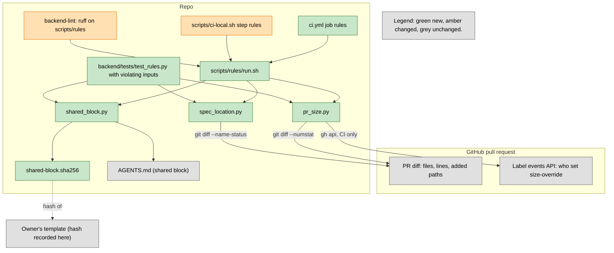

# BLOG-59: the `rules` CI job, implementation plan

> **For agentic workers:** REQUIRED SUB-SKILL: Use `superpowers:subagent-driven-development` or `superpowers:executing-plans`. Steps use checkbox (`- [ ]`) syntax; flip each box when done.

**Status:** proposed.
**Spec:** `docs/specs/2026-11-22-rules-ci-job.md`. Ticket BLOG-59, non-trivial; this plan and the spec merge as a docs-only PR first, the code PR follows from `main`.

**Goal:** `scripts/rules/run.sh` runs `pr-size`, `spec-location` and `shared-block`, locally (`scripts/ci-local.sh`) and in the CI job `rules`; each rule was red on a violating input before it existed.

**Architecture:** one small Python module per rule (standard library only) with a pure `check` function and a `main`; `run.sh` runs the three `main`s; pytest tests with violating inputs sit in `backend/tests/test_rules.py` and run in the existing `backend-test` job; the `rules` job adds the full history and the label-event call that only CI can make.

**Tech Stack:** Python 3.13 stdlib, git, `gh` (CI runners carry it), bash, pytest, ruff, pyright.

## TL;DR

- Ships: `scripts/rules/` (`run.sh`, `pr_size.py`, `spec_location.py`, `shared_block.py`, `shared-block.sha256`), `backend/tests/test_rules.py` and fixtures, CI job `rules`, a `rules` step in `ci-local.sh`, `ruff` and `pyright` also covering `scripts/rules`, one line each in `AGENTS.md` for the job and the lint line.
- The scripts are byte-identical across repos (W3 compares them by hash); the one repo-specific part is the data file `pr-size-generated.txt`. The `size-override` check stops Devin and other bot accounts, not a local session that runs `gh` as the owner (the owner's hook closes that side).
- One code PR after the docs PR, about 16 files, tests first. Owner merges (`.github/`). No dependency, no cost.
- After the job has run once on `main`, the owner decides whether `rules` becomes a required check in the `main` ruleset (not part of this work).
- The comment count of every edited file does not grow; the new files carry no comments.

## Cost

None. Runs about 20 seconds per PR, one GitHub API call.

## Architecture

Diagram source: `docs/plans/diagrams/2026-11-22-rules-ci-job.mmd` (green new, amber changed, grey unchanged):



## Global constraints

- Worktree `.worktrees/Personal-Blog-Studio-rules`, branch `feat/rules-ci-job`, from `origin/main` after the docs PR merged. Never in parallel with another `ci.yml` or `claude-review.yml` change.
- No comments in new code. Tool directives (`# noqa`) are allowed.
- Rule output: one line per rule, `<name>: ok` or `<name>: FAIL <reason>`; extra lines only on a failure.
- Edit and Write only. Commits at most 2 lines, no trailer.

## File map

| File | Change |
|---|---|
| `scripts/rules/common.py` | new: `git()` and `merge_base()` shared by the rules |
| `scripts/rules/shared_block.py`, `shared-block.sha256` | new |
| `scripts/rules/pr_size.py`, `pr-size-generated.txt` | new; the data file is the only repo-specific part |
| `scripts/rules/spec_location.py` | new |
| `scripts/rules/run.sh` | new (mode 755) |
| `backend/tests/test_rules.py` | new |
| `backend/tests/fixtures/rules/agents-block-good.md`, `agents-block-edited.md`, `agents-no-markers.md` | new |
| `backend/pyproject.toml` | pytest `pythonpath`, pyright `extraPaths` and `include` for `scripts/rules` |
| `scripts/ci-local.sh` | `rules` step; ruff on `scripts/rules` in the `backend-lint` step |
| `.github/workflows/ci.yml` | job `rules`; ruff on `scripts/rules` in `backend-lint` |
| `AGENTS.md` | the CI sentence lists `rules`; one line on `scripts/rules/` |

---

### Task 0: worktree

- [ ] **Step 1:** `git -C Personal-Blog-Studio worktree add ../.worktrees/Personal-Blog-Studio-rules -b feat/rules-ci-job origin/main`, then `cd backend && poetry install`. Expected: installs.
- [ ] **Step 2:** `cd backend && poetry run pytest -q`. Expected: all pass (baseline).

### Task 1: rule `shared-block`

**Files:** create `backend/tests/fixtures/rules/agents-block-good.md`, `agents-block-edited.md`, `agents-no-markers.md`, `backend/tests/test_rules.py`, `scripts/rules/shared_block.py`, `scripts/rules/shared-block.sha256`.

- [ ] **Step 1: fixtures.** `agents-block-good.md`:

```markdown
# AGENTS.md

Repo facts.

<!-- shared:start -->
## Shared rules

One rule.
<!-- shared:end -->
```

`agents-block-edited.md` is the same file with the line `One rule, edited.` instead of `One rule.`. `agents-no-markers.md`:

```markdown
# AGENTS.md

## Shared rules

One rule.
```

- [ ] **Step 2: failing test.** Create `backend/tests/test_rules.py` with this head and the shared-block tests (later tasks append):

All imports stay in the import block at the top of the file, sorted; later tasks add their lines there, never mid-file. `scripts/rules` is on pytest's path (`pythonpath` in `backend/pyproject.toml`, Task 5 Step 1; add it now with the first test).

```python
from pathlib import Path

import shared_block

RULES = Path(__file__).resolve().parents[2] / "scripts" / "rules"
FIXTURES = Path(__file__).parent / "fixtures" / "rules"
GOOD = (FIXTURES / "agents-block-good.md").read_text()
RECORDED = shared_block.digest(shared_block.extract(GOOD))


def test_the_block_runs_from_the_start_marker_to_the_end_marker():
    block = shared_block.extract(GOOD)
    assert block.startswith("<!-- shared:start -->\n")
    assert block.endswith("<!-- shared:end -->\n")
    assert "Repo facts." not in block


def test_an_untouched_block_passes():
    assert shared_block.check(GOOD, RECORDED) is None


def test_text_outside_the_block_may_change():
    assert shared_block.check(GOOD + "\nMore repo facts.\n", RECORDED) is None


def test_an_edited_block_fails():
    edited = (FIXTURES / "agents-block-edited.md").read_text()
    assert "differs" in shared_block.check(edited, RECORDED)


def test_missing_markers_fail():
    text = (FIXTURES / "agents-no-markers.md").read_text()
    assert "no shared block" in shared_block.check(text, RECORDED)


def test_the_hash_file_in_a_diff_is_noticed():
    assert shared_block.hash_file_changed(["a.py", "scripts/rules/shared-block.sha256"]) is True
    assert shared_block.hash_file_changed(["AGENTS.md"]) is False
```

In `backend/pyproject.toml` set `pythonpath = [".", "../scripts/rules"]` under `[tool.pytest.ini_options]` now (Task 5 Step 1 adds the pyright part).

- [ ] **Step 3: red.** `cd backend && poetry run pytest tests/test_rules.py -q`. Expected: FAIL, `ModuleNotFoundError: No module named 'shared_block'`.
- [ ] **Step 4: implement** `scripts/rules/common.py`:

```python
import os
import subprocess


def git(*args: str) -> str:
    return subprocess.run(["git", *args], check=True, capture_output=True, text=True).stdout


def merge_base() -> str:
    return git("merge-base", os.environ.get("BASE_SHA") or "origin/main", "HEAD").strip()
```

and `scripts/rules/shared_block.py`:

```python
import hashlib
import sys
from pathlib import Path

import common

START = "<!-- shared:start -->"
END = "<!-- shared:end -->"
HASH_FILE = "scripts/rules/shared-block.sha256"
RECORDED = Path(__file__).with_name("shared-block.sha256")


def extract(text: str) -> str | None:
    lines = text.splitlines()
    if START not in lines or END not in lines:
        return None
    first, last = lines.index(START), lines.index(END)
    if last < first:
        return None
    return "\n".join(lines[first : last + 1]) + "\n"


def digest(block: str) -> str:
    return hashlib.sha256(block.encode()).hexdigest()


def check(agents_text: str, recorded: str) -> str | None:
    block = extract(agents_text)
    if block is None:
        return "AGENTS.md has no shared block between the markers"
    if digest(block) != recorded.strip():
        return "the shared block differs from the owner's template (hash mismatch)"
    return None


def hash_file_changed(changed: list[str]) -> bool:
    return HASH_FILE in changed


def main(argv: list[str]) -> int:
    if argv[1:2] == ["--print-hash"]:
        block = extract(Path(argv[2]).read_text())
        if block is None:
            print("no shared block", file=sys.stderr)
            return 1
        print(digest(block))
        return 0
    problem = check(Path("AGENTS.md").read_text(), RECORDED.read_text())
    if problem:
        print(f"shared-block: FAIL {problem}")
        return 1
    changed = common.git("diff", "--name-only", "-M", common.merge_base(), "HEAD").splitlines()
    print("shared-block: ok (hash file changed in this PR)" if hash_file_changed(changed) else "shared-block: ok")
    return 0


if __name__ == "__main__":
    sys.exit(main(sys.argv))
```

- [ ] **Step 5: green.** Same command. Expected: PASS (5 tests).
- [ ] **Step 6: record the hash.** `python3 scripts/rules/shared_block.py --print-hash /path/to/templates/agents-shared-block.md > scripts/rules/shared-block.sha256` (the owner's template file in the workspace; its text and the `AGENTS.md` block are identical). Then `python3 scripts/rules/shared_block.py`. Expected: `shared-block: ok (hash file changed in this PR)` while the hash file is part of the branch's diff, `shared-block: ok` otherwise.
- [ ] **Step 7: mutation check.** In `check`, compare with `!=` replaced by `==`: the "untouched block passes" and "edited block fails" tests fail. Revert.
- [ ] **Step 8: commit.** `git add scripts/rules backend/pyproject.toml backend/tests/test_rules.py backend/tests/fixtures/rules && git commit -m "Add the shared-block rule"`

### Task 2: rule `pr-size`

**Files:** modify `backend/tests/test_rules.py`; create `scripts/rules/pr_size.py`.

- [ ] **Step 1: failing tests.** Add `import pr_size` to the import block at the top (sorted, before `import shared_block`) and append:

```python
def rows(count: int, lines: int = 1, path: str = "src/file{}.py") -> str:
    return "".join(f"{lines}\t0\t{path.format(i)}\n" for i in range(count))


def test_26_files_fail():
    assert "26 files" in pr_size.check(rows(26), override=False)


def test_25_files_pass():
    assert pr_size.check(rows(25), override=False) is None


def test_5001_lines_fail():
    assert "5001 lines" in pr_size.check("5001\t0\tsrc/big.py\n", override=False)


def test_5000_lines_pass():
    assert pr_size.check("2500\t2500\tsrc/big.py\n", override=False) is None


def test_lockfiles_fixtures_docs_and_generated_files_do_not_count():
    numstat = (
        rows(10, 900, "frontend/package-lock.json")
        + rows(10, 900, "docs/specs/s{}.md")
        + rows(10, 900, "backend/tests/fixtures/f{}.md")
        + "9000\t0\tbackend/poetry.lock\n"
        + "9000\t0\topenapi/v1.json\n"
        + "9000\t0\tfrontend/next-env.d.ts\n"
    )
    assert pr_size.measure(numstat) == (0, 0)


def test_a_binary_file_is_a_file_without_lines():
    assert pr_size.measure("-\t-\tlogo.png\n") == (1, 0)


def test_a_rename_counts_once_at_its_new_path():
    assert pr_size.measure("0\t0\tsrc/{old => new}/x.py\n") == (1, 0)
    assert pr_size.measure("0\t0\tCLAUDE.md => AGENTS.md\n") == (1, 0)
    assert pr_size.measure("0\t0\tdocs/{a.md => b.md}\n") == (0, 0)


def test_an_override_lifts_the_limit():
    assert pr_size.check(rows(26), override=True) is None


def label(event: str, actor: str, name: str = "size-override") -> dict:
    return {"event": event, "label": name, "actor": actor}


def test_the_owners_label_counts():
    assert pr_size.label_granted([label("labeled", "owner")], "owner") is True


def test_a_label_from_another_account_does_not_count():
    assert pr_size.label_granted([label("labeled", "agent")], "owner") is False


def test_a_removed_label_does_not_count():
    events = [label("labeled", "owner"), label("unlabeled", "owner")]
    assert pr_size.label_granted(events, "owner") is False


def test_other_labels_do_not_count():
    assert pr_size.label_granted([label("labeled", "owner", "bug")], "owner") is False
```

- [ ] **Step 2: red.** Same command. Expected: FAIL, no module `pr_size`.
- [ ] **Step 3: implement.** First the data file `scripts/rules/pr-size-generated.txt` (one path per line, the only repo-specific part of the rule):

```
openapi/v1.json
frontend/next-env.d.ts
```

then `scripts/rules/pr_size.py`:

```python
import json
import os
import re
import subprocess
import sys
from pathlib import Path

import common

MAX_FILES = 25
MAX_LINES = 5000
LABEL = "size-override"
LOCKFILES = {"package-lock.json", "poetry.lock"}
GENERATED = set(Path(__file__).with_name("pr-size-generated.txt").read_text().split())


def new_path(path: str) -> str:
    braces = re.fullmatch(r"(.*)\{(.*) => (.*)\}(.*)", path)
    if braces:
        return re.sub("/+", "/", braces[1] + braces[3] + braces[4])
    if " => " in path:
        return path.split(" => ", 1)[1]
    return path


def excluded(path: str) -> bool:
    parts = path.split("/")
    return (
        parts[-1] in LOCKFILES
        or "fixtures" in parts[:-1]
        or parts[0] == "docs"
        or path in GENERATED
    )


def measure(numstat: str) -> tuple[int, int]:
    files = lines = 0
    for row in numstat.splitlines():
        added, deleted, path = row.split("\t", 2)
        if excluded(new_path(path)):
            continue
        files += 1
        lines += sum(int(n) for n in (added, deleted) if n != "-")
    return files, lines


def label_granted(events: list[dict], owner: str) -> bool:
    granted = False
    for event in events:
        if event["label"] == LABEL and event["event"] in ("labeled", "unlabeled"):
            granted = event["event"] == "labeled" and event["actor"] == owner
    return granted


def check(numstat: str, override: bool) -> str | None:
    files, lines = measure(numstat)
    if files <= MAX_FILES and lines <= MAX_LINES:
        return None
    if override:
        return None
    return (
        f"{files} files and {lines} lines (limit {MAX_FILES} and {MAX_LINES}); "
        f"split the PR, or the owner sets the label {LABEL} and re-runs this job"
    )


def override_granted() -> bool:
    number = os.environ.get("PR_NUMBER")
    repo = os.environ.get("GITHUB_REPOSITORY")
    owner = os.environ.get("GITHUB_REPOSITORY_OWNER")
    if not (number and repo and owner):
        return False
    pick = (
        '.[] | select(.event == "labeled" or .event == "unlabeled")'
        " | {event: .event, label: .label.name, actor: .actor.login}"
    )
    result = subprocess.run(
        ["gh", "api", "--paginate", f"repos/{repo}/issues/{number}/events", "--jq", pick],
        capture_output=True,
        text=True,
    )
    if result.returncode != 0:
        return False
    events = [json.loads(line) for line in result.stdout.splitlines() if line.strip()]
    return label_granted(events, owner)


def main() -> int:
    numstat = common.git("diff", "--numstat", "-M", common.merge_base(), "HEAD")
    problem = check(numstat, override=False)
    if problem and override_granted():
        problem = None
    files, lines = measure(numstat)
    if problem:
        print(f"pr-size: FAIL {problem}")
        return 1
    print(f"pr-size: ok ({files} files, {lines} lines)")
    return 0


if __name__ == "__main__":
    sys.exit(main())
```

- [ ] **Step 4: green.** `poetry run pytest tests/test_rules.py -q`. Expected: PASS.
- [ ] **Step 5: mutation checks.** (a) change `<=` to `<` in `check`: the "25 files pass" test fails. (b) drop the `"fixtures" in parts[:-1]` clause: the exclusion test fails. (c) in `label_granted` drop the `actor == owner` part: "another account" fails. (d) drop the `unlabeled` handling (make `granted = True` on any label event): "removed label" fails. Revert each.
- [ ] **Step 6: commit.** `git add scripts/rules/pr_size.py scripts/rules/pr-size-generated.txt backend/tests/test_rules.py && git commit -m "Add the pr-size rule"`

### Task 3: rule `spec-location`

**Files:** modify `backend/tests/test_rules.py`; create `scripts/rules/spec_location.py`.

- [ ] **Step 1: failing tests.** Add `import spec_location` to the import block at the top (sorted, after `import shared_block`) and append:

```python
def test_a_dated_spec_outside_the_spec_folders_fails():
    assert spec_location.misplaced(["docs/shared/2026-11-22-idea.md"]) == ["docs/shared/2026-11-22-idea.md"]


def test_a_markdown_file_in_a_folder_named_specs_elsewhere_fails():
    assert spec_location.misplaced(["notes/specs/idea.md"]) == ["notes/specs/idea.md"]


def test_specs_plans_and_diagrams_in_their_folders_pass():
    paths = [
        "docs/specs/2026-11-22-idea.md",
        "docs/plans/2026-11-22-idea.md",
        "docs/plans/diagrams/2026-11-22-idea.mmd",
    ]
    assert spec_location.misplaced(paths) == []


def test_ordinary_files_pass():
    paths = ["README.md", "docs/api-changelog.md", "backend/tests/fixtures/rules/agents-block-good.md"]
    assert spec_location.misplaced(paths) == []


def test_added_and_renamed_to_paths_are_read_from_name_status():
    rows = "A\tx.md\nM\ty.md\nD\tz.md\nR100\told.md\tdocs/shared/2026-11-22-new.md\n"
    assert spec_location.added_paths(rows) == ["x.md", "docs/shared/2026-11-22-new.md"]
```

- [ ] **Step 2: red.** Expected: no module `spec_location`.
- [ ] **Step 3: implement** `scripts/rules/spec_location.py`:

```python
import re
import sys

import common

ALLOWED = ("docs/specs/", "docs/plans/")
DATED = re.compile(r"(^|/)\d{4}-\d{2}-\d{2}-[^/]+\.(md|mmd)$")
SPEC_FOLDERS = {"spec", "specs", "plan", "plans", "superpowers"}


def misplaced(paths: list[str]) -> list[str]:
    bad = []
    for path in paths:
        if path.startswith(ALLOWED):
            continue
        in_spec_folder = bool(SPEC_FOLDERS & set(path.split("/")[:-1])) and path.endswith((".md", ".mmd"))
        if DATED.search(path) or in_spec_folder:
            bad.append(path)
    return bad


def added_paths(name_status: str) -> list[str]:
    paths = []
    for row in name_status.splitlines():
        status, *names = row.split("\t")
        if status == "A" or status.startswith("R"):
            paths.append(names[-1])
    return paths


def main() -> int:
    bad = misplaced(added_paths(common.git("diff", "--name-status", "-M", common.merge_base(), "HEAD")))
    if bad:
        print("spec-location: FAIL specs and plans belong in docs/specs and docs/plans")
        for path in bad:
            print(f"  {path}")
        return 1
    print("spec-location: ok")
    return 0


if __name__ == "__main__":
    sys.exit(main())
```

- [ ] **Step 4: green.** Expected: PASS.
- [ ] **Step 5: mutation checks.** (a) drop the `DATED.search(path)` term: the dated-spec test fails. (b) drop the `status.startswith("R")` branch: the rename test fails. Revert.
- [ ] **Step 6: commit.** `git add scripts/rules/spec_location.py backend/tests/test_rules.py && git commit -m "Add the spec-location rule"`

### Task 4: `run.sh`

**Files:** modify `backend/tests/test_rules.py`; create `scripts/rules/run.sh`.

- [ ] **Step 1: failing tests.** Add `import os`, `import shutil` and `import subprocess` to the top of the import block (stdlib lines first, then a blank line, then `from pathlib import Path` stays with them: `import os`, `import shutil`, `import subprocess`, `from pathlib import Path`, blank line, `import pr_size`, ...). Append (a throwaway git repo carries a copy of the rules and a base commit):

```python
def make_repo(tmp_path: Path, agents: str = GOOD) -> Path:
    shutil.copytree(RULES, tmp_path / "scripts" / "rules", ignore=shutil.ignore_patterns("__pycache__"))
    (tmp_path / "scripts" / "rules" / "shared-block.sha256").write_text(RECORDED + "\n")
    (tmp_path / "AGENTS.md").write_text(agents)
    for step in (
        ["init", "-q", "-b", "main"],
        ["add", "-A"],
        ["-c", "user.name=t", "-c", "user.email=t@t", "-c", "commit.gpgsign=false", "commit", "-q", "-m", "base"],
    ):
        subprocess.run(["git", *step], cwd=tmp_path, check=True)
    return tmp_path


def commit_all(repo: Path) -> None:
    subprocess.run(["git", "add", "-A"], cwd=repo, check=True)
    subprocess.run(
        ["git", "-c", "user.name=t", "-c", "user.email=t@t", "-c", "commit.gpgsign=false", "commit", "-q", "-m", "change"],
        cwd=repo,
        check=True,
    )


def run_rules(repo: Path) -> subprocess.CompletedProcess:
    base = subprocess.run(
        ["git", "rev-parse", "HEAD~1"], cwd=repo, check=True, capture_output=True, text=True
    ).stdout.strip()
    env = {k: v for k, v in os.environ.items() if k not in ("PR_NUMBER", "GITHUB_REPOSITORY")}
    return subprocess.run(
        ["bash", "scripts/rules/run.sh"],
        cwd=repo,
        env={**env, "BASE_SHA": base},
        capture_output=True,
        text=True,
    )


def test_a_clean_change_passes_every_rule(tmp_path):
    repo = make_repo(tmp_path)
    (repo / "src.py").write_text("x = 1\n")
    commit_all(repo)
    result = run_rules(repo)
    assert result.returncode == 0
    assert result.stdout.splitlines() == [
        "pr-size: ok (1 files, 1 lines)",
        "spec-location: ok",
        "shared-block: ok",
    ]


def test_an_oversized_change_fails_pr_size_only(tmp_path):
    repo = make_repo(tmp_path)
    for i in range(26):
        (repo / f"f{i}.py").write_text("x = 1\n")
    commit_all(repo)
    result = run_rules(repo)
    assert result.returncode == 1
    assert "pr-size: FAIL 26 files" in result.stdout
    assert "spec-location: ok" in result.stdout
    assert "shared-block: ok" in result.stdout


def test_a_spec_in_the_wrong_place_fails_spec_location_only(tmp_path):
    repo = make_repo(tmp_path)
    (repo / "notes").mkdir()
    (repo / "notes" / "2026-11-22-idea.md").write_text("# idea\n")
    commit_all(repo)
    result = run_rules(repo)
    assert result.returncode == 1
    assert "spec-location: FAIL" in result.stdout
    assert "  notes/2026-11-22-idea.md" in result.stdout
    assert "pr-size: ok" in result.stdout


def test_an_edited_shared_block_fails_shared_block_only(tmp_path):
    repo = make_repo(tmp_path)
    (repo / "AGENTS.md").write_text((FIXTURES / "agents-block-edited.md").read_text())
    commit_all(repo)
    result = run_rules(repo)
    assert result.returncode == 1
    assert "shared-block: FAIL" in result.stdout
    assert "spec-location: ok" in result.stdout


def test_a_block_and_its_hash_changed_together_are_flagged(tmp_path):
    repo = make_repo(tmp_path)
    edited = (FIXTURES / "agents-block-edited.md").read_text()
    (repo / "AGENTS.md").write_text(edited)
    (repo / "scripts" / "rules" / "shared-block.sha256").write_text(
        shared_block.digest(shared_block.extract(edited)) + "\n"
    )
    commit_all(repo)
    result = run_rules(repo)
    assert result.returncode == 0
    assert "shared-block: ok (hash file changed in this PR)" in result.stdout
```

- [ ] **Step 2: red.** `poetry run pytest tests/test_rules.py -q`. Expected: the four new tests FAIL (no `run.sh`).
- [ ] **Step 3: implement** `scripts/rules/run.sh` (then `chmod +x`):

```bash
#!/usr/bin/env bash
set -uo pipefail
cd "$(dirname "$0")/../.."

status=0
for rule in pr_size spec_location shared_block; do
  python3 "scripts/rules/$rule.py" || status=1
done
exit "$status"
```

- [ ] **Step 4: green.** Expected: PASS (all tests of the file).
- [ ] **Step 5: mutation check.** Replace `|| status=1` by `|| true`: the three failing-rule tests fail on the return code. Revert.
- [ ] **Step 6: commit.** `git add scripts/rules/run.sh backend/tests/test_rules.py && git commit -m "Add run.sh for the rules"`

### Task 5: lint, `ci-local.sh`, the `rules` job

**Files:** modify `backend/pyproject.toml`, `scripts/ci-local.sh`, `.github/workflows/ci.yml`.

- [ ] **Step 1: pyright and ruff.** In `backend/pyproject.toml` set `include = ["blog_core", "studio_api", "blog_api", "dev_support", "tests", "../scripts/rules"]` and add `extraPaths = ["../scripts/rules"]` under `[tool.pyright]`. Run `cd backend && poetry run ruff check ../scripts/rules && poetry run ruff format --check ../scripts/rules && poetry run pyright`. Fix what they report in the new files (format with `ruff format ../scripts/rules` if it only reports layout). Expected: clean.
- [ ] **Step 2: `ci-local.sh`.** In the `backend-lint` step append `&& poetry run ruff check ../scripts/rules && poetry run ruff format --check ../scripts/rules` inside the subshell; add before `step "frontend-test"`:

```bash
step "rules"
scripts/rules/run.sh
```

Run `cd backend && poetry run pytest tests/test_ci_parity.py -q`. Expected: it fails until `ci.yml` has the job (red), then passes after Step 3.
- [ ] **Step 3: `ci.yml`.** In the `backend-lint` job's last lines, the `ruff check .` run gains `&& poetry run ruff check ../scripts/rules` and the format run `&& poetry run ruff format --check ../scripts/rules` (each as in `ci-local.sh`). Add the job after `backend-lint`:

```yaml
  rules:
    runs-on: ubuntu-latest
    timeout-minutes: 5
    permissions:
      contents: read
      pull-requests: read
      issues: read
    steps:
      - uses: actions/checkout@3d3c42e5aac5ba805825da76410c181273ba90b1 # v7.0.1
        with:
          fetch-depth: 0
          persist-credentials: false
      - run: scripts/rules/run.sh
        env:
          BASE_SHA: ${{ github.event.pull_request.base.sha }}
          PR_NUMBER: ${{ github.event.pull_request.number }}
          GH_TOKEN: ${{ github.token }}
```

(Copy the `uses:` line with its pin from the neighbouring jobs; keep the comment form they use.) The job has no `if` and no `needs`: it runs on drafts and on docs-only PRs. Do not add `labeled` to the `on.pull_request.types` of `ci.yml`: setting the label does not re-run the job, the owner re-runs it (the failure line says so). Run `cd backend && poetry run pytest tests/test_ci_parity.py -q`. Expected: PASS.
- [ ] **Step 4: commit.** `git add backend/pyproject.toml scripts/ci-local.sh .github/workflows/ci.yml && git commit -m "Run the rules locally and in CI"`

### Task 6: docs, cleanup, local CI, PR

- [ ] **Step 1: `AGENTS.md`.** Re-read the file. In the CI sentence add `rules` (`scripts/rules/run.sh`: `pr-size`, `spec-location`, `shared-block`; `comment-count` follows with BLOG-60) to the job list; add to the `main` ruleset sentence nothing (the owner decides on `rules` as a required check later). Keep the edit to those clauses.
- [ ] **Step 2: cleanup commit** (separate): in every edited file, `ci.yml`, `ci-local.sh`, `pyproject.toml`, `AGENTS.md`, delete comments that restate the code and redundant tests; the comment count of each must not grow (`ci.yml`: 5 now). Commit `Delete comments that restate the code in the touched files`.
- [ ] **Step 3: local checks.** `scripts/rules/run.sh` from the worktree (base `origin/main`): expected three `ok` lines. `./scripts/ci-local.sh` (needs Docker for the Azurite and actionlint steps; when Docker is not available say so in the PR and let CI run them).
- [ ] **Step 4: branch audit** (`auditing-branch-changes`), `git merge origin/main`, draft PR, wait for the draft's CI (`gh pr checks <n> --watch --interval 60 --fail-fast`, bare, in the background), `gh pr ready`, wait again, confirm every job ran, including `rules`. Gate: on the PR itself the `rules` job log shows the three lines; on a throwaway branch of the worktree (not pushed) add 26 files and run `scripts/rules/run.sh` to see `pr-size: FAIL`. Hand over; the PR description names the owner's follow-up: decide on `rules` as a required check once it ran on `main`.
- [ ] **Step 5:** after the merge: cleanup per the workspace rules, BLOG-59 Done; set `Status: done (PR #n)` in the spec and this plan in the same code PR (before merge).

## Self-review

- Spec coverage: `run.sh` and the one-line-per-rule output (Task 4), `pr-size` with exclusions and the owner-only label (2), `spec-location` (3), `shared-block` by hash (1), violating inputs first for each (1 to 4), the CI job and `ci-local.sh` (5), the docs line (6). Not here: `comment-count` (BLOG-60), the ruleset change (owner).
- Names: `extract`, `digest`, `check`, `measure`, `label_granted`, `override_granted`, `misplaced`, `added_paths` are used with the same signatures in tests and code.
- Review focus (inputs a tester will hit): a PR behind `main` (the merge-base diff), a rename of a big file (counts once), a binary file (zero lines), an agent-set label (ignored), a failed API call (no override), a block with Windows line endings (`splitlines` normalises, the hash is of the normalised text), a PR that edits `AGENTS.md` outside the block (passes).
